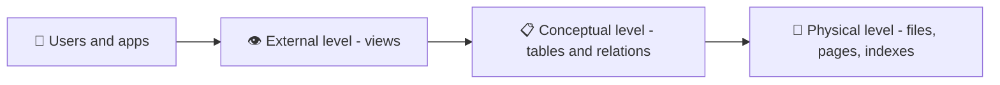

# 01 · What is a DBMS

> [!info] Topic info
> **Subject:** DBMS · **Part:** SQL & Data Modeling · **Priority:** 🔥 High · **Status:** ✅ done · **Last reviewed:** 2026-11-19
>
> [← Back to DBMS](README.md) · [Interview questions →](questions/sql-and-modeling-qa.md)

> [!abstract] In one line
> A **DBMS (Database Management System)** is software that **stores, organizes and protects data** and lets many users **query and change it safely** — handling **concurrency, crashes, security and integrity** so your app doesn't have to.

---

## 1. The problem

We're building a small social app. Version 1 stores users and posts in JSON files on disk. It works for 10 users.

At 10,000 users it breaks: two requests write the same file and one update is lost. The server crashes mid-write and the file is half-written. Finding "all posts by user 42" means reading every file.

---

## 2. File system vs DBMS

| Problem | File system | DBMS |
|---|---|---|
| **Redundancy** | Same data copied across files | Stored once, linked by keys |
| **Inconsistency** | Copies drift apart | Constraints keep data valid |
| **Concurrent access** | Lost updates | Locks / MVCC handle it |
| **Crash recovery** | Half-written files | Transactions + log restore a clean state |
| **Querying** | Write custom code per question | One language: **SQL** |
| **Security** | Whole file or nothing | Per-table / per-user permissions |

> [!tip] 🎤 Say it like this
> "A DBMS sits between the application and the data on disk. Instead of every app writing its own file-handling code, the DBMS gives us a query language, enforces rules like 'every post must have a valid author', lets thousands of users work at once without corrupting data, and recovers cleanly after a crash."

---

## 3. Three-level architecture and data independence

A DBMS separates **how data is stored** from **how users see it**:

- **Physical data independence** — add an index or move files to SSD, and queries don't change.
- **Logical data independence** — add a column to `users`, and apps using a view don't break.

---

## 4. Key terms

- **Schema** — the structure (tables, columns, types). Changes rarely.
- **Instance** — the actual data at one moment. Changes all the time.
- **DDL** (Data Definition Language) — `CREATE`, `ALTER`, `DROP`: define structure.
- **DML** (Data Manipulation Language) — `SELECT`, `INSERT`, `UPDATE`, `DELETE`: work with rows.
- **DCL / TCL** — `GRANT`/`REVOKE` permissions; `COMMIT`/`ROLLBACK` transactions.

> [!note] Types of DBMS
> **Relational (RDBMS)** — tables + SQL (PostgreSQL, MySQL). **NoSQL** — document, key-value, graph, wide-column. For when to pick which, see [SQL vs NoSQL](../system-design/databases/02-sql-vs-nosql.md) and [NoSQL basics](22-nosql-basics.md).

> [!failure] Interview traps
> - Saying "database" and "DBMS" are the same — the database is the **data**; the DBMS is the **software** managing it.
> - Forgetting **concurrency and recovery** — those are the hardest things a DBMS does, not just storage.
> - Mixing up schema (structure) and instance (data at a point in time).

---

## Summary

- DBMS = software that manages data: storage, queries, concurrency, recovery, security.
- Beats plain files on redundancy, consistency, concurrent access and crashes.
- Three levels (external / conceptual / physical) give **data independence**.
- SQL splits into **DDL, DML, DCL, TCL**.

> [!success] Key takeaway
> A DBMS lets you treat data as a safe, shared, queryable resource instead of a pile of files you guard yourself.
