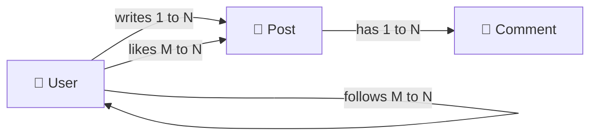

# 02 · ER Model

> [!info] Topic info
> **Subject:** DBMS · **Part:** SQL & Data Modeling · **Priority:** 🔥 High · **Status:** ✅ done · **Last reviewed:** 2026-11-19
>
> [← Back to DBMS](README.md) · [Interview questions →](questions/sql-and-modeling-qa.md)

> [!abstract] In one line
> The **ER (Entity-Relationship) model** is a **diagram of the data** — **entities** (things), their **attributes**, and the **relationships** between them with **cardinality** (1:1, 1:N, M:N) — drawn **before** you create tables.

---

## 1. The problem

The product manager says: "Users write posts. Others can comment and like. Users follow each other."

Before writing `CREATE TABLE`, we need a picture everyone agrees on. Otherwise we discover in month three that "a post can have many authors" — and redo the schema.

---

## 2. Building blocks

- **Entity** — a real-world thing we store: `User`, `Post`, `Comment`.
- **Attribute** — a property: `name`, `email`, `created_at`.
  - **Key** attribute — uniquely identifies (`user_id`).
  - **Composite** — made of parts (`address` = street + city).
  - **Multivalued** — many values (`phone_numbers`) → becomes its own table.
  - **Derived** — computed (`age` from `birth_date`, `like_count`).
- **Relationship** — how entities connect: User **writes** Post.
- **Weak entity** — can't exist alone and has no full key of its own. `Comment` #3 only makes sense inside its Post.

---

## 3. Cardinality — the part interviewers test

| Type | Example | How it becomes tables |
|---|---|---|
| **1 : 1** | User ↔ Profile | FK on either side (often same PK) |
| **1 : N** | User → Posts | FK `user_id` on the **N side** (`posts`) |
| **M : N** | Users ↔ liked Posts | **Junction table** `likes(user_id, post_id)` |

`follows` is a **recursive** (self) relationship: User relates to User → `follows(follower_id, followee_id)`.

**Participation:** **total** = every post *must* have an author (NOT NULL FK). **Partial** = a user *may* have zero posts.

> [!tip] 🎤 Say it like this
> "I start with an ER diagram: entities like User and Post, their attributes, and relationships with cardinality. A one-to-many becomes a foreign key on the many side. A many-to-many, like users liking posts, becomes a junction table with both foreign keys as a composite primary key."

---

## 4. Extended ER (quick)

- **Specialization / generalization** — `Account` splits into `PersonalAccount` and `BusinessAccount` (IS-A).
- **Aggregation** — treat a relationship as an entity, e.g. a `Report` filed about a "User likes Post" event.

> [!failure] Interview traps
> - Putting the FK on the **1 side** of a 1:N (`users.post_id`) — it can only hold one post.
> - Storing M:N as a comma list (`posts.liked_by = "1,5,9"`) instead of a junction table.
> - Storing derived values (like counts) without saying it's a deliberate [denormalization](../system-design/database-scaling/06-denormalization.md).

---

## Summary

- Entities, attributes, relationships — the blueprint before tables.
- **1:N → FK on N side**, **M:N → junction table**, 1:1 → FK on either side.
- Weak entities depend on an owner; recursive relationships link a table to itself.

> [!success] Key takeaway
> Get cardinality right on the diagram and the table design almost writes itself.
