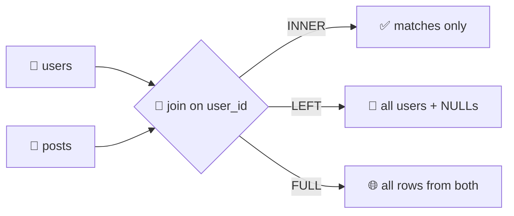

# 06 · Joins

> [!info] Topic info
> **Subject:** DBMS · **Part:** SQL & Data Modeling · **Priority:** 🔥 High · **Status:** ✅ done · **Last reviewed:** 2026-11-19
>
> [← Back to DBMS](README.md) · [Interview questions →](questions/sql-and-modeling-qa.md)

> [!abstract] In one line
> A **join** combines rows from two tables using a **matching condition** — **INNER** keeps only matches, **LEFT / RIGHT / FULL** also keep unmatched rows (filled with **NULL**), **CROSS** pairs everything, and a **SELF** join matches a table with itself.

---

## 1. The problem

Normalized data is split: post text lives in `posts`, author names in `users`. To show "Asha: Hello world" on the feed, we need to stitch them back together. That's a join.

---

## 2. The sample data

**users**

| user_id | name |
|---|---|
| 1 | Asha |
| 2 | Ravi |
| 3 | Meera |

**posts**

| post_id | user_id |
|---|---|
| 101 | 1 |
| 102 | 1 |
| 103 | NULL *(author deleted)* |

```sql
SELECT u.name, p.post_id
FROM users u
INNER JOIN posts p ON p.user_id = u.user_id;
```

---

## 3. Each join type with its result

| Join | Keeps | Result rows (name, post_id) |
|---|---|---|
| **INNER** | Only matching pairs | (Asha,101) (Asha,102) |
| **LEFT** | All users + matches | (Asha,101) (Asha,102) (Ravi,NULL) (Meera,NULL) |
| **RIGHT** | All posts + matches | (Asha,101) (Asha,102) (NULL,103) |
| **FULL OUTER** | Everything from both | (Asha,101) (Asha,102) (Ravi,NULL) (Meera,NULL) (NULL,103) |
| **CROSS** | Every user × every post | 3 × 3 = **9 rows**, no `ON` |



**Self join** — a table joined with itself using two aliases. "Find mutual follows":

```sql
SELECT a.follower_id, a.followee_id
FROM follows a
JOIN follows b
  ON a.follower_id = b.followee_id
 AND a.followee_id = b.follower_id;
```

**Anti-join** (very common ask) — "users who never posted":

```sql
SELECT u.name FROM users u
LEFT JOIN posts p ON p.user_id = u.user_id
WHERE p.post_id IS NULL;      -- Ravi, Meera
```

> [!tip] 🎤 Say it like this
> "Inner join returns only rows that match on both sides. Left join keeps every row from the left table and fills NULLs where there's no match — I use it with `WHERE right.id IS NULL` to find rows with no match. Full outer keeps both sides, cross join is a Cartesian product, and a self join compares rows of the same table, like mutual follows."

---

## 4. Gotchas

> [!warning] Filter in ON vs WHERE for LEFT JOIN
> `LEFT JOIN posts p ON p.user_id = u.user_id AND p.created_at > '2026-01-01'` keeps all users.
> Moving that date filter to `WHERE` removes the NULL rows — silently turning it into an **inner join**.

- **Row explosion** — joining users → posts → likes multiplies rows (1 user × 50 posts × 200 likes = 10,000 rows). `COUNT(*)` then over-counts; use `COUNT(DISTINCT …)` or aggregate in a subquery first.
- **Join algorithms** (how the DB does it): nested loop (small inputs / indexed), hash join (big unsorted), merge join (both sorted). See [query processing](21-query-processing.md).

> [!failure] Interview traps
> - Forgetting that NULL never equals NULL, so post 103 matches nobody, even in an inner join.
> - Saying RIGHT JOIN is special — it's just LEFT JOIN with the tables swapped.
> - Missing the `ON` condition → accidental cross join with millions of rows.

---

## Summary

- **INNER** = matches · **LEFT/RIGHT** = one side kept · **FULL** = both kept · **CROSS** = all pairs · **SELF** = table with itself.
- LEFT JOIN + `IS NULL` = "rows with no match".
- Put filters on the right table in `ON`, not `WHERE`, to keep a left join a left join.

> [!success] Key takeaway
> Draw the tiny 3-row example in your head — it answers every "how many rows does this join return?" question.
