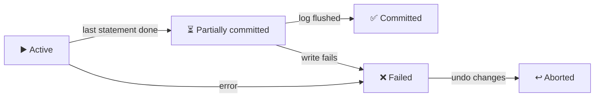

# 13 · Transactions & ACID

> [!info] Topic info
> **Subject:** DBMS · **Part:** Transactions & Internals · **Priority:** 🔥 High · **Status:** ✅ done · **Last reviewed:** 2026-11-19
>
> [← Back to DBMS](README.md) · [Interview questions →](questions/transactions-and-internals-qa.md)

> [!abstract] In one line
> A **transaction** is a group of reads/writes that runs as **one unit** — it either **commits** fully or **rolls back** fully — and **ACID** lists the four guarantees it gives.

---

## 1. The problem

A bank app moves ₹500 from Alice to Bob: subtract from Alice, add to Bob. Two `UPDATE`s.

If the server crashes after the first one, ₹500 just vanished. We need both updates to succeed together or not at all.

---

## 2. ACID — quick recap

| Letter | Guarantee | Built with |
|---|---|---|
| **Atomicity** | All or nothing | Undo log / rollback — see [Recovery & WAL](18-recovery-and-wal.md) |
| **Consistency** | Constraints hold before and after (balance ≥ 0, FKs) | Constraints + correct app logic |
| **Isolation** | Concurrent txns don't see each other's half-done work | [Locks](15-locking-and-2pl.md) or [MVCC](16-isolation-levels-and-mvcc.md) |
| **Durability** | Once committed, it survives a crash | WAL flushed to disk on commit |

The anomalies and isolation-level table are already in [ACID Transactions (System Design)](../system-design/databases/03-acid-transactions.md). This note adds the **DBMS-theory view**.

```sql
BEGIN;
UPDATE accounts SET balance = balance - 500 WHERE id = 'alice';
UPDATE accounts SET balance = balance + 500 WHERE id = 'bob';
COMMIT;   -- or ROLLBACK; to undo both
```

> [!tip] 🎤 Say it like this
> "A transaction is a logical unit of work that either fully commits or fully rolls back. ACID means atomic, consistent, isolated and durable. Atomicity and durability come from the write-ahead log, isolation comes from locking or MVCC, and consistency is the database plus my app keeping the rules true."

---

## 3. Transaction states

Textbooks love this diagram. A transaction moves through five states:



- **Partially committed** = all statements ran, but changes may still be only in memory.
- **Committed** = the commit log record is safely on disk. Now it's durable.
- After **Aborted**, the DB either **restarts** the txn (e.g. deadlock victim) or **kills** it (logic error).

---

## 4. Useful extras

- **Autocommit:** most clients wrap every single statement in its own transaction unless you say `BEGIN`.
- **Savepoint:** a checkpoint *inside* a transaction. `ROLLBACK TO SAVEPOINT s1` undoes only the part after it.
- **Keep transactions short.** A txn open for 30 s holds locks and old row versions the whole time — other users wait and the DB bloats.

> [!warning] Don't call the network inside a transaction
> `BEGIN → UPDATE → call payment API (2 s) → COMMIT` holds row locks for 2 s. Do slow external calls **outside** the transaction.

> [!failure] Interview traps
> - Mixing up ACID **C** (constraints hold) with CAP **C** (all replicas agree) — see [CAP Theorem](../system-design/core-concepts/07-cap-theorem.md).
> - Thinking "it's in a transaction" means no race conditions — at Read Committed, lost updates still happen.
> - Assuming ACID spans two services or two databases — it doesn't; that needs [2PC or Sagas](../system-design/distributed-transactions/01-distributed-transactions-problem.md).

---

## Summary

- Transaction = one logical unit of work: **COMMIT** or **ROLLBACK**.
- **A + D** from the log, **I** from locks/MVCC, **C** from constraints.
- States: Active → Partially committed → Committed, or Failed → Aborted.
- Keep transactions short; use savepoints for partial rollback.

> [!success] Key takeaway
> A transaction makes many steps look like one. Everything in the rest of this part — locks, MVCC, WAL — exists to keep that promise.
