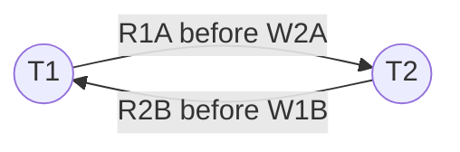

# 14 · Schedules & Serializability

> [!info] Topic info
> **Subject:** DBMS · **Part:** Transactions & Internals · **Priority:** ⚡ Medium · **Status:** ✅ done · **Last reviewed:** 2026-11-19
>
> [← Back to DBMS](README.md) · [Interview questions →](questions/transactions-and-internals-qa.md)

> [!abstract] In one line
> A **schedule** is the order in which operations of concurrent transactions run; it is **serializable** if its result equals **some one-at-a-time (serial) order** — checked with a **precedence graph**.

---

## 1. The problem

Running transactions one after another (serial) is always correct but slow — one user waits for everyone else.

Running them **interleaved** is fast, but some interleavings give wrong answers. We need a rule for "which interleavings are safe?"

---

## 2. Key words

- **Schedule:** the actual sequence of reads (R) and writes (W) from T1, T2… e.g. `R1(A) R2(A) W1(A) W2(A)`.
- **Serial schedule:** T1 fully, then T2 fully. Always correct.
- **Serializable schedule:** interleaved, but **same effect** as some serial order. This is the goal.

**Conflicting operations** — two ops conflict when all three are true:
1. They're from **different** transactions.
2. They touch the **same** data item.
3. At least one is a **write**.

So R-W, W-R and W-W conflict. R-R never conflicts.

---

## 3. Conflict serializability — the precedence graph

1. Draw a node per transaction.
2. For each conflicting pair where Ti's op comes **before** Tj's, draw an edge **Ti → Tj**.
3. **No cycle → conflict serializable.** Any topological order of the graph is the equivalent serial order.

> [!example] Worked example
> Schedule: `R1(A) W2(A) R2(B) W1(B)`
> - `R1(A)` before `W2(A)` → edge **T1 → T2**
> - `R2(B)` before `W1(B)` → edge **T2 → T1**
>
> Cycle T1 ⇄ T2 → **not** conflict serializable.

> [!tip] 🎤 Say it like this
> "A schedule is serializable if it gives the same result as running the transactions one at a time. To test conflict serializability I build a precedence graph: an edge from Ti to Tj whenever Ti does a conflicting operation on the same item before Tj. If there's no cycle, it's serializable, and a topological sort gives the equivalent serial order."

---

## 4. View serializability (the looser one)

Two schedules are **view equivalent** if each transaction **reads the same values** (same initial read, same writer for each read) and the **same final write** wins for every item.

- Every conflict-serializable schedule is view serializable, **not the other way round**.
- The extra cases always involve **blind writes** (a write without reading first).
- Testing view serializability is **NP-complete**, so real databases use conflict serializability.

| | **Conflict serializable** | **View serializable** |
|---|---|---|
| **Test** | Precedence graph, no cycle | Compare reads + final writes |
| **Cost to check** | Polynomial — easy | NP-complete — hard |
| **Covers** | Subset | Superset (adds blind-write cases) |

---

## 5. Recoverable schedules

Serializable isn't enough — we also need safe **aborts**.

- **Recoverable:** if T2 reads data written by T1, T2 commits only **after** T1 commits.
- **Cascadeless:** T2 reads T1's data only **after** T1 commits — so one abort never forces a chain of aborts (**cascading rollback**).
- **Strict:** nobody reads *or writes* an item until its last writer commits/aborts. [Strict 2PL](15-locking-and-2pl.md) gives you this.

> [!failure] Interview traps
> - Saying R-R is a conflict — it isn't.
> - Drawing edges for operations on **different** items.
> - Thinking view serializable ⇒ conflict serializable — it's the reverse.

---

## Summary

- Serial = correct but slow; serializable = interleaved but same result.
- Conflict = different txns, same item, at least one write.
- **Precedence graph without a cycle** ⇒ conflict serializable.
- Databases enforce this with [2PL](15-locking-and-2pl.md) or SSI ([MVCC](16-isolation-levels-and-mvcc.md)).

> [!success] Key takeaway
> Draw the precedence graph: no cycle = safe. That one trick answers most serializability questions.
