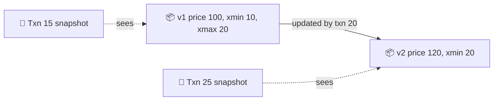

# 16 · Isolation Levels & MVCC

> [!info] Topic info
> **Subject:** DBMS · **Part:** Transactions & Internals · **Priority:** 🔥 High · **Status:** ✅ done · **Last reviewed:** 2026-11-19
>
> [← Back to DBMS](README.md) · [Interview questions →](questions/transactions-and-internals-qa.md)

> [!abstract] In one line
> **Isolation levels** trade correctness for speed by allowing some anomalies; **MVCC** (multi-version concurrency control) keeps **several versions of each row** so **readers never block writers** and each transaction reads a consistent **snapshot**.

---

## 1. The problem

With pure [locking](15-locking-and-2pl.md), a 10-second analytics report holding shared locks blocks every checkout that wants to update those rows.

Readers and writers fighting over the same rows kills throughput. We want readers to see a stable picture **without** blocking anyone.

---

## 2. Isolation levels — recap

| Level | Stops | Still allows |
|---|---|---|
| **Read Uncommitted** | nothing much | dirty reads |
| **Read Committed** (Postgres default) | dirty reads | non-repeatable reads, phantoms, lost updates |
| **Repeatable Read** (MySQL default) | + non-repeatable reads | write skew (and phantoms in some DBs) |
| **Serializable** | everything | — (but more aborts/retries) |

Full anomaly table with examples: [ACID Transactions (System Design)](../system-design/databases/03-acid-transactions.md).

```sql
SET TRANSACTION ISOLATION LEVEL REPEATABLE READ;
```

---

## 3. How MVCC works (Postgres style)

Every row version carries two hidden fields: **xmin** (txn that created it) and **xmax** (txn that deleted/replaced it).

- **UPDATE** never overwrites. It marks the old version's `xmax` and inserts a **new version** with a new `xmin`.
- Each transaction gets a **snapshot**: the list of txns committed when it started.
- A version is **visible** if its `xmin` is committed in my snapshot and its `xmax` isn't.



- **Read Committed:** a new snapshot per **statement**.
- **Repeatable Read:** one snapshot per **transaction**.
- **Serializable (SSI):** snapshot + tracking of read/write dependencies; aborts a txn if a dangerous cycle appears.

**Cleanup:** dead versions pile up. Postgres **VACUUM** (autovacuum) removes versions no running txn can see. MySQL InnoDB instead keeps old versions in the **undo log** and rebuilds them on read.

> [!tip] 🎤 Say it like this
> "MVCC keeps multiple versions of each row. An update creates a new version instead of overwriting, and every transaction reads from a snapshot of what was committed when it started. So readers never block writers and writers never block readers — only two writers on the same row still conflict. The cost is old versions that need cleanup, like VACUUM in Postgres."

---

## 4. Snapshot isolation's hole — write skew

Two doctors are on call. Both run: "if on-call count ≥ 2, take myself off". Both snapshots see 2, both update **different rows**, no write conflict → **0 doctors on call**.

Fixes: `SERIALIZABLE` isolation, or `SELECT … FOR UPDATE` on the rows you checked.

**✅ Pros**
- Reads don't block writes, writes don't block reads.
- Consistent snapshots for long reports and backups.

**❌ Cons**
- Extra storage for old versions; table **bloat** if VACUUM falls behind.
- Long-running transactions stop cleanup for everyone.
- Snapshot isolation alone allows write skew.

> [!failure] Interview traps
> - Saying MVCC removes all locking — writers on the **same row** still take locks.
> - Assuming "Repeatable Read" means the same thing in Postgres and MySQL — it doesn't.
> - Forgetting that an idle-in-transaction connection blocks VACUUM and bloats tables.

---

## Summary

- Higher isolation = fewer anomalies, more waiting/aborts.
- MVCC = new row version on each update + per-txn snapshot.
- Postgres: `xmin`/`xmax` + VACUUM. MySQL: undo log.
- Snapshot isolation can still allow **write skew** → use Serializable or `FOR UPDATE`.

> [!success] Key takeaway
> MVCC is why modern databases scale reads: everyone gets their own snapshot, and only writer-vs-writer on the same row has to wait.
