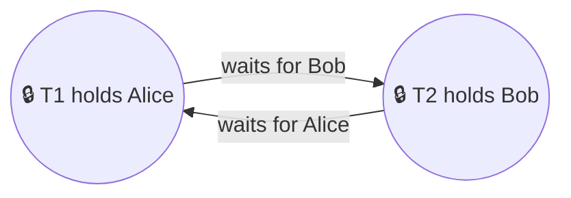

# 17 · Deadlocks

> [!info] Topic info
> **Subject:** DBMS · **Part:** Transactions & Internals · **Priority:** 🔥 High · **Status:** ✅ done · **Last reviewed:** 2026-11-19
>
> [← Back to DBMS](README.md) · [Interview questions →](questions/transactions-and-internals-qa.md)

> [!abstract] In one line
> A **deadlock** is when transactions wait on each other's locks in a **cycle**, so none can move; databases either **detect** it with a **wait-for graph** and kill a victim, or **prevent** it with rules like **wait-die / wound-wait**.

---

## 1. The problem

Two transfers run at once:
- T1: Alice → Bob. Locks **Alice**, then wants **Bob**.
- T2: Bob → Alice. Locks **Bob**, then wants **Alice**.

Each holds what the other needs. Both wait forever.

---

## 2. Four conditions (Coffman)

A deadlock needs **all four** at once — break any one and it can't happen:

| Condition | Meaning | How to break it |
|---|---|---|
| **Mutual exclusion** | Lock held by one txn only | Hard — X locks need this |
| **Hold and wait** | Hold some locks, wait for more | Take all locks upfront (conservative 2PL) |
| **No preemption** | Can't steal a lock | Abort/roll back a txn (wound-wait) |
| **Circular wait** | T1 → T2 → T1 | **Lock in a fixed order** ⭐ |

---

## 3. Detection — the wait-for graph

The DB keeps a graph: edge **Ti → Tj** means "Ti waits for a lock Tj holds". A **cycle = deadlock**.

- The DB checks for cycles periodically or when a lock wait passes a timeout (Postgres: `deadlock_timeout`, default 1 s).
- It picks a **victim** (usually the youngest or the one with least work done), **rolls it back**, and returns an error.
- MySQL and Postgres both use detection. Your app must **catch the error and retry**.

---

## 4. Prevention — timestamp schemes

Each txn gets a timestamp at start; **older = higher priority**. When Ti requests a lock held by Tj:

| Scheme | Older asks for younger's lock | Younger asks for older's lock |
|---|---|---|
| **Wait-die** (non-preemptive) | Older **waits** | Younger **dies** (aborts, restarts later) |
| **Wound-wait** (preemptive) | Older **wounds** younger (younger aborts) | Younger **waits** |

Memory trick: the **first word is what the older one does**.
A restarted txn keeps its **original timestamp**, so it eventually becomes the oldest and can't starve.

Other options: **timeout** (abort if waiting > N seconds — simple but may kill non-deadlocked txns) and **lock ordering**.

> [!tip] 🎤 Say it like this
> "A deadlock is a cycle of transactions each waiting for a lock the next one holds. Databases like Postgres and MySQL detect it with a wait-for graph, abort one victim, and the app retries. Prevention schemes like wait-die and wound-wait use transaction timestamps so only one direction of waiting is allowed. In app code, the best fix is to always lock rows in the same order, like by ascending ID."

---

## 5. Avoiding deadlocks in real code

- **Consistent order:** lock accounts by ascending ID — both transfers lock Alice first.
- **Short transactions** — fewer locks held for less time.
- **Lock what you'll write upfront** (`SELECT … FOR UPDATE`) instead of S → X upgrades.
- **Retry on deadlock errors** (Postgres `40P01`, MySQL `1213`) with a small backoff.

> [!failure] Interview traps
> - Mixing up **wait-die** and **wound-wait** — in both, the **older** txn never gets aborted.
> - Saying a deadlock is the same as long lock waiting — waiting ends; a deadlock never does.
> - Forgetting that the app must **retry** the victim transaction.

---

## Summary

- Deadlock = cycle in the **wait-for graph**.
- **Detect**: find cycle → abort victim → app retries (what real DBs do).
- **Prevent**: wait-die, wound-wait, conservative 2PL, timeouts.
- In code: **lock in a consistent order**, keep transactions short.

> [!success] Key takeaway
> You can't fully avoid deadlocks with locking — so lock in a fixed order and always retry the victim.
