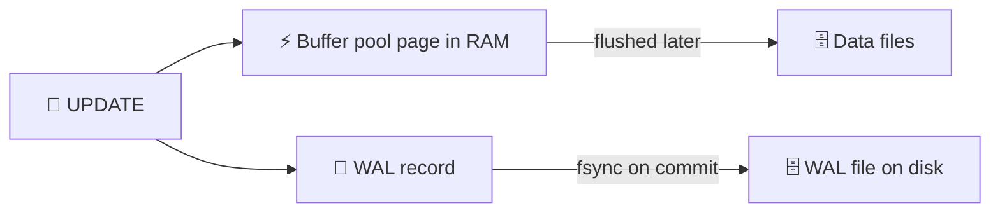

# 18 · Recovery & Write-Ahead Logging (WAL)

> [!info] Topic info
> **Subject:** DBMS · **Part:** Transactions & Internals · **Priority:** ⚡ Medium · **Status:** ✅ done · **Last reviewed:** 2026-11-19
>
> [← Back to DBMS](README.md) · [Interview questions →](questions/transactions-and-internals-qa.md)

> [!abstract] In one line
> Before changing any data page on disk, the DB writes the change to an append-only **write-ahead log**; after a crash it **redoes** committed work and **undoes** uncommitted work from the log, using **checkpoints** so it doesn't replay from the beginning of time.

---

## 1. The problem

Pages are changed in memory (the **buffer pool**) and flushed to disk later — writing every page on every commit would be far too slow.

So when the power dies, disk may have **uncommitted** changes (flushed early) and be **missing committed** ones (not flushed yet). That breaks both atomicity and durability.

---

## 2. The WAL rule

1. Every change first creates a **log record**: `<txn id, page, old value, new value>`.
2. The log record must reach disk **before** the data page does.
3. On `COMMIT`, the DB flushes the log up to the commit record (one fast **sequential** write). Data pages can be written lazily later.

Why it's fast: appending to one log file is sequential I/O; random page writes are batched in the background.

---

## 3. Undo and redo

| Log part | Uses | Fixes |
|---|---|---|
| **Undo** (old value) | Roll back a txn that **didn't commit** | Atomicity |
| **Redo** (new value) | Re-apply a txn that **did commit** but whose pages weren't flushed | Durability |

**Recovery after crash (ARIES-style, simplified):**
1. **Analysis** — read the log from the last checkpoint; find which txns were active.
2. **Redo** — replay everything forward to rebuild the exact state at crash time.
3. **Undo** — roll back txns that never committed.

---

## 4. Checkpoints

Without them, recovery would replay **months** of log. A **checkpoint** periodically flushes dirty pages and writes a marker: "everything before here is on disk".

- Recovery starts from the last checkpoint → minutes become seconds.
- Older log segments can be deleted or archived.
- Trade-off: frequent checkpoints = faster recovery but more I/O spikes.

> [!tip] 🎤 Say it like this
> "The write-ahead log rule is: log the change before the data page hits disk. On commit we only need to fsync the log, which is a fast sequential write. After a crash, the database redoes committed changes and undoes uncommitted ones, starting from the last checkpoint so it doesn't replay the whole history."

> [!note] The WAL is also used for…
> **Replication** (Postgres streams WAL to replicas — see [Replication](../system-design/database-scaling/03-replication.md)), **point-in-time recovery** (base backup + archived WAL), and **change data capture** (Debezium reads the log).

**Shadow paging** is the textbook alternative: copy-on-write pages and swap a root pointer on commit. Simple, but fragments data, so most DBs use WAL.

> [!failure] Interview traps
> - Saying data is written to disk on every commit — only the **log** is.
> - Mixing up undo (rollback uncommitted) and redo (re-apply committed).
> - Turning off `fsync` / `synchronous_commit` "for speed" — you can lose committed data.

---

## Summary

- **WAL rule:** log first, data page later.
- **Commit** = log flushed to disk.
- **Redo** committed, **undo** uncommitted after a crash.
- **Checkpoints** limit how much log to replay.

> [!success] Key takeaway
> The log is the source of truth; data files are just a cache of it that's allowed to be behind.
