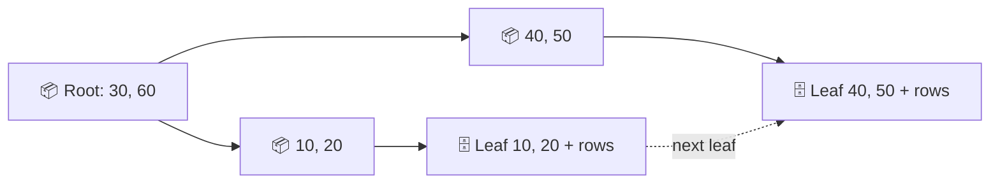

# 19 · Indexing & B+ Trees

> [!info] Topic info
> **Subject:** DBMS · **Part:** Transactions & Internals · **Priority:** 🔥 High · **Status:** ✅ done · **Last reviewed:** 2026-11-19
>
> [← Back to DBMS](README.md) · [Interview questions →](questions/transactions-and-internals-qa.md)

> [!abstract] In one line
> An **index** is a separate sorted structure that maps column values to rows; most are **B+ trees** (data only in linked leaves, great for ranges), a table can have one **clustered** index (decides physical order) and many **non-clustered** ones.

---

## 1. The problem

`SELECT * FROM orders WHERE customer_id = 42` on 50M rows does a **full table scan** — reading every page, seconds per query.

An index lets the DB jump straight to the matching rows in ~3–4 page reads. The basics (composite, covering, leftmost prefix, when indexes aren't used) are in [Indexing (System Design)](../system-design/database-scaling/01-indexing.md). Here's the theory interviewers ask.

---

## 2. Clustered vs non-clustered

| | **Clustered** | **Non-clustered (secondary)** |
|---|---|---|
| **What it is** | Table rows are **stored in index order** | Separate structure with key + pointer |
| **How many** | **One** per table | Many |
| **Leaf holds** | The full row | Key + row pointer (or primary key) |
| **Lookup** | One tree walk | Tree walk + jump to the row |
| **Example** | MySQL InnoDB primary key | Index on `email` |

- In **InnoDB**, secondary index leaves store the **primary key**, so a lookup by `email` walks two trees: email index → PK → clustered index. Keep PKs small.
- **Postgres** has no true clustered index — tables are **heaps** (unordered) and every index points to a row location. `CLUSTER` sorts once but isn't maintained.

**Dense vs sparse:** a **dense** index has an entry for every row; a **sparse** index has one entry per page/block and only works when data is sorted on that key (clustered).

---

## 3. B tree vs B+ tree

| | **B tree** | **B+ tree** ⭐ |
|---|---|---|
| **Data stored in** | Every node | **Leaves only** |
| **Internal nodes** | Keys + data | Keys only → **more keys per page**, shorter tree |
| **Leaves linked?** | No | **Yes** — range scan just walks right |
| **Search cost** | Can stop early at an internal node | Always goes to a leaf (predictable) |
| **Used by** | Rare in DBs | Almost every RDBMS |

With ~500 keys per node, 3 levels hold 500³ ≈ **125 million** keys. Root and upper levels sit in RAM, so a lookup is usually **1–2 disk reads**. More on splits and write cost: [B-Trees](../system-design/databases/04-b-trees.md).

> [!tip] 🎤 Say it like this
> "Databases use B+ trees: internal nodes only hold keys so the tree is short and wide, and all data sits in leaves that are linked together. That gives O(log n) point lookups and very fast range scans. A clustered index stores the table itself in key order, so there's only one; non-clustered indexes are separate trees that point back to the row or the primary key."

---

## 4. Hash index

Hash the key → bucket → row pointer. **O(1)** for `=`, but:
- ❌ No ranges (`>`, `BETWEEN`), no `ORDER BY`, no prefix `LIKE 'ab%'`.
- Used in memory (Redis, hash joins), Postgres `USING HASH`, MySQL MEMORY engine.

Other index types (one line each): **bitmap** (low-cardinality columns in warehouses), **GIN** (arrays, JSON, full-text), **GiST** (geo).

> [!failure] Interview traps
> - "Indexes are hash tables" — almost always B+ trees.
> - Saying a table can have many clustered indexes — only one physical order.
> - Using a random UUIDv4 as InnoDB PK — inserts land on random pages, causing splits; prefer auto-increment or UUIDv7.
> - Forgetting every index slows down writes.

---

## Summary

- **Clustered** = table order (1 per table); **non-clustered** = separate tree with pointers.
- **B+ tree**: keys in internal nodes, data in **linked leaves** → fast ranges.
- **Hash index**: only equality.
- Dense = entry per row; sparse = entry per block (needs sorted data).

> [!success] Key takeaway
> "B+ tree with linked leaves" is the answer to *why are DB indexes fast at both lookups and ranges*.
