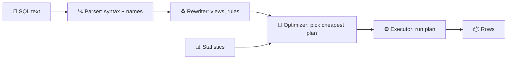

# 21 · Query Processing & Joins Internals

> [!info] Topic info
> **Subject:** DBMS · **Part:** Transactions & Internals · **Priority:** 🔥 High · **Status:** ✅ done · **Last reviewed:** 2026-11-19
>
> [← Back to DBMS](README.md) · [Interview questions →](questions/transactions-and-internals-qa.md)

> [!abstract] In one line
> Every SQL query goes **parse → rewrite → optimize → execute**; the **cost-based optimizer** uses table **statistics** to pick access paths and a join algorithm — **nested loop**, **hash join**, or **merge join**.

---

## 1. The problem

SQL says **what** you want, not **how** to get it. The query `orders JOIN customers WHERE country = 'IN'` could be run in hundreds of ways.

One plan takes 5 ms, another takes 5 minutes. The DB's job is to pick the cheap one.

---

## 2. The pipeline



- **Parser** — checks syntax, resolves table/column names, builds a tree (relational algebra — see [Relational Algebra](04-relational-algebra.md)).
- **Rewriter** — expands views, simplifies (e.g. turns some subqueries into joins).
- **Optimizer** — generates candidate plans, estimates each one's cost (pages read + CPU), picks the cheapest.
- **Executor** — runs the plan tree; each node pulls rows from its children (**iterator / volcano model**).

**Statistics** = row counts, distinct values, histograms per column. Collected by `ANALYZE`. Stale stats → bad row estimates → bad plans.

**Heuristics the optimizer applies:** push filters down (filter before join), project only needed columns, join the smallest results first.

---

## 3. The three join algorithms

| Algorithm | How | Best when | Cost |
|---|---|---|---|
| **Nested loop** | For each outer row, look up matches in inner (ideally via index) | Outer side is **small** + index on inner join key | O(N × log M) with index, O(N × M) without |
| **Hash join** | Build hash table on smaller table, probe with the bigger | Big tables, **equality** joins, no useful index | O(N + M), needs memory |
| **Merge join** | Sort both on the key, then walk side by side | Both inputs **already sorted** (indexes) or range/ordered output | O(N + M) after sort |

> [!example] Picking one
> - 10 orders for one customer × customers table with PK → **nested loop** with index.
> - 5M orders × 1M customers, full report → **hash join**.
> - Both tables read via index on `customer_id` in order → **merge join**.

Hash join only works for `=`. If the hash table doesn't fit in memory (`work_mem`), it spills to disk and slows down.

> [!tip] 🎤 Say it like this
> "The database parses the SQL, rewrites it, then a cost-based optimizer uses statistics to choose indexes, join order and join algorithm, and the executor runs that plan. For joins: nested loop is great when one side is tiny and the other has an index, hash join is the workhorse for big equality joins, and merge join wins when both sides are already sorted. I check which one it picked with EXPLAIN ANALYZE."

---

## 4. Seeing the plan

```sql
EXPLAIN ANALYZE
SELECT c.name, o.total FROM orders o JOIN customers c ON c.id = o.customer_id
WHERE c.country = 'IN';
-- Hash Join  (rows=48210 actual time=…)
--   -> Seq Scan on orders
--   -> Hash -> Index Scan on customers (country)
```

How to read and fix plans (slow query log, N+1, pagination): [Query Optimization](../system-design/database-scaling/05-query-optimization.md).

> [!failure] Interview traps
> - Thinking the DB runs SQL clauses in written order — logical order is `FROM → WHERE → GROUP BY → HAVING → SELECT → ORDER BY → LIMIT`.
> - Blaming "joins are slow" — a nested loop over 1M rows **without an index** is slow; a hash join isn't.
> - Ignoring estimated vs actual rows in EXPLAIN — a big gap means stale statistics.

---

## Summary

- **Parse → rewrite → optimize → execute.**
- Cost-based optimizer depends on **statistics** (`ANALYZE`).
- **Nested loop** = small × indexed, **hash** = big equality, **merge** = pre-sorted.
- Verify with `EXPLAIN ANALYZE`.

> [!success] Key takeaway
> You write *what*; the optimizer decides *how*. Good indexes and fresh statistics are how you help it choose well.
