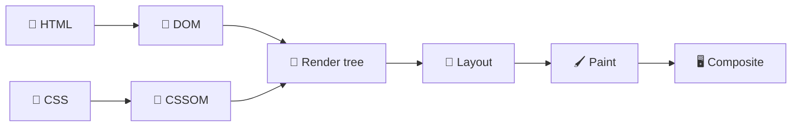

# 01 · How Browsers Render a Page

> [!info] Topic info
> **Subject:** Frontend · **Part:** JavaScript, HTML/CSS & the Browser · **Priority:** 🔥 High · **Status:** ✅ done · **Last reviewed:** 2026-11-19
>
> [← Back to Frontend](README.md) · [Interview questions →](questions/javascript-and-browser-qa.md)

> [!abstract] In one line
> The **critical rendering path** turns HTML, CSS and JS into pixels: **DOM + CSSOM → render tree → layout → paint → composite** — and anything that blocks it delays the first paint.

---

## 1. The problem

Our shop page has 80 KB of HTML, a 200 KB CSS file and a 500 KB JS bundle. The user sees a **white screen for 3 seconds** on a phone.

To fix that, you must know what the browser does between "bytes arrived" and "pixels on screen". The network part (DNS, TCP, TLS) is in [what happens when you type a URL](../computer-networks/deep-dives/what-happens-when-you-type-a-url.md) — here we focus on rendering.

---

## 2. The critical rendering path

1. **DOM** (Document Object Model) — the HTML parsed into a tree of nodes.
2. **CSSOM** — the CSS parsed into a tree of style rules.
3. **Render tree** — only the **visible** nodes with their final styles. `display: none` elements are left out; `visibility: hidden` ones stay in (they still take space).
4. **Layout** (also called reflow) — calculate the exact **size and position** of every box.
5. **Paint** — fill in pixels: text, colours, borders, shadows, images, often into several layers.
6. **Composite** — the GPU stacks the layers in the right order and shows the frame.

> [!note] CSS is render-blocking
> The browser won't paint until the CSSOM is ready — otherwise you'd see unstyled content flash. So **CSS blocks rendering**, and by default **JS blocks HTML parsing**.

---

## 3. Scripts: normal vs async vs defer

A plain `<script src>` stops the HTML parser, downloads the file, runs it, then continues. A 500 KB script in `<head>` = blank page until it's done.

| Attribute | Downloads | Runs | Order kept? | Use for |
|---|---|---|---|---|
| **none** | Blocks parsing | Immediately | ✅ | Almost never in `<head>` |
| **async** | In parallel | As soon as it arrives (pauses parser) | ❌ | Independent scripts — analytics, ads |
| **defer** | In parallel | After HTML is parsed, before `DOMContentLoaded` | ✅ | Your app code |

`type="module"` scripts are **deferred by default**.

> [!tip] 🎤 Say it like this
> "The browser builds the DOM from HTML and the CSSOM from CSS, combines them into a render tree, then does layout, paint and composite. CSS blocks rendering and plain scripts block parsing, so I put CSS early, keep critical CSS small, and load scripts with `defer` — or `async` for independent things like analytics."

---

## 4. Reflow vs repaint

After the first render, changes cost different amounts:

| Change | Triggers | Cost |
|---|---|---|
| **width, height, margin, font-size, adding nodes** | Layout → paint → composite (**reflow**) | 💰💰💰 |
| **color, background, visibility** | Paint → composite (**repaint**) | 💰💰 |
| **transform, opacity** | Composite only (GPU) | 💰 |

That's why smooth animations use `transform` and `opacity`, not `top`/`left`.

> [!warning] Layout thrashing
> Reading a layout value (`offsetHeight`, `getBoundingClientRect()`) right after writing a style forces the browser to do layout **immediately**. Doing that in a loop over 500 items = 500 forced layouts. Fix: **batch all reads, then all writes**, or use `requestAnimationFrame`.

**Other quick wins:** inline critical CSS, preload key fonts/images, lazy-load images below the fold (`loading="lazy"`), keep the DOM small. More in [22 · Web performance](22-web-performance.md).

> [!failure] Interview traps
> - Saying `display: none` and `visibility: hidden` are the same — only the first removes the element from layout.
> - Thinking `async` keeps script order — it doesn't; `defer` does.
> - Animating `left`/`top`/`width` instead of `transform`.
> - Forgetting that CSS blocks rendering too, not just JS.

---

## Summary

| Step | What happens |
|---|---|
| **DOM + CSSOM** | Parse HTML and CSS into trees |
| **Render tree** | Visible nodes + computed styles |
| **Layout** | Sizes and positions (reflow) |
| **Paint** | Pixels into layers (repaint) |
| **Composite** | GPU combines layers into the frame |

> [!success] Key takeaway
> Unblock the path (small critical CSS, `defer` scripts) for a fast first paint, and animate only `transform`/`opacity` to skip layout and paint.
