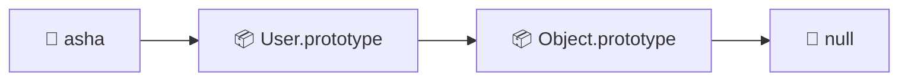

# 06 · Closures, `this` & Prototypes

> [!info] Topic info
> **Subject:** Frontend · **Part:** JavaScript, HTML/CSS & the Browser · **Priority:** 🔥 High · **Status:** ✅ done · **Last reviewed:** 2026-11-19
>
> [← Back to Frontend](README.md) · [Interview questions →](questions/javascript-and-browser-qa.md)

> [!abstract] In one line
> A **closure** is a function that **remembers variables from where it was created**; **`this`** is decided by **how a function is called**; **prototypes** are how objects **inherit** methods from other objects.

---

## 1. Closures

When a function is created, it keeps a live link to its outer scope — even after the outer function has returned.

```js
function makeCounter() {
  let count = 0;                 // private — nothing outside can touch it
  return () => ++count;
}
const next = makeCounter();
next(); next();                  // 1, 2
```

**Used for:** private state, factories, `debounce`/`memoize`, React hooks, event handlers that remember data.

### The classic loop question

```js
for (var i = 0; i < 3; i++) setTimeout(() => console.log(i), 0);  // 3 3 3
for (let i = 0; i < 3; i++) setTimeout(() => console.log(i), 0);  // 0 1 2
```

`var` has **one** `i` for the whole function, so all three callbacks see the final value 3. `let` creates a **new `i` per iteration**, so each closure captures its own.

> [!warning] Memory
> A closure keeps its outer variables alive. A forgotten event listener holding a closure over a 50 MB array = a memory leak.

> [!tip] 🎤 Say it like this
> "A closure is a function bundled with the variables of the scope it was created in. Even after the outer function returns, the inner one can still read and update those variables. That's how we get private state, like a counter, and it's why `let` in a loop fixes the classic `setTimeout` bug — each iteration gets its own binding."

---

## 2. The 4 rules of `this` (+ arrows)

`this` is set **at call time**. Check these in priority order:

| Rule | Call looks like | `this` is |
|---|---|---|
| **1 · new** | `new User()` | The new object |
| **2 · Explicit** | `fn.call(obj)`, `apply`, `bind` | `obj` |
| **3 · Implicit** | `obj.fn()` | `obj` (the thing left of the dot) |
| **4 · Default** | `fn()` | `undefined` in strict mode, `window` otherwise |

**Arrow functions** have **no own `this`** — they use `this` from the surrounding code (lexical). You can't change it with `call`/`bind`, and you can't `new` them.

```js
const user = {
  name: "Asha",
  hi() { console.log(this.name); },
  later() { setTimeout(() => console.log(this.name), 0); }, // arrow keeps user ✅
};
const f = user.hi;
f();            // undefined — lost "implicit" binding, now default rule
user.later();   // "Asha"
```

---

## 3. call, apply, bind

All three set `this` explicitly:

```js
greet.call(user, "Hi", "!");     // runs now, args one by one
greet.apply(user, ["Hi", "!"]);  // runs now, args as an array
const g = greet.bind(user, "Hi"); // returns a NEW function, runs later
g("!");
```

Memory trick: **A**pply = **A**rray, **C**all = **C**ommas, **bind** = later.

---

## 4. Prototypes & the prototype chain

Every object has a hidden link, `[[Prototype]]` (read it with `Object.getPrototypeOf(obj)`). When a property isn't on the object, JS looks up this chain until it hits `null`.



```js
class User { constructor(n) { this.name = n; } hi() { return this.name; } }
const asha = new User("Asha");
asha.hi();          // found on User.prototype
asha.toString();    // found on Object.prototype
```

`class` is **syntax sugar** over this — methods live on `User.prototype`, shared by every instance (one copy in memory, not one per object).

> [!note] `__proto__` vs `prototype`
> `prototype` is a property of **functions/classes** — the object that instances will link to. `__proto__` (or `getPrototypeOf`) is the link **on an instance**. So `asha.__proto__ === User.prototype`.

> [!failure] Interview traps
> - Passing `obj.method` as a callback and losing `this` — fix with `bind` or an arrow.
> - Using an arrow function as an object method and expecting `this` to be the object.
> - Saying JS has "classical" inheritance — it's prototypal; `class` is sugar.
> - Mixing up `prototype` and `__proto__`.

---

## Summary

| Concept | One line |
|---|---|
| **Closure** | Function + remembered outer variables |
| **`this`** | new → explicit → implicit → default; arrows inherit |
| **call / apply / bind** | Now with commas / now with array / later |
| **Prototype chain** | Property lookup walks up to `Object.prototype` → `null` |

> [!success] Key takeaway
> Closures = *where* a function was written; `this` = *how* it was called; prototypes = *where* to look next.
