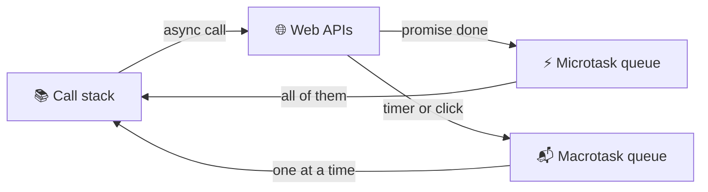

# 07 · Async JavaScript — Event Loop & Promises

> [!info] Topic info
> **Subject:** Frontend · **Part:** JavaScript, HTML/CSS & the Browser · **Priority:** 🔥 High · **Status:** ✅ done · **Last reviewed:** 2026-11-19
>
> [← Back to Frontend](README.md) · [Interview questions →](questions/javascript-and-browser-qa.md)

> [!abstract] In one line
> JS runs on **one thread**; the **event loop** runs the call stack, then **all microtasks** (promises), then **one macrotask** (timers, events), and repeats — **promises / async-await** are the clean way to write code on top of it.

---

## 1. The problem

The browser runs your JS, layout and paint on the **main thread**. If one function takes 2 s, the page freezes — no clicks, no scrolling.

So slow things (network, timers) are handed to the browser's **Web APIs**, and their callbacks come back later through queues. The event loop decides **what runs next**. (Node's loop has extra phases — see [Node.js event loop](../nodejs-backend/02-event-loop.md).)

---

## 2. How the event loop works



One loop "tick":
1. Run the current script until the **call stack is empty**.
2. Run **every microtask** — including new ones added meanwhile.
3. Browser may **render** (about every 16 ms at 60 fps).
4. Take **one macrotask**, run it, go back to step 2.

| **Microtasks** (high priority) | **Macrotasks** (tasks) |
|---|---|
| `Promise.then/catch/finally`, `await` continuation | `setTimeout`, `setInterval` |
| `queueMicrotask`, `MutationObserver` | DOM events, network callbacks, `MessageChannel` |

---

## 3. "What prints?"

```js
console.log("1");
setTimeout(() => console.log("2"), 0);
Promise.resolve().then(() => console.log("3"));
(async () => { console.log("4"); await null; console.log("5"); })();
console.log("6");
// 1 4 6 3 5 2
```

- **Sync first:** 1, 4 (an async function runs synchronously until its first `await`), 6.
- **Microtasks:** 3, then 5 (code after `await` is a microtask).
- **Macrotask:** 2 — `setTimeout(…, 0)` means "at least 0 ms", never "now".

> [!tip] 🎤 Say it like this
> "JavaScript is single-threaded. Synchronous code runs first on the call stack. When it's empty, the event loop drains the whole microtask queue — promise callbacks and code after `await` — then takes one macrotask like a timer or click, and repeats. That's why a resolved promise always logs before a `setTimeout` of zero."

> [!warning] Microtask starvation
> A promise chain that keeps adding microtasks never lets the loop reach rendering or timers — the page freezes just like an infinite loop.

---

## 4. Promises & async/await

A **promise** is an object for a future value, in one of 3 states: **pending → fulfilled** or **rejected** (settled once, never changes).

```js
async function loadDashboard(id) {
  try {
    const [user, orders] = await Promise.all([getUser(id), getOrders(id)]); // parallel
    return { user, orders };
  } catch (err) {
    showError(err);  // any rejection lands here
  }
}
```

| Combinator | Resolves when | Rejects when |
|---|---|---|
| **Promise.all** | All succeed | **First** failure |
| **Promise.allSettled** | All finish (any result) | Never |
| **Promise.race** | First to settle (win or fail) | First settles with failure |
| **Promise.any** | First success | All fail |

> [!failure] Interview traps
> - Awaiting in sequence when calls are independent — 3 × 200 ms = 600 ms vs 200 ms with `Promise.all`.
> - `await` inside `forEach` — `forEach` doesn't wait. Use `for…of` or `Promise.all(arr.map(…))`.
> - Forgetting `return` inside `.then` — the next `.then` gets `undefined`.
> - Thinking `setTimeout(fn, 0)` runs immediately.

---

## Summary

- One thread; heavy work blocks clicks and paint.
- Order: **sync → all microtasks → render → one macrotask**.
- Promise callbacks and `await` continuations are microtasks.
- `Promise.all` for parallel, `allSettled` when partial failure is OK.

> [!success] Key takeaway
> Know the order "sync, microtasks, macrotask" and you can answer any "what prints" question.
