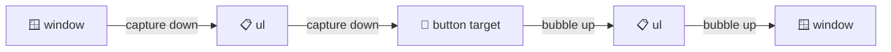

# 08 · DOM & Events — Bubbling, Delegation, Debounce/Throttle

> [!info] Topic info
> **Subject:** Frontend · **Part:** JavaScript, HTML/CSS & the Browser · **Priority:** 🔥 High · **Status:** ✅ done · **Last reviewed:** 2026-11-19
>
> [← Back to Frontend](README.md) · [Interview questions →](questions/javascript-and-browser-qa.md)

> [!abstract] In one line
> DOM events travel **down (capturing)**, hit the **target**, then travel **up (bubbling)** — which enables **event delegation** (one listener for many children); **debounce/throttle** control how often handlers run.

---

## 1. The problem

A todo list has **1,000 items**, each with a delete button. Adding 1,000 click listeners wastes memory, and new items added later have no listener at all.

Meanwhile, the search box fires an API call on **every keystroke** — typing "javascript" sends 10 requests. Both are fixed by understanding events.

---

## 2. The DOM in 30 seconds

The **DOM** is the browser's live tree of the page that JS can read and change.

```js
const list = document.querySelector("#todos");
const li = document.createElement("li");
li.textContent = "Buy milk";       // safe — not parsed as HTML
list.append(li);
```

- Prefer `textContent` over `innerHTML` with user data — `innerHTML` can run injected scripts ([XSS](12-web-security.md)).
- Adding 1,000 nodes? Build them in a `DocumentFragment` and append **once** — one reflow instead of 1,000.

---

## 3. Event phases: capturing → target → bubbling



- **Capture** — from `window` down to the target. Listen with `addEventListener("click", fn, true)`.
- **Bubble** — from the target back up. This is the **default** for listeners.
- `e.target` = the element actually clicked. `e.currentTarget` = the element whose listener is running.
- `e.stopPropagation()` stops the journey. `e.preventDefault()` stops the browser's default action (form submit, link navigation) — they're different things.

---

## 4. Event delegation

Put **one** listener on the parent and check `e.target`:

```js
list.addEventListener("click", (e) => {
  const btn = e.target.closest("button.delete");
  if (!btn) return;
  btn.closest("li").remove();
});
```

**✅ Pros:** one listener instead of 1,000; works for items added later.
**❌ Cons:** a few events don't bubble (`focus`, `blur` — use `focusin`/`focusout`); a child calling `stopPropagation` breaks it.

> [!tip] 🎤 Say it like this
> "Events capture down from the window to the target, then bubble back up. Event delegation uses bubbling: I attach one listener to a parent, and use `e.target.closest()` to find which child was clicked. It saves memory and automatically handles elements added later."

---

## 5. Debounce vs throttle

| | **Debounce** | **Throttle** |
|---|---|---|
| **Rule** | Run **after** the user stops for X ms | Run **at most once** every X ms |
| **Typing "javascript" (300 ms)** | 1 call, after typing stops | ~1 call per 300 ms while typing |
| **Use for** | Search box, autosave, window resize end | Scroll, mousemove, infinite scroll check |

```js
function debounce(fn, ms) {
  let t;
  return (...args) => { clearTimeout(t); t = setTimeout(() => fn(...args), ms); };
}
```

Throttle code is in [13 · JS coding questions](13-js-coding-questions.md).

> [!failure] Interview traps
> - Confusing `stopPropagation` with `preventDefault`.
> - Mixing up `target` and `currentTarget`.
> - Calling `debounce(fn)` inside the handler on each event — creates a new timer each time, so nothing is debounced.
> - Forgetting `removeEventListener` → memory leaks in SPAs.

---

## Summary

- Events: **capture ↓ → target → bubble ↑** (listeners bubble by default).
- Delegation = one parent listener + `e.target.closest()`.
- Debounce = wait for a pause; throttle = fixed max rate.
- Batch DOM writes (`DocumentFragment`) and use `textContent` for user data.

> [!success] Key takeaway
> Bubbling makes delegation possible; debounce and throttle stop noisy events from flooding your handlers and your API.
