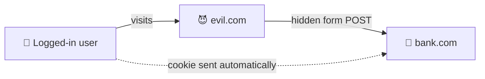

# 12 · Web Security — XSS, CSRF, CORS, CSP, Clickjacking

> [!info] Topic info
> **Subject:** Frontend · **Part:** JavaScript, HTML/CSS & the Browser · **Priority:** 🔥 High · **Status:** ✅ done · **Last reviewed:** 2026-11-19
>
> [← Back to Frontend](README.md) · [Interview questions →](questions/javascript-and-browser-qa.md)

> [!abstract] In one line
> The big frontend attacks are **XSS** (attacker's script runs on your page), **CSRF** (attacker's site makes your browser send a request with your cookies) and **clickjacking** (your page hidden in an invisible iframe); **CSP**, **SameSite cookies** and **frame-ancestors** are the defences — and **CORS** is about *reading* responses, not protection.

---

## 1. The problem

Our social app lets users post comments. One user posts ``. Every visitor who views it sends their cookies to the attacker. That's one bug — the browser has several more traps.

The server-side view (cookies, sessions, JWT) is in [Auth & network security](../computer-networks/06-auth-and-security.md). Here's the frontend angle.

---

## 2. XSS — Cross-Site Scripting

Attacker gets **their JavaScript** to run in **your origin**, so it can read tokens, call APIs as the user, or change the page.

- **Stored** — saved in the DB (the comment above), hits every viewer.
- **Reflected** — in the URL: `/search?q=<script>…`, sent to victims as a link.
- **DOM-based** — your own JS writes untrusted data into the page (`el.innerHTML = location.hash`).

**Defences:**
- **Escape output** — React/Vue escape `{text}` by default. Danger zones: `dangerouslySetInnerHTML`, `v-html`, `innerHTML`, `href="javascript:…"`.
- **Sanitize** HTML you must render (DOMPurify).
- **HttpOnly cookies** so a script can't read the session.
- **CSP** as a second wall (below).

---

## 3. CSRF — Cross-Site Request Forgery

You're logged in to `bank.com`. You visit `evil.com`, which has a hidden form that POSTs to `bank.com/transfer`. Your browser **attaches your bank cookie automatically** — the bank sees a valid request.



**Defences:** `SameSite=Lax` or `Strict` cookies (the main fix today), **CSRF tokens** (random value in the form the attacker can't know), checking `Origin` header, and never changing data on `GET`.

> [!note] XSS beats CSRF defences
> If the attacker has XSS, they run code **on your origin** — they can read the CSRF token and send same-site requests. Fix XSS first.

---

## 4. CORS — not a security shield

The **Same-Origin Policy** stops `evil.com`'s JS from **reading** responses from `api.bank.com`. **CORS** is the server's way to *relax* that for trusted origins via `Access-Control-Allow-Origin`.

CORS doesn't stop the request from being **sent** (that's why CSRF works). Details and preflight: [Browser networking → CORS](../computer-networks/03-browser-networking.md).

---

## 5. CSP & clickjacking

**CSP (Content Security Policy)** — a response header listing where scripts, styles and images may load from. Even if XSS slips through, inline or unknown-domain scripts are blocked.

```
Content-Security-Policy: default-src 'self'; script-src 'self' https://cdn.example.com; frame-ancestors 'none'
```

**Clickjacking** — attacker loads your page in a transparent iframe over a "Win a prize" button; the user actually clicks "Delete account". Fix: `frame-ancestors 'none'` in CSP (or the older `X-Frame-Options: DENY`).

> [!tip] 🎤 Say it like this
> "XSS is when attacker script runs on my page — I prevent it by escaping output, sanitizing any HTML, avoiding `innerHTML`, and adding CSP. CSRF is when another site makes the user's browser send a request with their cookies — SameSite cookies and CSRF tokens stop it. CORS isn't a protection; it only controls which origins can read responses. And `frame-ancestors` stops clickjacking."

| Attack | Fix |
|---|---|
| **XSS** | Escape, sanitize, CSP, HttpOnly cookies |
| **CSRF** | SameSite cookies, CSRF tokens, check Origin |
| **Clickjacking** | `frame-ancestors 'none'` / `X-Frame-Options` |
| **Token theft** | HttpOnly cookie, not localStorage |
| **Man-in-the-middle** | HTTPS everywhere + HSTS |

> [!failure] Interview traps
> - "CORS protects my API from attackers" — curl and servers ignore CORS entirely.
> - "React means no XSS" — not with `dangerouslySetInnerHTML` or user-controlled `href`.
> - Mixing up XSS (attacker code runs in your page) and CSRF (attacker borrows your cookies).
> - Frontend-only validation — always validate on the server too.

---

## Summary

- **XSS** → escape + sanitize + CSP + HttpOnly.
- **CSRF** → SameSite + tokens.
- **CORS** → controls reading, not sending; not auth.
- **Clickjacking** → `frame-ancestors`.

> [!success] Key takeaway
> Treat every piece of user data as hostile when you render it — most frontend security bugs are XSS in disguise.
