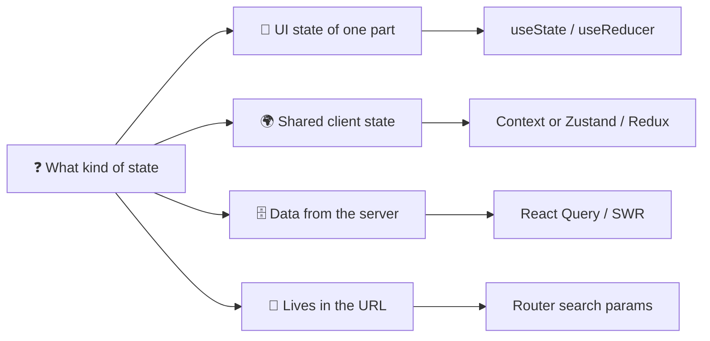

# 16 · State Management

> [!info] Topic info
> **Subject:** Frontend · **Part:** React & Performance · **Priority:** 🔥 High · **Status:** ✅ done · **Last reviewed:** 2026-11-19
>
> [← Back to Frontend](README.md) · [Interview questions →](questions/react-and-performance-qa.md)

> [!abstract] In one line
> State management is deciding **where each piece of state lives** — local, lifted, **Context**, a global store (**Redux Toolkit**, **Zustand**) or a **server-state cache** (React Query) — so components share data without chaos.

---

## 1. The problem

A shop app: the cart is shown in the header, product page and checkout. The logged-in user is needed in 30 components. Product data comes from the API and must stay fresh.

Putting everything in one giant global store makes every change re-render half the app. Putting everything local means passing props through 6 layers.

---

## 2. Start local, lift when needed

- **Local state** — only one component needs it (a dropdown's `open`).
- **Lift state up** — two siblings need it → move it to their **closest common parent** and pass it down.
- **Prop drilling** — passing props through middle components that don't use them (`App → Layout → Header → Menu → Avatar`). Fine for 2–3 levels; painful beyond.

Fixes for drilling: **component composition** (pass `children` / elements instead of data), **Context**, or a store.

---

## 3. Context

Context lets any component under a `<Provider>` read a value with `useContext`, skipping the middle layers. Great for **rarely changing** data: theme, logged-in user, locale.

> [!warning] Context is not a state manager
> When the provider's `value` changes, **every consumer re-renders** — even if it only uses one field. Putting a fast-changing value (typing, cart counts) in one big context causes slow re-renders. Split contexts, memoize the value, or use a store with **selectors**.

---

## 4. The four kinds of state

The big modern insight: **most "global state" was really server data** (users, products). A server-state library handles caching, refetching and loading flags, so the client store stays tiny. Filters and pagination belong in the **URL** so they survive refresh and can be shared.

---

## 5. Comparing the options

| Option | Best for | Strengths | Weaknesses |
|---|---|---|---|
| **Context** | Theme, auth user, locale | Built in, zero deps | All consumers re-render; no devtools |
| **Redux Toolkit** | Large apps, many devs, complex flows | Predictable (actions → reducers), great devtools, middleware | More boilerplate and concepts |
| **Zustand** | Small–medium shared client state | Tiny, no provider, selectors avoid extra re-renders | Less structure for big teams |
| **React Query / SWR** | Server data | Caching, dedupe, background refetch, retries | Not for pure client state |

> [!example] Redux in one breath
> **Store** holds state → UI **dispatches** an action `{type: 'cart/add'}` → a pure **reducer** returns new state → subscribed components re-render. Redux Toolkit's `createSlice` removes most boilerplate and uses Immer so you can "mutate" safely.

> [!tip] 🎤 Say it like this
> "I start with local state and lift it only when siblings need it. Server data goes into React Query, URL-worthy state into search params, and stable app-wide values like theme into Context. If there's still a lot of shared client state, I add Zustand for small apps or Redux Toolkit for big teams that need structure and devtools."

> [!failure] Interview traps
> - "We use Redux for everything" — including API data, which React Query handles far better.
> - Not knowing why Context causes extra re-renders.
> - Storing **derived** data in state (e.g. `filteredList`) — compute it from the source instead, or it goes out of sync.

---

## Summary

- Keep state **as local as possible**; lift only when needed.
- **Context** for rarely changing values; split it to limit re-renders.
- **Server state ≠ client state** — use React Query/SWR for server data.
- **Zustand** = light store, **Redux Toolkit** = structured store for big apps.

> [!success] Key takeaway
> Classify the state first (UI, shared, server, URL), then pick the lightest tool that fits it.
