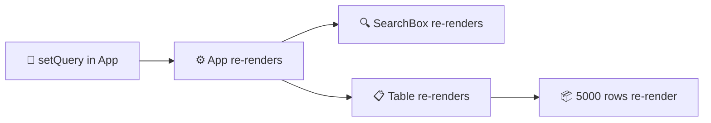

# 17 · React Performance

> [!info] Topic info
> **Subject:** Frontend · **Part:** React & Performance · **Priority:** 🔥 High · **Status:** ✅ done · **Last reviewed:** 2026-11-19
>
> [← Back to Frontend](README.md) · [Interview questions →](questions/react-and-performance-qa.md)

> [!abstract] In one line
> Most React slowness is **too many or too expensive re-renders**; fix it by **measuring first**, then **moving state down**, **memoizing** (`React.memo`, `useMemo`, `useCallback`), **virtualizing** long lists and **deferring** non-urgent updates.

---

## 1. The problem

A dashboard with a search box and a 5,000-row table. Every keystroke updates state at the top, the whole table re-renders, and typing lags by 200 ms.

Before fixing anything, **measure**: React DevTools **Profiler** shows which components rendered, why, and how long they took.

---

## 2. Why a component re-renders

1. Its **state** changed.
2. Its **parent** re-rendered (by default, **all children re-render**, even with the same props).
3. A **Context** it reads changed.



> [!note] Re-render is not the bug
> Re-renders are usually cheap. They only matter when they are **frequent** (typing, scrolling) **and** **expensive** (big trees, heavy calculations).

---

## 3. The fixes, cheapest first

### Move state down / split components
If only `SearchBox` needs `query`, keep the state **inside SearchBox**. The table no longer re-renders on every key. Also: pass heavy parts as `children` — they keep their identity when the wrapper re-renders.

### Memoization
- **`React.memo(Component)`** — skip re-render if props are **shallow-equal** to last time.
- **`useCallback` / `useMemo`** — keep function and object props the **same reference**, otherwise `React.memo` is useless (`{}` !== `{}`).

```jsx
const Row = React.memo(function Row({ item, onSelect }) { /* ... */ });
const onSelect = useCallback(id => setSelected(id), []);
```

### Virtualization (windowing)
Render only the ~30 rows **visible on screen**, not all 5,000 — libraries like `react-window` or TanStack Virtual. Cuts DOM nodes by 99%.

### Defer non-urgent work (React 18 concurrent rendering)
- **`useTransition`** — `startTransition(() => setFilter(q))` marks the update as low priority; typing stays responsive and React can interrupt the slow render.
- **`useDeferredValue(query)`** — render the list with a slightly "lagging" copy of the value.

### Other wins
- **Debounce** search input (wait 300 ms) before filtering or fetching.
- **Code-split** heavy components with `React.lazy` + `Suspense`.
- Avoid creating new objects/arrays in Context `value` every render.

> [!tip] 🎤 Say it like this
> "First I profile with React DevTools to see what re-renders and why. Then I fix the cause: move state closer to where it's used, split contexts, and memoize with React.memo plus stable callbacks only where the profiler shows it helps. For long lists I virtualize, and for heavy updates during typing I use useTransition or a debounce."

> [!failure] Interview traps
> - Wrapping everything in `React.memo` — adds comparison cost and hides design problems.
> - `React.memo` with an inline `onClick={() => ...}` or `style={{}}` prop — new reference every time, so memo never hits.
> - Using index keys in virtualized/reordered lists.
> - Optimizing without measuring (and in **dev mode**, which is much slower than production).

---

## Summary

| Problem | Fix |
|---|---|
| **State too high** | Move it down, split components, use `children` |
| **Same props, still re-renders** | `React.memo` + `useCallback`/`useMemo` |
| **Huge lists** | Virtualization |
| **Typing lag on heavy update** | `useTransition`, `useDeferredValue`, debounce |
| **Big initial bundle** | `React.lazy` code splitting |

> [!success] Key takeaway
> Measure with the Profiler, fix the structure first (state placement), and use memoization as a targeted tool — not a default.
