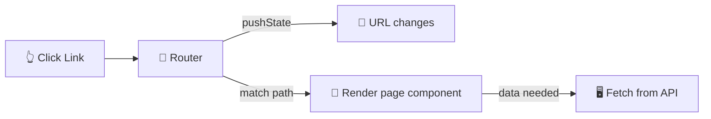

# 19 · Routing

> [!info] Topic info
> **Subject:** Frontend · **Part:** React & Performance · **Priority:** ⚡ Medium · **Status:** ✅ done · **Last reviewed:** 2026-11-19
>
> [← Back to Frontend](README.md) · [Interview questions →](questions/react-and-performance-qa.md)

> [!abstract] In one line
> **Client-side routing** swaps page components in a **single-page app** using the **History API** — no full page reload — with **React Router** (or Next.js file-based routes), plus **protected routes** and **route-level code splitting**.

---

## 1. The problem

In a classic site, clicking a link asks the server for a new HTML page — full reload, white flash, all JS state lost. In a **SPA** (single-page app) we want instant navigation while keeping the URL meaningful: shareable, bookmarkable, and the Back button works.

---

## 2. How client-side routing works

The router intercepts link clicks, calls `history.pushState()` to change the URL **without** a request, and renders the component that matches the path. Back/forward fire a `popstate` event, which the router listens to.



```jsx
<Routes>
  <Route path="/" element={<Home />} />
  <Route path="/products/:id" element={<Product />} />  {/* useParams() */}
  <Route path="/admin" element={<RequireAuth><Admin /></RequireAuth>} />
  <Route path="*" element={<NotFound />} />
</Routes>
```

> [!warning] Server config for SPAs
> Refreshing on `/products/42` hits the server for that path. The server (Nginx, S3/CDN) must return `index.html` for unknown paths, or users get a **404**.

Useful pieces: **nested routes** with `<Outlet />` for shared layouts, `useNavigate()` for redirects after actions, and `useSearchParams()` for filters in the URL.

---

## 3. Protected routes

Wrap private pages in a guard that checks auth and redirects to `/login`, remembering where the user wanted to go.

```jsx
function RequireAuth({ children }) {
  const { user } = useAuth();
  const location = useLocation();
  if (!user) return <Navigate to="/login" state={{ from: location }} replace />;
  return children;
}
```

> [!important] Golden rule
> Frontend guards are **UX only**. Anyone can edit JS in DevTools. The **API must check authorization** on every request. See [authentication vs authorization](../system-design/api-fundamentals/09-authentication-vs-authorization.md).

---

## 4. Code splitting by route

Users visiting the home page shouldn't download the admin dashboard. Load each page on demand:

```jsx
const Admin = lazy(() => import('./pages/Admin'));
<Suspense fallback={<Spinner />}><Admin /></Suspense>
```

The bundler creates a separate **chunk** per page. Prefetch likely next pages on link hover to hide the delay.

> [!note] Next.js
> Next.js uses **file-based routing** (`app/products/[id]/page.tsx`), splits code per route automatically, and runs auth checks in **middleware** on the server.

> [!tip] 🎤 Say it like this
> "Client-side routing uses the History API to change the URL without a reload and render the matching component. I lazy-load each route so the first bundle stays small, and protect private routes with a guard that redirects to login — but real security is always enforced by the API."

> [!failure] Interview traps
> - Thinking a route guard is security.
> - Forgetting the server fallback to `index.html` (refresh → 404).
> - Using `<a href>` instead of `<Link>` — causes a full reload.

---

## Summary

- Router + **History API** = navigation without reloads.
- **Dynamic params**, nested layouts, search params for filters.
- **Protected routes** redirect, but the **API enforces** access.
- **`lazy` + `Suspense`** per route keeps the initial bundle small.

> [!success] Key takeaway
> Routing is about URLs that behave like real pages: shareable, reload-safe, lazy-loaded and guarded (with the server as the real gatekeeper).
