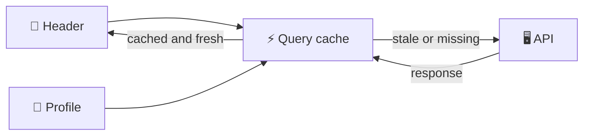

# 20 · Data Fetching

> [!info] Topic info
> **Subject:** Frontend · **Part:** React & Performance · **Priority:** 🔥 High · **Status:** ✅ done · **Last reviewed:** 2026-11-19
>
> [← Back to Frontend](README.md) · [Interview questions →](questions/react-and-performance-qa.md)

> [!abstract] In one line
> Fetching data in React means handling **loading, error and empty states**, avoiding **race conditions**, and **caching** results — which is why most apps use a server-state library like **TanStack Query (React Query)** or **SWR** instead of raw `useEffect`.

---

## 1. The problem

A product page fetches `/api/products/42` in `useEffect`. Then the bugs arrive:
- The user clicks product 43 quickly — the slow response for 42 arrives **last** and overwrites 43.
- Going back to the list refetches everything — spinner every time.
- Three components need the same user → **three identical requests**.

---

## 2. The basic pattern (and its race condition)

```jsx
useEffect(() => {
  const controller = new AbortController();
  setStatus('loading');
  fetch(`/api/products/${id}`, { signal: controller.signal })
    .then(r => { if (!r.ok) throw new Error(r.status); return r.json(); })
    .then(data => { setProduct(data); setStatus('success'); })
    .catch(err => { if (err.name !== 'AbortError') setStatus('error'); });
  return () => controller.abort();   // cancel old request when id changes
}, [id]);
```

- **Always model 4 states:** loading, error (with retry button), empty, success.
- **`fetch` does not throw on 404/500** — check `r.ok`.
- **Race condition fix:** abort the old request in cleanup (or ignore it with a `let ignore = true` flag).

---

## 3. Server-state libraries: React Query / SWR

They treat server data as a **cache keyed by query key**, with smart rules for when to refetch.

```jsx
const { data, isPending, isError, refetch } = useQuery({
  queryKey: ['product', id],
  queryFn: () => api.getProduct(id),
  staleTime: 60_000,     // fresh for 1 min: no refetch
});
```



What you get for free:
- **Deduplication** — 3 components, 1 request.
- **Stale-while-revalidate** — show cached data instantly, refresh in the background.
- **Refetch on window focus / reconnect**, **retries** with backoff, **pagination / infinite scroll** helpers.
- **Mutations** with cache **invalidation** (`invalidateQueries(['cart'])`) and **optimistic updates** (update UI first, roll back on error).

> [!example] Optimistic update
> User clicks ❤️ Like → count goes 10 → 11 instantly → request sent in background → if it fails, roll back to 10 and show a toast. Feels instant even on 300 ms networks.

---

## 4. Other patterns worth naming

- **Debounce** search requests (300 ms) and cancel the previous one.
- **Prefetch** on hover so the next page opens instantly.
- **Suspense for data** — `useSuspenseQuery` or React 19's `use()` lets a `<Suspense>` boundary show the fallback; pair with an **Error Boundary** for failures.
- **Server Components / SSR** fetch on the server, so no client waterfall — see [rendering strategies](21-rendering-strategies.md).
- Avoid **waterfalls** (fetch A, then B, then C) — fire independent requests in parallel.

> [!tip] 🎤 Say it like this
> "Raw useEffect fetching needs loading, error and empty states plus cleanup to avoid race conditions. In real apps I use React Query: it caches by key, dedupes requests, refetches stale data in the background, retries, and handles mutations with invalidation or optimistic updates. That removes most server data from my global store."

> [!failure] Interview traps
> - Not handling the race condition when params change quickly.
> - Treating a 500 as success because `fetch` didn't throw.
> - Copying API data into Redux and manually keeping it in sync.
> - Request waterfalls caused by nested components each fetching after the parent renders.

---

## Summary

| Concern | Solution |
|---|---|
| **Race conditions** | AbortController in cleanup |
| **Duplicate requests** | Query cache dedupe |
| **Spinners everywhere** | Stale-while-revalidate, prefetch |
| **Slow-feeling writes** | Optimistic updates |
| **Waterfalls** | Parallel requests, fetch on server |

> [!success] Key takeaway
> Server data is a cache, not app state — let React Query/SWR manage it and always design the loading, error and empty states.
