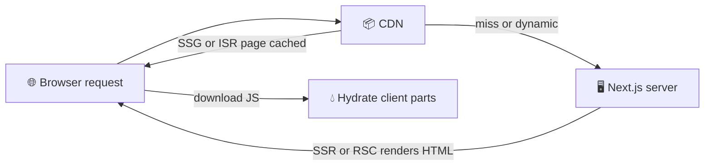

# 21 · Rendering Strategies (CSR, SSR, SSG, ISR, RSC)

> [!info] Topic info
> **Subject:** Frontend · **Part:** React & Performance · **Priority:** 🔥 High · **Status:** ✅ done · **Last reviewed:** 2026-11-19
>
> [← Back to Frontend](README.md) · [Interview questions →](questions/react-and-performance-qa.md)

> [!abstract] In one line
> The rendering strategy decides **where and when HTML is built** — in the browser (**CSR**), on the server per request (**SSR**), at build time (**SSG**), rebuilt periodically (**ISR**), or as **React Server Components** that send no JS for server-only parts.

---

## 1. The problem

A plain React SPA sends an almost empty `
` plus 500 KB of JS. On a slow phone the user stares at a blank screen for 3 s, and some crawlers and link previews see nothing. A blog, a store and a dashboard need different answers.

---

## 2. The strategies

- **CSR (client-side rendering)** — browser downloads JS, then renders and fetches data. Simple hosting (static files on a CDN), but slow first paint and weak SEO.
- **SSR (server-side rendering)** — server runs React for **each request** and sends full HTML. Fast first paint and SEO; then JS **hydrates** it (attaches event handlers) to make it interactive.
- **SSG (static site generation)** — HTML built **once at build time**, served from a CDN. Fastest and cheapest, but data is as old as the last build.
- **ISR (incremental static regeneration)** — SSG + **rebuild a page in the background** after N seconds or on demand. Static speed with fairly fresh data.
- **RSC (React Server Components)** — components that run **only on the server**, can read the DB directly, and ship **zero JS** to the browser. Only `'use client'` components hydrate.

---

## 3. Comparison

| Strategy | HTML built | First paint | SEO | Data freshness | Good for |
|---|---|---|---|---|---|
| **CSR** | In browser | Slow | Weak | Live | Dashboards behind login |
| **SSR** | Per request | Fast | ✅ | Live | Personalized pages, search results |
| **SSG** | At build | Fastest | ✅ | Stale until rebuild | Docs, blogs, marketing |
| **ISR** | Build + background refresh | Fastest | ✅ | Minutes old | Product pages, news |
| **RSC** | Server, streamed | Fast | ✅ | Live or cached | Modern Next.js apps, less client JS |

> [!note] Next.js App Router
> In Next.js, every component is a **Server Component by default**. Pages are static unless they use dynamic data (cookies, headers, `no-store` fetch); `revalidate: 60` gives ISR. **Streaming** with `<Suspense>` sends the page shell first and fills slow parts in as they finish.

---

## 4. Hydration — the hidden cost

SSR HTML **looks** ready but buttons don't work until JS downloads and hydrates. A big bundle = long "uncanny valley". **Hydration mismatch** errors happen when server and client render different output (e.g. `Date.now()`, `window` checks during render).

Fixes: less client JS (RSC), **selective / progressive hydration** with Suspense (React 18), and keeping render output deterministic.

> [!tip] 🎤 Say it like this
> "It depends on the page. Marketing and docs are SSG on a CDN; product pages use ISR so they stay static but refresh every few minutes; personalized pages use SSR; logged-in dashboards can be plain CSR. With Next.js App Router I default to Server Components and only mark interactive bits as client components, which keeps the JS bundle small."

> [!failure] Interview traps
> - Saying SSR means "no JavaScript" — it still hydrates.
> - Confusing **SSR** with **RSC**: SSR renders client components to HTML once; RSC components never ship JS or hydrate.
> - Forgetting SSR costs server CPU per request — cache it or use ISR where possible.
> - Using browser-only APIs (`window`, `localStorage`) during server render.

---

## Summary

- **CSR** = browser builds it; **SSR** = server per request; **SSG** = at build; **ISR** = SSG that refreshes; **RSC** = server-only components with no client JS.
- SSR/SSG pages still need **hydration** for interactivity.
- Mix strategies **per page**.

> [!success] Key takeaway
> Pick by page: how fresh must the data be, does SEO matter, and how personalized is it — then serve as much as possible statically from a CDN.
