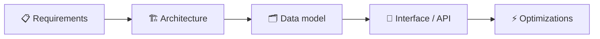
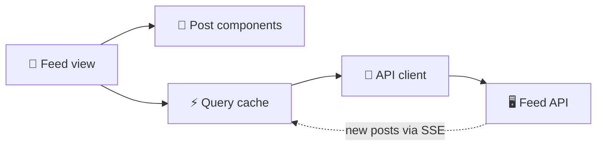

# 25 · Frontend System Design

> [!info] Topic info
> **Subject:** Frontend · **Part:** React & Performance · **Priority:** 🔥 High · **Status:** ✅ done · **Last reviewed:** 2026-11-19
>
> [← Back to Frontend](README.md) · [Interview questions →](questions/react-and-performance-qa.md)

> [!abstract] In one line
> A frontend system design interview asks you to design a **client app** (news feed, autocomplete, chat) — answer with the **RADIO** framework: **R**equirements, **A**rchitecture, **D**ata model, **I**nterface (API), **O**ptimizations.

---

## 1. The problem

"Design the Facebook news feed" in 45 minutes. Without a structure, candidates jump into component code or backend databases. Interviewers want to see **client-side** thinking: components, state, API shape, performance, accessibility.

For backend-side design see [system design](../system-design/01-what-is-system-design.md).

---

## 2. The RADIO framework

| Step | Time | What to cover |
|---|---|---|
| **R — Requirements** | ~5 min | Core features, devices, offline?, scale (items, users), non-functional (perf, a11y, i18n) |
| **A — Architecture** | ~10 min | Main components and how they talk: views, store, API client, cache |
| **D — Data model** | ~5 min | Entities and where each lives (server cache vs client state vs URL) |
| **I — Interface** | ~10 min | API between client and server (+ component props), pagination style |
| **O — Optimizations** | ~15 min | Performance, network, UX states, accessibility, security — **where you score most** |

> [!question] Questions to ask first
> - Which platforms — desktop, mobile web, both? Slow networks?
> - What content — text only, or images and video?
> - Real-time updates needed? Offline support?
> - Roughly how many items will a user scroll through?

---

## 3. Worked example: news feed

**R:** infinite scrolling feed of posts (text + images), like and comment, new posts appear. Mobile-first, works on 3G.

**A:**

**D:** `Post { id, author, content, media[], likeCount, likedByMe, createdAt }`, `User { id, name, avatarUrl }` — normalized in the cache so one user update fixes all their posts.

**I:** `GET /feed?cursor=abc&limit=10` → `{ posts, nextCursor }`. **Cursor pagination**, not offset — new posts at the top would shift offsets and cause duplicates. `POST /posts/:id/like`.

**O:**
- **Virtualized list** — only render posts on screen; keep DOM small after 500 posts.
- **Infinite scroll** with `IntersectionObserver` on a sentinel near the bottom; prefetch next page early.
- **Images**: lazy load, `srcset`, fixed aspect-ratio boxes (no CLS), blur placeholders.
- **Optimistic likes**; "**N new posts**" pill instead of jumping the scroll.
- **SSR** first page for fast LCP; skeleton loaders; error + retry per page.
- **A11y**: feed is `role="feed"`, keyboard navigation, alt text. **Security**: sanitize user content (XSS).

---

## 4. Quick sketch: autocomplete

- **Debounce** input (~300 ms) and require 2+ chars.
- **Cache** results per query in memory (`"rea"` → results); cancel stale requests (AbortController) so old responses can't overwrite new ones.
- Keyboard support (↑ ↓ Enter Esc), ARIA `combobox` + `listbox` roles, highlight matched text.
- Limit to ~10 results; show loading / no results states.

> [!tip] 🎤 Say it like this
> "I use RADIO: clarify requirements, sketch the component architecture, define the data model and where state lives, design the API — like cursor-based pagination for a feed — and spend the most time on optimizations: virtualization, lazy images, caching, optimistic updates, accessibility and security."

> [!failure] Interview traps
> - Spending 20 minutes on database sharding — it's a **frontend** round.
> - Skipping requirements and designing the wrong thing.
> - Offset pagination for a live feed.
> - Forgetting loading/error/empty states and accessibility.

---

## Summary

- **RADIO**: Requirements → Architecture → Data model → Interface → Optimizations.
- Feed: cursor pagination, virtualization, lazy images, optimistic updates, SSR first page.
- Autocomplete: debounce, cache, cancel stale requests, keyboard + ARIA.

> [!success] Key takeaway
> Structure beats brilliance: walk through RADIO out loud and save the most time for client-side optimizations.
