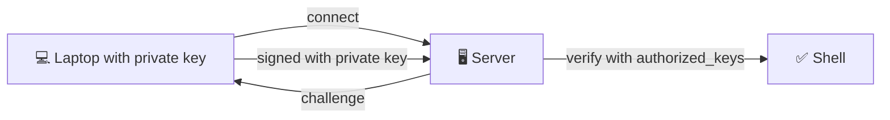

# 04 · SSH & Server Hardening

> [!info] Topic info
> **Subject:** Infrastructure · **Part:** Linux, Containers & Kubernetes · **Priority:** ⚡ Medium · **Status:** ✅ done · **Last reviewed:** 2026-11-19
>
> [← Back to Infrastructure](README.md) · [Interview questions →](questions/linux-containers-k8s-qa.md)

> [!abstract] In one line
> **SSH** gives encrypted remote access using **key pairs**; **hardening** means shrinking the attack surface — keys only, no root login, a **firewall**, updates, and least privilege.

---

## 1. The problem

You launch a VM with a public IP. Within **minutes**, bots start trying `root / 123456` on port 22 — thousands of attempts a day.

A password login is one lucky guess away from losing the box.

---

## 2. How SSH key auth works

You generate a **key pair**: the **private key** stays on your laptop, the **public key** goes into `~/.ssh/authorized_keys` on the server. The server sends a challenge only the private key can sign — the private key never leaves your machine.



```bash
ssh-keygen -t ed25519 -C "bharat@laptop"
ssh-copy-id deploy@203.0.113.10
ssh -i ~/.ssh/id_ed25519 deploy@203.0.113.10
```

Use `~/.ssh/config` for aliases, and **ProxyJump** to reach private servers through a **bastion** (a single hardened entry host).

---

## 3. Hardening checklist

In `/etc/ssh/sshd_config`:

```bash
PermitRootLogin no
PasswordAuthentication no
AllowUsers deploy
```

Then the rest:

- **Firewall:** allow only 22, 80, 443 (`ufw allow 443`), default deny. In the cloud, use **security groups** too.
- **Restrict SSH:** only from your office/VPN IP or a bastion; **fail2ban** bans IPs after repeated failures.
- **Updates:** `unattended-upgrades` for security patches.
- **Least privilege:** app runs as its own user; `sudo` only for admins.
- **Keys:** private key `chmod 600`; rotate and remove keys when people leave.
- **Better still:** no SSH at all — AWS SSM Session Manager or immutable servers you replace instead of patch.

> [!tip] 🎤 Say it like this
> "I'd disable password and root login, use key-based auth only, and allow SSH just from a bastion or VPN. A firewall exposes only 80 and 443 publicly, the OS auto-applies security patches, and the app runs as an unprivileged user."

> [!failure] Interview traps
> - Changing the SSH port and calling it security — it only cuts log noise.
> - Disabling password auth **before** confirming key login works — you lock yourself out.
> - Sharing one private key across the team — no audit trail, painful to revoke.
> - Leaving the DB port (5432, 27017) open to `0.0.0.0/0`.

---

## Summary

- SSH keys: private stays local, public goes in `authorized_keys`.
- No root, no passwords, firewall default-deny, bastion for private hosts.
- Patch automatically; run apps unprivileged.

> [!success] Key takeaway
> Expose as little as possible, require keys, and assume every public IP is being attacked right now.
