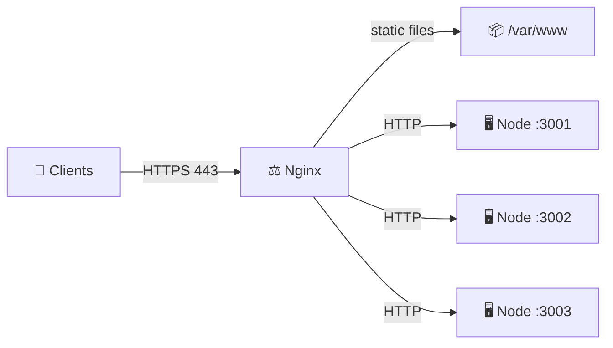

# 05 · Nginx

> [!info] Topic info
> **Subject:** Infrastructure · **Part:** Linux, Containers & Kubernetes · **Priority:** 🔥 High · **Status:** ✅ done · **Last reviewed:** 2026-11-19
>
> [← Back to Infrastructure](README.md) · [Interview questions →](questions/linux-containers-k8s-qa.md)

> [!abstract] In one line
> **Nginx** is a fast, event-driven web server most often used as a **reverse proxy** in front of app servers — it handles **TLS termination, load balancing, gzip, static files** and buffering so your app doesn't have to.

---

## 1. The problem

Your Node API listens on port 3000. Exposing it directly means Node must handle HTTPS certs, serve images, compress responses, and survive slow clients — and you can't run 3 copies behind one address.

Nginx sits in front and does all of that in one place. (Proxy vs reverse proxy is covered in [Proxy vs Reverse Proxy](../system-design/networking/06-proxy-vs-reverse-proxy.md).)

---

## 2. How it works



Nginx uses a few **worker processes** (usually one per core), each with an **event loop** handling thousands of connections — like Node, not one thread per request like old Apache. That's why one box can hold **10k+ concurrent connections** with little memory.

---

## 3. A typical config

```nginx
upstream api { least_conn; server 127.0.0.1:3001; server 127.0.0.1:3002; }

server {
  listen 443 ssl;
  server_name api.example.com;
  ssl_certificate     /etc/letsencrypt/live/api.example.com/fullchain.pem;
  ssl_certificate_key /etc/letsencrypt/live/api.example.com/privkey.pem;
  gzip on;

  location /static/ { root /var/www; expires 30d; }
  location / {
    proxy_pass http://api;
    proxy_set_header Host $host;
    proxy_set_header X-Forwarded-For $proxy_add_x_forwarded_for;
  }
}
```

| Feature | What it does |
|---|---|
| **TLS termination** | Nginx decrypts HTTPS; app gets plain HTTP on a private network |
| **Load balancing** | `upstream` block — round robin (default), `least_conn`, `ip_hash` |
| **Static files** | Served from disk by Nginx, never hits Node |
| **gzip** | Compresses JSON/HTML/CSS — often 70–80% smaller |
| **Buffering** | Absorbs slow clients so app workers are freed fast |
| **Extras** | Rate limiting (`limit_req`), caching, HTTP→HTTPS redirect, WebSocket upgrade |

```bash
sudo nginx -t                  # test config — always before reload
sudo systemctl reload nginx    # zero-downtime reload
```

> [!tip] 🎤 Say it like this
> "I put Nginx in front of the Node processes as a reverse proxy. It terminates TLS, serves static assets, gzips responses and load-balances across app instances with an upstream block. The app only sees plain HTTP, and I pass the real client IP through X-Forwarded-For."

> [!warning] Common 502 / 504
> - **502 Bad Gateway** — Nginx couldn't talk to the app (app down, wrong port).
> - **504 Gateway Timeout** — app was too slow; default `proxy_read_timeout` is 60 s.
> - WebSockets need `proxy_http_version 1.1` + `Upgrade` / `Connection` headers, or they fail.

> [!failure] Interview traps
> - Forgetting `X-Forwarded-For` / `Host` — app logs show Nginx's IP for every user.
> - Reloading without `nginx -t` and taking the site down with a typo.
> - Confusing Nginx's event model with "multi-threaded" — it's workers + event loops.
> - In Kubernetes, the same job is done by an **Ingress controller** (often Nginx-based) — see [Kubernetes Workloads](10-kubernetes-workloads.md).

---

## Summary

- Reverse proxy in front of app servers: one public entry point.
- TLS, gzip, static files, load balancing, buffering, rate limits.
- Event-driven workers → huge concurrency on little RAM.
- `nginx -t` then `reload` — zero downtime.

> [!success] Key takeaway
> Let Nginx handle the "web edge" jobs so your app code only does business logic.
