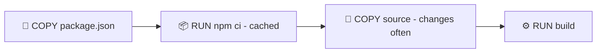

# 07 · Dockerfile Best Practices

> [!info] Topic info
> **Subject:** Infrastructure · **Part:** Linux, Containers & Kubernetes · **Priority:** 🔥 High · **Status:** ✅ done · **Last reviewed:** 2026-11-19
>
> [← Back to Infrastructure](README.md) · [Interview questions →](questions/linux-containers-k8s-qa.md)

> [!abstract] In one line
> A good Dockerfile gives **small, fast-building, secure** images: **multi-stage builds**, **slim base images**, **layer-cache-friendly ordering**, **.dockerignore**, **non-root user**, and **one process per container**.

---

## 1. The problem

Your first Dockerfile is `FROM node:20` + `COPY . .` + `npm install`. The image is **1.2 GB**, every code change reinstalls all packages (3 min builds), it runs as root, and it ships your `.env` and `.git`.

Each rule below fixes one of those.

---

## 2. A good Node.js Dockerfile

```dockerfile
# ---- build stage ----
FROM node:20-slim AS build
WORKDIR /app
COPY package*.json ./
RUN npm ci
COPY . .
RUN npm run build && npm prune --omit=dev

# ---- runtime stage ----
FROM node:20-slim
WORKDIR /app
ENV NODE_ENV=production
COPY --from=build --chown=node:node /app/dist ./dist
COPY --from=build --chown=node:node /app/node_modules ./node_modules
USER node
EXPOSE 3000
CMD ["node", "dist/server.js"]
```

---

## 3. The rules and why

| Rule | Why |
|---|---|
| **Multi-stage build** | Compilers, dev deps and source stay in the build stage; final image only has runtime files. 1.2 GB → ~200 MB |
| **Slim / alpine / distroless base** | Fewer MB, fewer packages → fewer CVEs. Alpine uses musl — test native modules |
| **Copy package.json first, then code** | Dependencies layer stays **cached** until package.json changes. Builds go from minutes to seconds |
| **.dockerignore** | Keep `node_modules`, `.git`, `.env`, logs out of the build context — faster, no leaked secrets |
| **Non-root USER** | A container escape as root is far worse than as `node` |
| **Pin versions** | `node:20.11-slim` or a digest, not `latest` — reproducible builds |
| **One process per container** | Separate API and worker containers; scale and restart them independently |
| **Exec-form CMD** | `CMD ["node", ...]` makes node PID 1 so it receives SIGTERM. Shell form wraps it in `sh`, which swallows signals |
| **Combine RUN + clean up** | `apt-get install ... && rm -rf /var/lib/apt/lists/*` in **one** layer, or the junk stays in an earlier layer |



Docker reuses a layer only if it **and every layer above it** is unchanged. So put things that change rarely first.

> [!tip] 🎤 Say it like this
> "I use a multi-stage build so the final image only has the compiled app and production deps on a slim base. I copy package.json and install before copying source so the dependency layer stays cached. A .dockerignore keeps secrets and node_modules out, and the container runs as a non-root user with exec-form CMD so it gets SIGTERM properly."

> [!failure] Interview traps
> - `COPY . .` before `npm ci` — every code change busts the dependency cache.
> - Secrets via `ARG` / `ENV` — they're visible in `docker history`. Inject at runtime or use BuildKit secrets.
> - `RUN rm` of a file in a later layer doesn't shrink the image — the earlier layer still has it.
> - Running `npm start` as CMD — npm may not forward SIGTERM; run `node` directly.

---

## Summary

- **Small:** multi-stage + slim base.
- **Fast:** order layers from least to most changing; `.dockerignore`.
- **Secure:** non-root, pinned versions, no secrets in layers.
- **Operable:** one process, exec-form CMD, logs to stdout.

> [!success] Key takeaway
> Order for the cache, split build from runtime, and ship only what production needs — as a non-root user.
