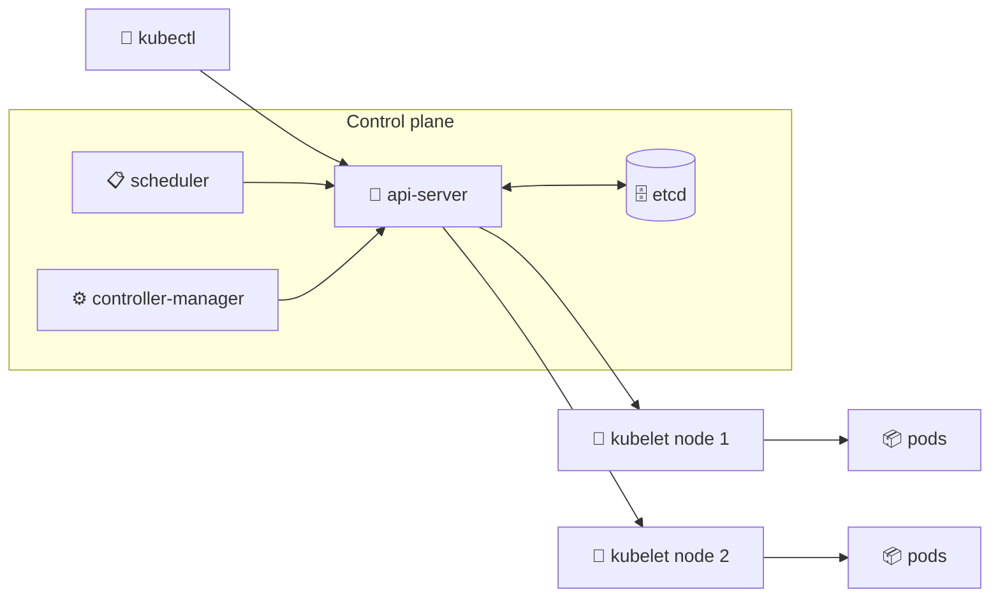

# 09 · Kubernetes Architecture

> [!info] Topic info
> **Subject:** Infrastructure · **Part:** Linux, Containers & Kubernetes · **Priority:** 🔥 High · **Status:** ✅ done · **Last reviewed:** 2026-11-19
>
> [← Back to Infrastructure](README.md) · [Interview questions →](questions/linux-containers-k8s-qa.md)

> [!abstract] In one line
> **Kubernetes (K8s)** runs containers across a cluster of machines: you declare the **desired state** in YAML, and the **control plane** (api-server, etcd, scheduler, controller-manager) keeps **worker nodes** (kubelet, kube-proxy) matching it — forever.

---

## 1. The problem

Compose runs your app on one server. Now you have **20 servers** and **60 containers**. Which server has room? Who restarts a container when a node dies at 3 a.m.? How do you roll out v2 without downtime?

Kubernetes is the **orchestrator** that answers all of these automatically.

---

## 2. The big idea: desired state + reconcile loops

You don't say "start 3 containers". You say "**there should be 3 replicas** of `api:1.4`" and save it to the cluster.

Controllers constantly compare **desired** vs **actual** and fix the difference. A node dies → 2 running ≠ 3 desired → a new pod is started elsewhere. This is called **reconciliation**, and it's why K8s is self-healing.

> [!example] Analogy
> A thermostat: you set 22°C, it keeps checking and heating/cooling. You never say "turn the heater on for 10 minutes".

---

## 3. The components

**Control plane** (the brain):

| Component | Job |
|---|---|
| **kube-apiserver** | The front door. Every read/write — kubectl, controllers, kubelets — goes through its REST API. Handles auth and validation |
| **etcd** | Distributed key-value store holding **all cluster state**. Uses Raft consensus; the only stateful piece — back it up |
| **kube-scheduler** | Picks a **node** for each new pod based on free CPU/memory, affinity, taints |
| **kube-controller-manager** | Runs the reconcile loops — Deployment, ReplicaSet, Node, Job controllers |

**Worker nodes** (the muscle):

| Component | Job |
|---|---|
| **kubelet** | Agent on every node. Watches the api-server for pods assigned to it, starts them via the runtime, runs probes, reports status |
| **kube-proxy** | Programs iptables/IPVS rules so a **Service** IP routes to the right pods |
| **Container runtime** | Actually runs containers — **containerd** or CRI-O (Docker images still work) |

---

## 4. What happens on `kubectl apply`

1. kubectl sends the Deployment to the **api-server** → stored in **etcd**.
2. Deployment controller creates a ReplicaSet → which creates 3 **Pod** objects (no node yet).
3. **Scheduler** sees unscheduled pods, picks nodes, writes the choice back.
4. **kubelet** on each chosen node sees its new pod, pulls the image, starts the container.
5. kube-proxy updates routing so the Service sends traffic to the new pods.

> [!tip] 🎤 Say it like this
> "Kubernetes is declarative: I store the desired state through the API server, it's persisted in etcd, and controllers keep reconciling actual state toward it. The scheduler places pods on nodes, and the kubelet on each node actually runs them and reports back. Nothing talks to etcd directly except the API server."

> [!note] Managed Kubernetes
> On **EKS / GKE / AKS** the cloud runs the control plane for you; you only manage worker nodes (or not even those, with Fargate / Autopilot).

> [!failure] Interview traps
> - Saying the scheduler **starts** pods — it only picks the node; the kubelet starts them.
> - Forgetting etcd is the single source of truth — lose it without backup and you lose the cluster's state.
> - Thinking K8s needs Docker — it uses containerd/CRI-O; Docker-built images run fine.
> - Components talking to each other directly — they all go through the api-server.

---

## Summary

- **Declarative desired state** + **reconcile loops** = self-healing.
- Control plane: **api-server** (front door), **etcd** (state), **scheduler** (placement), **controller-manager** (loops).
- Nodes: **kubelet** (runs pods), **kube-proxy** (service routing), **containerd** (runtime).

> [!success] Key takeaway
> You describe what you want; Kubernetes keeps making it true — that one idea explains every component.
