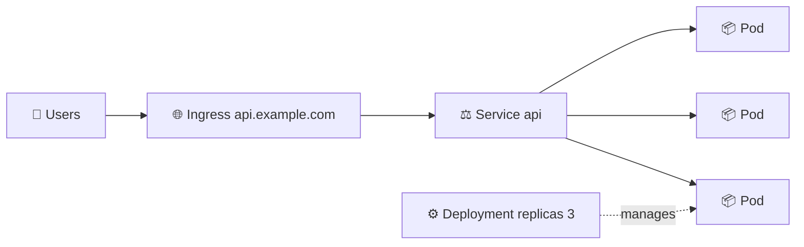

# 10 · Kubernetes Workloads

> [!info] Topic info
> **Subject:** Infrastructure · **Part:** Linux, Containers & Kubernetes · **Priority:** 🔥 High · **Status:** ✅ done · **Last reviewed:** 2026-11-19
>
> [← Back to Infrastructure](README.md) · [Interview questions →](questions/linux-containers-k8s-qa.md)

> [!abstract] In one line
> **Pods** run containers; **Deployments** keep N stateless replicas running and roll them out; **Services** give them a stable address; **Ingress** exposes HTTP routes; **StatefulSets, DaemonSets and Jobs** cover databases, per-node agents and one-off tasks.

---

## 1. The problem

Your API needs 3 replicas, a stable address other services can call, a public URL `api.example.com`, a nightly cleanup task, and a log agent on every node.

Each of those is a different Kubernetes object.

---

## 2. Pod → Deployment → Service → Ingress



- **Pod** — smallest unit: one (or a few tightly-coupled) containers sharing an IP and volumes. Pods are **disposable** — IP changes when recreated.
- **Deployment** — "keep 3 pods of `api:1.4`". Manages a **ReplicaSet** under the hood and does **rolling updates** and rollbacks.
- **Service** — stable virtual IP + DNS name (`api.default.svc.cluster.local`) that load-balances to pods matching a **label selector**.
- **Ingress** — HTTP(S) routing by host/path to Services, with TLS. Needs an **Ingress controller** (Nginx, Traefik, cloud LB).

```yaml
apiVersion: apps/v1
kind: Deployment
metadata: { name: api }
spec:
  replicas: 3
  selector: { matchLabels: { app: api } }
  template:
    metadata: { labels: { app: api } }
    spec:
      containers:
        - name: api
          image: myrepo/api:1.4.2
          ports: [{ containerPort: 3000 }]
```

---

## 3. Service types

| Type | Reachable from | Use |
|---|---|---|
| **ClusterIP** (default) | Inside the cluster only | Service-to-service calls |
| **NodePort** | `<any-node-IP>:30000–32767` | Quick testing, rarely prod |
| **LoadBalancer** | A cloud load balancer with public IP | Expose one service directly |
| **Headless** (`clusterIP: None`) | DNS returns pod IPs directly | StatefulSets, client-side LB |

---

## 4. Other workload types

| Object | For | Example |
|---|---|---|
| **StatefulSet** | Stateful apps needing **stable names + own disk** | Postgres, Kafka: `db-0`, `db-1`, each with its own PersistentVolume, started in order |
| **DaemonSet** | **One pod per node** | Log shipper (Fluent Bit), node metrics exporter |
| **Job** | Run to completion, retry on failure | DB migration, one-off import |
| **CronJob** | Job on a schedule | Nightly report at 02:00 |

> [!tip] 🎤 Say it like this
> "A Deployment runs stateless replicas and handles rolling updates. A Service gives those pods one stable DNS name and load-balances by label, and an Ingress routes external HTTP traffic to Services. For databases I'd use a StatefulSet for stable identity and per-pod storage, DaemonSets for per-node agents, and Jobs or CronJobs for batch work."

> [!warning] Rolling updates
> Deployments replace pods gradually, controlled by **maxSurge** (extra pods allowed) and **maxUnavailable** (pods allowed down). Without a **readiness probe**, traffic hits new pods before they're ready. `kubectl rollout undo deployment/api` rolls back. More in [Rolling Deployments](../system-design/deployment/03-rolling-deployments.md).

> [!failure] Interview traps
> - Calling pods directly by IP — they change; always go through a Service.
> - Running a database as a Deployment — pods share no stable identity or dedicated disk.
> - Creating bare Pods — nothing recreates them when they die.
> - Thinking Ingress works alone — it needs an Ingress controller installed.

---

## Summary

- **Pod** = unit, **Deployment** = stateless replicas + rollouts, **Service** = stable address, **Ingress** = HTTP entry.
- **StatefulSet** for identity + storage, **DaemonSet** per node, **Job/CronJob** for batch.
- Labels and selectors wire everything together.

> [!success] Key takeaway
> Deployments run it, Services find it, Ingress exposes it — pick StatefulSet / DaemonSet / Job only when the workload shape demands it.
