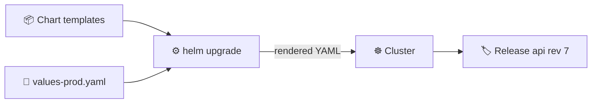

# 12 · Helm

> [!info] Topic info
> **Subject:** Infrastructure · **Part:** Linux, Containers & Kubernetes · **Priority:** 💤 Low · **Status:** ✅ done · **Last reviewed:** 2026-11-19
>
> [← Back to Infrastructure](README.md) · [Interview questions →](questions/linux-containers-k8s-qa.md)

> [!abstract] In one line
> **Helm** is the **package manager for Kubernetes**: a **chart** is a templated bundle of YAML, **values** fill in the blanks per environment, and each install is a versioned **release** you can upgrade or roll back.

---

## 1. The problem

One service needs a Deployment, Service, Ingress, ConfigMap, HPA — 5 YAML files. Staging and prod differ only in replicas, image tag and domain. Copy-pasting YAML per environment drifts fast.

And installing Postgres or Prometheus by hand means writing hundreds of lines yourself.

---

## 2. How it works



- **Chart** — folder with `Chart.yaml`, `templates/*.yaml` (Go templates), and default `values.yaml`.
- **Values** — per-environment settings: `replicaCount: 5`, `image.tag: 1.4.2`.
- **Release** — one installed copy of a chart, with a **revision history**.

```yaml
# templates/deployment.yaml (snippet)
replicas: {{ .Values.replicaCount }}
image: "{{ .Values.image.repo }}:{{ .Values.image.tag }}"
```

```bash
helm upgrade --install api ./chart -f values-prod.yaml --set image.tag=1.4.2
helm history api
helm rollback api 6
helm install pg oci://registry-1.docker.io/bitnamicharts/postgresql   # public chart
```

> [!tip] 🎤 Say it like this
> "Helm packages Kubernetes manifests as a chart with templates and default values. Each environment gets its own values file, and every install or upgrade becomes a numbered release revision, so rolling back is one command. We also use public charts for things like Postgres or Prometheus instead of writing manifests ourselves."

> [!note] Alternatives
> **Kustomize** (built into kubectl) patches plain YAML without templates. Many teams pair Helm or Kustomize with **GitOps** tools like Argo CD that sync the cluster from Git.

> [!failure] Interview traps
> - Putting real secrets in `values.yaml` committed to Git.
> - Thinking `helm rollback` also rolls back database migrations — it doesn't.

---

## Summary

- **Chart** = templates + defaults, **values** = per-env config, **release** = installed, versioned copy.
- `upgrade --install`, `history`, `rollback`.

> [!success] Key takeaway
> Helm turns many YAML files into one versioned, configurable package — same chart, different values per environment.
