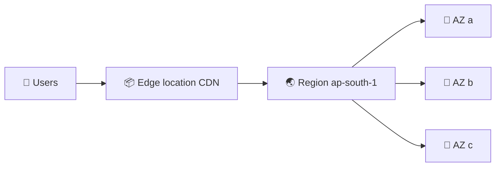

# 13 · Cloud Fundamentals

> [!info] Topic info
> **Subject:** Infrastructure · **Part:** Cloud & Operations · **Priority:** 🔥 High · **Status:** ✅ done · **Last reviewed:** 2026-11-19
>
> [← Back to Infrastructure](README.md) · [Interview questions →](questions/cloud-and-ops-qa.md)

> [!abstract] In one line
> The **cloud** is renting compute, storage and managed services **on demand** over the internet, paying **only for what you use**, instead of buying and running your own servers.

---

## 1. The problem

Your startup expects 10k users at launch. Buying servers means paying ₹20 lakh upfront, waiting 6 weeks for delivery, and guessing capacity.

Guess too low → site dies on launch day. Guess too high → expensive machines sit idle. The cloud lets you start with 2 small servers in 5 minutes and add 20 more when traffic arrives.

---

## 2. Service models — IaaS, PaaS, SaaS

The difference is **how much you manage** vs how much the provider manages.

| Model | You manage | Provider manages | Example |
|---|---|---|---|
| **On-premise** | Everything — building, power, hardware, OS, app | Nothing | Your own data center |
| **IaaS** (Infrastructure) | OS, runtime, app, data | Hardware, network, virtualization | AWS EC2, GCP Compute Engine |
| **PaaS** (Platform) | App code + data | OS, runtime, scaling, patching | Heroku, AWS Elastic Beanstalk, Google App Engine |
| **SaaS** (Software) | Just your usage / config | Everything | Gmail, Slack, Salesforce |

Serverless (AWS Lambda) and managed DBs (RDS) sit between IaaS and PaaS — you give code or config, they run it.

> [!example] Pizza analogy
> Home-made = on-prem · Buy frozen pizza and bake it = IaaS · Order delivery = PaaS · Eat at the restaurant = SaaS.

---

## 3. Regions and Availability Zones

- **Region** — a geographic area, e.g. `ap-south-1` (Mumbai), `us-east-1` (N. Virginia). Pick the one close to users and allowed by data laws.
- **Availability Zone (AZ)** — one or more separate data centers inside a region, with own power and network. Regions usually have 3+ AZs, a few ms apart.
- **Edge locations** — hundreds of small sites for CDN and DNS (CloudFront, Route 53).

> [!important] Golden rule
> Spread production across **at least 2 AZs**. One AZ going down (power, fire, network cut) is a real event; a whole region going down is rare but happens — that's what multi-region DR is for.

GCP and Azure use the same idea: regions + zones.

---

## 4. Shared responsibility model

The provider secures **the cloud** (data centers, hardware, hypervisor). You secure what you put **in the cloud** (IAM, data, OS patches on EC2, security groups, encryption settings).

The more managed the service, the less you own: on EC2 you patch the OS; on RDS AWS patches it; on S3 you only own access policies and data.

> [!warning] Most cloud breaches are on the customer side
> Public S3 buckets, leaked access keys, `0.0.0.0/0` open on port 22. AWS didn't get hacked — the config was wrong.

---

## 5. Pricing basics

- **Pay-as-you-go** — per second / hour of compute, per GB stored, per request.
- **CapEx → OpEx** — no big upfront purchase; a monthly bill instead.
- **Data transfer out** costs money (internet egress ~$0.09/GB on AWS); data in is free. Cross-AZ traffic is also charged — a classic surprise on the bill.
- Discounts for commitment (reserved / savings plans) and for spare capacity (spot) — see [22 · Autoscaling & Cost](22-autoscaling-and-cost.md).

> [!tip] 🎤 Say it like this
> "The cloud gives me on-demand infrastructure I pay for by usage, so I can scale up in minutes instead of buying hardware. I'd deploy across multiple Availability Zones in one region for high availability. Security is shared — AWS secures the hardware, but IAM, network rules, encryption and patching my own servers are on me."

**✅ Pros:** fast to start, elastic scaling, global reach, managed services remove ops work.
**❌ Cons:** bills can explode without monitoring, vendor lock-in, egress costs, less control over hardware.

> [!failure] Interview traps
> - Thinking an AZ = a region, or that "deploying in the cloud" makes you highly available by default. One EC2 in one AZ is still a single point of failure.
> - Saying the cloud provider is responsible for your data security.
> - Forgetting egress / cross-AZ data transfer costs.

---

## Summary

| Concept | One line |
|---|---|
| **IaaS / PaaS / SaaS** | How much of the stack you manage |
| **Region / AZ** | Geography / isolated data centers inside it |
| **Shared responsibility** | Provider secures the cloud, you secure what's in it |
| **Pay-as-you-go** | OpEx, elastic, but watch egress |

> [!success] Key takeaway
> Cloud = rent, don't buy. Use multiple AZs for availability, and remember that security config is your job.
