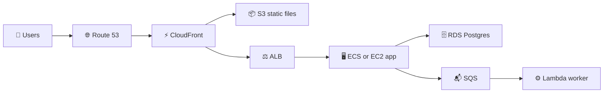

# 14 · AWS Core Services

> [!info] Topic info
> **Subject:** Infrastructure · **Part:** Cloud & Operations · **Priority:** 🔥 High · **Status:** ✅ done · **Last reviewed:** 2026-11-19
>
> [← Back to Infrastructure](README.md) · [Interview questions →](questions/cloud-and-ops-qa.md)

> [!abstract] In one line
> AWS has 200+ services, but a typical web app uses about **ten**: **EC2, S3, RDS, DynamoDB, Lambda, ELB, CloudFront, SQS/SNS, ECS/EKS and Route 53**.

---

## 1. The problem

An interviewer says "deploy this app on AWS". You need to pick the right building block for each job — compute, storage, database, queue, DNS — and know why.

---

## 2. The "use it for" cheat sheet

| Service | What it is | Use it for | GCP / Azure |
|---|---|---|---|
| **EC2** | Virtual machines | Full control over OS, long-running servers | Compute Engine / Virtual Machines |
| **S3** | Object storage | Files, images, backups, static sites, data lake | Cloud Storage / Blob Storage |
| **RDS / Aurora** | Managed SQL (Postgres, MySQL) | Relational data, transactions | Cloud SQL / Azure SQL |
| **DynamoDB** | Managed key-value NoSQL | Huge scale, simple access by key, single-digit ms | Firestore, Bigtable / Cosmos DB |
| **Lambda** | Serverless functions | Event-driven, spiky or small jobs | Cloud Functions / Azure Functions |
| **ELB (ALB/NLB)** | Load balancer | Spread traffic across instances | Cloud Load Balancing / Azure LB |
| **CloudFront** | CDN | Cache static assets near users | Cloud CDN / Azure Front Door |
| **SQS** | Message queue | Decouple services, background jobs | Pub/Sub / Service Bus |
| **SNS** | Pub/sub notifications | Fan-out one event to many subscribers | Pub/Sub / Event Grid |
| **ECS / EKS** | Container orchestration | Run Docker containers; EKS = managed Kubernetes | GKE / AKS |
| **Route 53** | DNS | Domains, health-checked failover, latency routing | Cloud DNS / Azure DNS |

---

## 3. A typical web app on AWS

---

## 4. Key interview points per service

**EC2** — pick an instance family (`t` burstable, `m` general, `c` compute, `r` memory). Put it in an **Auto Scaling Group** behind a load balancer; never rely on one instance.

**S3** — stores objects in buckets, 11 nines durability. Not a file system — no partial edits. Use **presigned URLs** so users upload directly without going through your server. Block public access by default. Storage classes (Standard → Infrequent Access → Glacier) cut cost for old data.

**RDS** — AWS handles backups, patching and failover. **Multi-AZ** = standby copy for failover (availability). **Read replicas** = extra copies for reads (scaling). Don't mix these up.

**DynamoDB** — design around access patterns: partition key (+ sort key). Great at scale, bad at ad-hoc queries and joins. See [SQL vs NoSQL](../system-design/databases/02-sql-vs-nosql.md).

**Lambda** — pay per invocation and ms. Max 15 min per run. **Cold starts** add latency (100 ms – 1 s+) after idle. Watch DB connections — 1,000 parallel Lambdas = 1,000 connections (use RDS Proxy).

**ELB** — **ALB** = layer 7 (HTTP, path/host routing, good for web apps). **NLB** = layer 4 (TCP/UDP, millions of req/s, static IP).

**SQS vs SNS** — SQS: one consumer group pulls messages (queue). SNS: pushes one message to many subscribers (fan-out). Common combo: **SNS → multiple SQS queues**. SQS standard = at-least-once, so consumers must be **idempotent**; FIFO queues keep order.

**ECS vs EKS** — ECS is simpler and AWS-only. EKS is Kubernetes — portable, more power, more complexity. **Fargate** runs either without managing servers.

> [!tip] 🎤 Say it like this
> "For a typical web app I'd put Route 53 and CloudFront in front, an ALB routing to containers on ECS Fargate across two AZs, and RDS Postgres with Multi-AZ for data. Static files and uploads go to S3 via presigned URLs. Slow work like emails goes through SQS to a worker, so the API stays fast."

> [!failure] Interview traps
> - Saying RDS read replicas give failover — that's **Multi-AZ**'s job (Aurora blurs this, but know the difference).
> - Using Lambda for long-running or always-busy workloads — it gets expensive and hits the 15 min limit.
> - Treating S3 like a database or a disk.
> - Forgetting SQS can deliver a message twice.

---

## Summary

- Compute: **EC2** (control) · **ECS/EKS** (containers) · **Lambda** (events).
- Data: **S3** (files) · **RDS** (SQL) · **DynamoDB** (key-value at scale).
- Traffic: **Route 53** → **CloudFront** → **ALB**.
- Async: **SQS** (queue) · **SNS** (fan-out).

> [!success] Key takeaway
> Know one line of "use it for" per service and one gotcha each — that's what interviewers probe.
