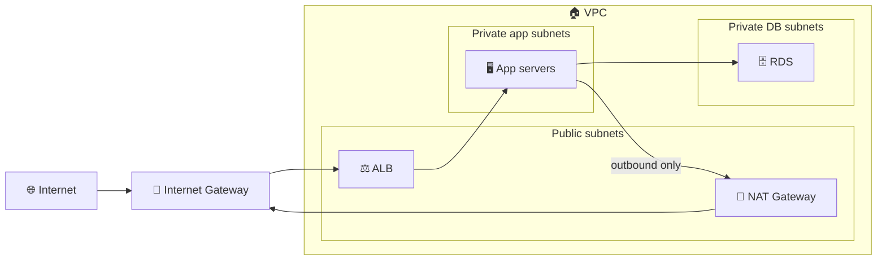

# 15 · VPC Networking

> [!info] Topic info
> **Subject:** Infrastructure · **Part:** Cloud & Operations · **Priority:** 🔥 High · **Status:** ✅ done · **Last reviewed:** 2026-11-19
>
> [← Back to Infrastructure](README.md) · [Interview questions →](questions/cloud-and-ops-qa.md)

> [!abstract] In one line
> A **VPC** (Virtual Private Cloud) is your own private network in the cloud, split into **public and private subnets**, with **route tables, gateways, security groups and NACLs** controlling what can talk to what.

---

## 1. The problem

You launch an app server and a Postgres DB. If both get public IPs, anyone on the internet can try to log into your database.

We want: the load balancer reachable from the internet, the app servers hidden, the DB reachable **only** from the app.

---

## 2. The building blocks

- **VPC** — a private IP range, e.g. `10.0.0.0/16` (65k addresses), inside one region.
- **Subnet** — a slice of the VPC in **one AZ**, e.g. `10.0.1.0/24` (256 addresses).
- **Route table** — rules saying where traffic for an IP range goes.
- **Internet Gateway (IGW)** — the VPC's door to the internet (both ways).
- **NAT Gateway** — lets private servers make **outbound** calls (download packages, call Stripe) without being reachable from outside.

> [!important] What makes a subnet "public"
> Only one thing: its route table has `0.0.0.0/0 → Internet Gateway`. A private subnet routes `0.0.0.0/0 → NAT Gateway` (or nowhere).

---

## 3. Typical 3-tier VPC

Each tier has a subnet in **2–3 AZs**. Only the ALB and NAT live in public subnets. Admin access goes via a **bastion host** or, better, **SSM Session Manager** (no open SSH port).

---

## 4. Security groups vs NACLs

| | **Security Group** | **NACL** (Network ACL) |
|---|---|---|
| **Attached to** | Instance / ENI (network card) | Subnet |
| **State** | **Stateful** — reply traffic auto-allowed | **Stateless** — must allow both directions |
| **Rules** | Allow only | Allow **and deny** |
| **Evaluation** | All rules together | In number order, first match wins |
| **Typical use** | Main firewall for every resource | Extra subnet-wide guardrail, block a bad IP range |

Best trick: reference **security groups by ID**. DB SG allows port 5432 only **from the app SG** — no IP lists to maintain when servers scale.

> [!tip] 🎤 Say it like this
> "I'd build a VPC with public subnets for the load balancer and NAT gateway, and private subnets for app servers and the database, spread over at least two AZs. Security groups chain the tiers: the ALB accepts 443 from the internet, the app accepts traffic only from the ALB's group, and the DB only from the app's group. Private servers reach the internet outbound through the NAT."

---

## 5. Connecting VPCs and services

- **VPC peering** — connect two VPCs privately (not transitive).
- **Transit Gateway** — hub connecting many VPCs and on-prem networks.
- **VPC endpoints** — reach S3/DynamoDB/other AWS APIs privately without going through NAT (saves NAT data charges).
- **Site-to-site VPN / Direct Connect** — link to your office or data center.

> [!failure] Interview traps
> - Putting the database in a public subnet "with a strong password".
> - Thinking NAT allows inbound traffic — it's outbound only.
> - Forgetting NACLs are stateless — you allowed port 443 in but blocked the ephemeral reply ports (1024–65535) out.
> - One NAT Gateway in one AZ = single point of failure and cross-AZ charges; use one per AZ in production.

---

## Summary

- VPC → subnets per AZ → route tables decide public vs private.
- **IGW** = two-way internet; **NAT** = outbound only for private subnets.
- **Security groups** (stateful, per instance) do most of the work; **NACLs** (stateless, per subnet) are a backup layer.

> [!success] Key takeaway
> Only the load balancer faces the internet. Everything else sits in private subnets, and tiers trust each other by security group, not by IP.
