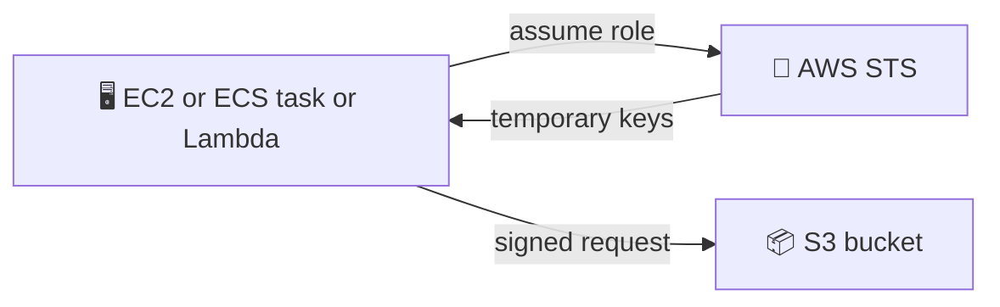

# 16 · IAM (Identity & Access Management)

> [!info] Topic info
> **Subject:** Infrastructure · **Part:** Cloud & Operations · **Priority:** 🔥 High · **Status:** ✅ done · **Last reviewed:** 2026-11-19
>
> [← Back to Infrastructure](README.md) · [Interview questions →](questions/cloud-and-ops-qa.md)

> [!abstract] In one line
> **IAM** decides **who** (users, roles) can do **what** (actions) on **which resources**, using JSON **policies** — and the rule is always **least privilege**.

---

## 1. The problem

A developer puts AWS admin keys in a `.env` file and pushes it to GitHub. Within minutes, bots find the keys and spin up 200 crypto-mining servers. Bill: $50k.

IAM exists so every person and service gets **only the access it needs**, ideally with **temporary** credentials.

---

## 2. The building blocks

- **Root user** — the account owner. Turn on MFA, lock it away, never use it daily.
- **IAM user** — a person or app with **long-term** credentials (password / access keys).
- **Group** — a set of users sharing policies (e.g. `developers`).
- **Role** — an identity with **no permanent credentials**. Someone or something *assumes* it and gets **temporary keys** (valid 15 min – 12 h).
- **Policy** — a JSON document listing allowed / denied actions.

```json
{
  "Effect": "Allow",
  "Action": ["s3:GetObject", "s3:PutObject"],
  "Resource": "arn:aws:s3:::user-uploads/*"
}
```

This lets the app read and write only in one bucket — not delete, not other buckets.

---

## 3. How a request is evaluated

1. Everything is **denied by default**.
2. An explicit **Allow** in any attached policy grants access.
3. An explicit **Deny** anywhere **always wins** over any Allow.

Policies can sit on identities (users/roles) or on resources (S3 bucket policy, SQS queue policy). In multi-account setups, **SCPs** (Service Control Policies) in AWS Organizations set the outer limit for whole accounts.

---

## 4. Roles over access keys



- **EC2 / ECS / Lambda** — attach a role; the SDK picks up temporary keys automatically. No keys in code or env vars.
- **CI/CD** (GitHub Actions) — use **OIDC federation**: GitHub proves its identity, AWS hands back a short-lived role session.
- **Humans** — log in via **SSO** (IAM Identity Center) and assume roles per account.
- **Cross-account** — role in account B trusts account A.

> [!tip] 🎤 Say it like this
> "I follow least privilege: every service gets its own IAM role with only the actions and resources it needs. I avoid long-lived access keys — EC2, ECS and Lambda get roles with temporary credentials, CI uses OIDC, and humans use SSO with MFA. Explicit deny always beats allow, which is useful for guardrails."

> [!failure] Interview traps
> - Using `"Action": "*"`, `"Resource": "*"` because "it's easier for now" — it never gets fixed later.
> - Hard-coding access keys in code, Docker images or env files. Store secrets properly — see [Secrets management](../system-design/security/03-secrets-management.md).
> - Confusing IAM (AWS access) with your app's own user auth — see [Authentication vs Authorization](../system-design/api-fundamentals/09-authentication-vs-authorization.md).
> - Using the root user for daily work.

---

## Summary

| Piece | Role |
|---|---|
| **User** | Long-term identity — keep for humans only, ideally via SSO |
| **Role** | Temporary credentials for services, CI, cross-account |
| **Policy** | JSON allow / deny on actions + resources |
| **Evaluation** | Default deny → Allow grants → explicit Deny wins |

> [!success] Key takeaway
> Least privilege + roles with temporary credentials. If a key is leaked, it should be useless in an hour and limited to one bucket.
