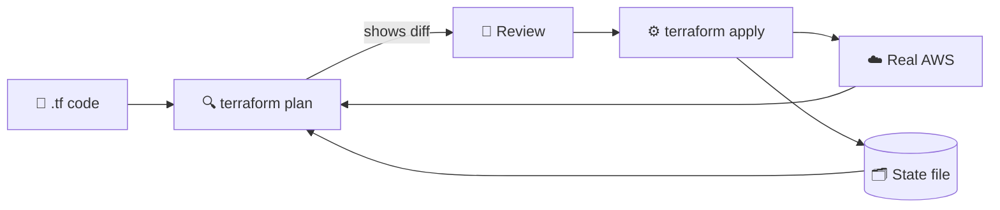

# 17 · Terraform (Infrastructure as Code)

> [!info] Topic info
> **Subject:** Infrastructure · **Part:** Cloud & Operations · **Priority:** 🔥 High · **Status:** ✅ done · **Last reviewed:** 2026-11-19
>
> [← Back to Infrastructure](README.md) · [Interview questions →](questions/cloud-and-ops-qa.md)

> [!abstract] In one line
> **Terraform** lets you describe cloud infrastructure in **declarative code**, then **plan** and **apply** changes, tracking what exists in a **state file**.

---

## 1. The problem

Your production VPC, 3 subnets, ALB, RDS and 15 security groups were all created by clicking in the AWS console. Now you need an identical staging environment.

Nobody remembers every setting. Someone changed a rule last month and didn't tell anyone. **Infrastructure as Code (IaC)** fixes this: infra lives in Git, is reviewed in PRs, and can be recreated in minutes.

---

## 2. How it works

You write **what you want** (declarative), not the steps. Terraform compares it to reality and works out the difference.

```hcl
resource "aws_s3_bucket" "uploads" {
  bucket = "myapp-prod-uploads"
  tags   = { env = "prod" }
}
```



- `terraform init` — download **providers** (plugins for AWS, GCP, Cloudflare…).
- `terraform plan` — show what will be created / changed / **destroyed**. Always read it.
- `terraform apply` — make the changes and update state.
- `terraform destroy` — delete everything in this config.

---

## 3. State — the most asked part

The **state file** (`terraform.tfstate`) maps your code to real resource IDs (`aws_s3_bucket.uploads` → `myapp-prod-uploads`). Without it, Terraform can't know what it already created.

- **Remote state** — store it in S3 (or Terraform Cloud / GCS), not on a laptop, so the whole team shares one truth.
- **Locking** — while one person runs `apply`, others are blocked (S3 native lock file or a DynamoDB table). Prevents two applies corrupting state.
- State can contain **secrets** (DB passwords) — encrypt the bucket and limit access.
- Split state per environment / component (`prod/network`, `prod/app`) so one mistake can't touch everything.

> [!tip] 🎤 Say it like this
> "Terraform is declarative IaC: I describe the infra, `plan` shows the diff against the state file, and `apply` makes it real. I keep state remote in S3 with locking so the team can't run conflicting applies, and I split it per environment. Changes go through PRs with the plan output posted for review."

---

## 4. Modules, environments and drift

- **Modules** — reusable blocks, like functions. One `vpc` module used by dev, staging and prod with different inputs (`cidr`, `az_count`).
- **Variables / outputs** — inputs to a config and values it exposes (e.g. VPC ID for another stack).
- **Environments** — usually separate folders or workspaces per env, each with its own state.
- **Drift** — someone changed infra by hand in the console. `terraform plan` shows it; you either revert it with `apply` or update the code. Prevent it by removing console write access in prod.

**Terraform vs others:** CloudFormation (AWS-only, managed by AWS), Pulumi (IaC in TypeScript/Python), OpenTofu (open-source Terraform fork). Ansible configures *inside* servers — see [18 · Ansible](18-ansible.md).

> [!failure] Interview traps
> - Committing `terraform.tfstate` to Git — secrets leak and merges break.
> - Running `apply` without reading the plan — a renamed resource can mean **destroy + recreate** a production DB. Use `prevent_destroy` on critical resources.
> - Editing infra in the console after adopting Terraform (drift).
> - Calling Terraform "imperative" — it's declarative.

---

## Summary

| Concept | One line |
|---|---|
| **plan / apply** | Preview the diff, then make it real |
| **State** | Maps code to real resources — remote + locked + encrypted |
| **Modules** | Reusable infra blocks across environments |
| **Drift** | Reality differs from code — detect with plan |

> [!success] Key takeaway
> Infra in Git, changes through PRs, state remote and locked, and never apply a plan you haven't read.
