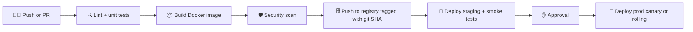

# 19 · CI/CD Pipelines

> [!info] Topic info
> **Subject:** Infrastructure · **Part:** Cloud & Operations · **Priority:** 🔥 High · **Status:** ✅ done · **Last reviewed:** 2026-11-19
>
> [← Back to Infrastructure](README.md) · [Interview questions →](questions/cloud-and-ops-qa.md)

> [!abstract] In one line
> A **CI/CD pipeline** automatically **tests, builds and deploys** every change: **CI** checks the code on every push, **CD** ships the tested artifact to environments with little or no manual work.

---

## 1. The problem

A team of 8 merges code all week, then one person deploys on Friday by SSH-ing in and running `git pull`. Tests were "run locally". Something breaks and no one knows which of 40 commits did it.

The concepts (CI vs continuous delivery vs deployment) are in [System Design · CI/CD](../system-design/deployment/02-ci-cd.md). This note is the **practical pipeline**.

---

## 2. A practical pipeline



- **On PR:** lint, type check, unit tests, build — must pass before merge.
- **On merge to main:** build the image **once**, tag it with the commit SHA, push to ECR / GHCR.
- **Promote the same image** to staging, then prod. Never rebuild per environment.
- **Deploy** with a safe strategy — [rolling](../system-design/deployment/03-rolling-deployments.md), [blue-green](../system-design/deployment/04-blue-green.md) or [canary](../system-design/deployment/05-canary-releases.md) — and auto-rollback on bad health checks.

---

## 3. GitHub Actions example

```yaml
name: ci
on: { push: { branches: [main] }, pull_request: {} }
permissions: { id-token: write, contents: read }
jobs:
  test-build:
    runs-on: ubuntu-latest
    steps:
      - uses: actions/checkout@v4
      - uses: actions/setup-node@v4
        with: { node-version: 22, cache: npm }
      - run: npm ci && npm test
      - run: docker build -t myapp:${{ github.sha }} .
```

A deploy job would then log in to AWS via **OIDC** (`id-token: write` — no stored keys, see [16 · IAM](16-iam.md)), push the image and update the ECS service or Helm release.

---

## 4. What makes a pipeline good

- **Fast** — under ~10 min for PR checks. Cache dependencies, run jobs in parallel.
- **Reliable** — flaky tests get fixed or quarantined, not retried forever.
- **Secure** — secrets in the CI secret store or OIDC, pinned action versions, image scanning (Trivy), dependency audit.
- **Traceable** — every prod deploy maps to a commit SHA, so you can roll back by redeploying the previous tag.
- **Migrations** — run DB migrations as a separate, backward-compatible step — see [schema migrations](../system-design/deployment/08-schema-migrations.md).

> [!tip] 🎤 Say it like this
> "Every PR runs lint and tests. On merge, the pipeline builds one Docker image tagged with the commit SHA, scans it, pushes it to the registry and deploys it to staging with smoke tests. The same image is promoted to prod with a rolling or canary deploy, and rollback is just redeploying the previous tag. CI authenticates to AWS with OIDC, so no long-lived keys."

> [!failure] Interview traps
> - Rebuilding the image for each environment — prod then runs something staging never tested.
> - Using the `latest` tag — you can't tell what's running or roll back cleanly.
> - Storing AWS keys as plain CI variables when OIDC is available.
> - No automatic rollback / health check after deploy.

---

## Summary

| Stage | Purpose |
|---|---|
| **PR checks** | Catch bugs before merge |
| **Build once** | One immutable image per commit |
| **Staging + smoke** | Prove it works in a prod-like env |
| **Prod deploy** | Safe rollout + auto rollback |

> [!success] Key takeaway
> Build once, tag with the SHA, promote the same artifact, and make rollback a one-click redeploy.
