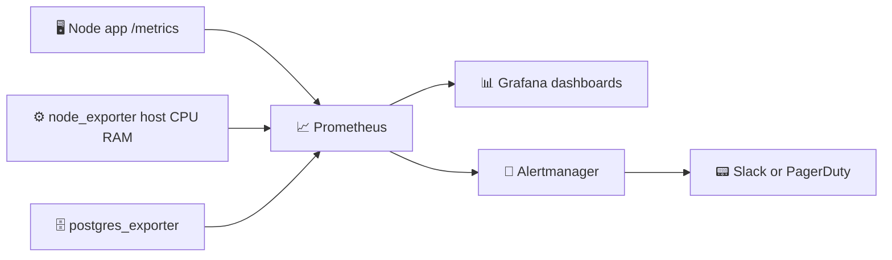

# 20 · Prometheus & Grafana

> [!info] Topic info
> **Subject:** Infrastructure · **Part:** Cloud & Operations · **Priority:** ⚡ Medium · **Status:** ✅ done · **Last reviewed:** 2026-11-19
>
> [← Back to Infrastructure](README.md) · [Interview questions →](questions/cloud-and-ops-qa.md)

> [!abstract] In one line
> **Prometheus** **pulls (scrapes)** numeric metrics from your services every few seconds and stores them as **time series**; **Grafana** turns them into **dashboards**, and **Alertmanager** sends alerts.

---

## 1. The problem

Users say "the app feels slow". Without metrics you can't tell whether it's CPU, the DB, or one endpoint — and you only hear about it from users.

What metrics are and which ones to track (RED, USE, golden signals) is covered in [System Design · Metrics](../system-design/observability/04-metrics.md). This note is the **practical setup**.

---

## 2. How it works



- **Pull model** — each service exposes `GET /metrics` (plain text); Prometheus scrapes it every 15 s.
- **Exporters** — sidecar programs that expose metrics for things you don't own (Linux host, Postgres, Redis, Nginx).
- **Service discovery** — in Kubernetes, Prometheus finds pods automatically via labels.
- **Pushgateway** — only for short batch jobs that die before being scraped.

---

## 3. Metric types and PromQL

| Type | Meaning | Example |
|---|---|---|
| **Counter** | Only goes up | `http_requests_total` |
| **Gauge** | Up and down | `memory_used_bytes`, queue length |
| **Histogram** | Values in buckets → percentiles | `http_request_duration_seconds` |

Labels add dimensions: `http_requests_total{route="/login", status="500"}`.

```promql
# requests per second over last 5 min
sum(rate(http_requests_total[5m]))
# p95 latency
histogram_quantile(0.95, sum(rate(http_request_duration_seconds_bucket[5m])) by (le))
```

In Node.js, the `prom-client` package exposes these.

---

## 4. Alerts

Alert rules live in Prometheus; **Alertmanager** groups, dedupes and routes them. Alert on **symptoms users feel** (error rate > 2% for 5 min, p95 > 1 s), not on every CPU spike. See [Alerts & monitoring](../system-design/observability/06-alerts-and-monitoring.md).

> [!tip] 🎤 Say it like this
> "Prometheus scrapes a /metrics endpoint on each service and on exporters like node_exporter, and stores time series with labels. I build Grafana dashboards around rate, errors and p95 latency using PromQL, and Alertmanager routes symptom-based alerts to Slack or PagerDuty."

> [!warning] High cardinality kills Prometheus
> Every unique label combination is a new time series. A `user_id` or full URL label with 1M values = 1M series → memory blow-up. Use bounded labels like route template and status code.

> [!failure] Interview traps
> - Averaging latency instead of using percentiles from histograms.
> - Using `rate()` on a gauge, or reading a raw counter value as "requests per second".
> - Prometheus is not for long-term storage at scale — add Thanos / Mimir or a managed service (Amazon Managed Prometheus, Grafana Cloud).

---

## Summary

- Prometheus = pull-based time-series DB + PromQL; Grafana = dashboards; Alertmanager = routing.
- Counter / gauge / histogram; percentiles from histograms.
- Keep labels low-cardinality.

> [!success] Key takeaway
> Expose /metrics, scrape it, dashboard the RED metrics, alert on user-facing symptoms.
