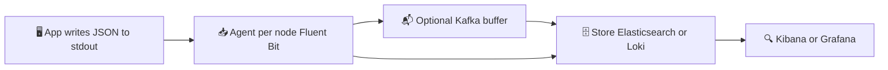

# 21 · Logging Stack

> [!info] Topic info
> **Subject:** Infrastructure · **Part:** Cloud & Operations · **Priority:** ⚡ Medium · **Status:** ✅ done · **Last reviewed:** 2026-11-19
>
> [← Back to Infrastructure](README.md) · [Interview questions →](questions/cloud-and-ops-qa.md)

> [!abstract] In one line
> A **logging stack** **collects** logs from every server and container, **ships** them to one central store, and lets you **search** them — e.g. **ELK / EFK**, **Loki + Grafana**, or **CloudWatch Logs**.

---

## 1. The problem

You have 40 containers across 10 nodes. A user reports a failed payment at 14:32. SSH-ing into each node and running `grep` is hopeless — and the pod that failed has already been replaced, taking its logs with it.

What to log and structured logging are covered in [System Design · Logging](../system-design/observability/02-logging.md) and [Log aggregation](../system-design/observability/03-log-aggregation.md). This note is the **practical setup**.

---

## 2. How it works

1. **App** logs **JSON to stdout** — don't write files inside containers. Include `timestamp`, `level`, `message`, `requestId`, `userId`.
2. **Agent** (Fluent Bit, Fluentd, Vector, Promtail) runs once per node (a Kubernetes **DaemonSet**), tails container logs, adds metadata like pod and namespace.
3. **Store** indexes them; **UI** lets you search `requestId="abc123"` across every service.

---

## 3. Common stacks

| Stack | How it stores | Good for | Watch out |
|---|---|---|---|
| **ELK / EFK** (Elasticsearch + Logstash/Fluentd + Kibana) | Full-text indexes every field | Powerful search and analytics | Heavy and costly to run at TB/day |
| **Loki + Grafana** | Indexes only labels, compresses log text | Cheap, pairs with Prometheus | Slower for free-text searches |
| **CloudWatch Logs** (AWS) | Managed | Zero ops on AWS | Query cost, weaker UI |
| **SaaS** (Datadog, New Relic) | Managed | Fast to adopt | Expensive per GB |

GCP: Cloud Logging · Azure: Monitor Logs.

---

## 4. Operating it

- **Correlation ID** — generate a `requestId` at the edge and pass it through every service, so one search shows the full journey. Tracing takes this further — see [Distributed tracing](../system-design/observability/05-distributed-tracing.md).
- **Retention** — e.g. 7–14 days hot (searchable), then archive to S3 for 1 year (compliance). Logs are often the biggest observability bill.
- **Levels** — `info` in prod, `debug` only when needed; sample very noisy success logs.
- **Never log** passwords, tokens, card numbers or full PII — mask them in the app or agent.

> [!tip] 🎤 Say it like this
> "Apps log structured JSON to stdout with a request ID. A Fluent Bit DaemonSet on each node ships logs to a central store — Elasticsearch if we need rich search, Loki if we want cheap storage alongside Grafana. We keep a short hot retention, archive the rest to S3, and mask sensitive fields."

> [!failure] Interview traps
> - Writing logs to files inside containers — lost when the container dies.
> - Plain text logs that can't be filtered by field.
> - Logging secrets or PII.
> - No retention policy → storage bill grows forever.

---

## Summary

- **stdout JSON → node agent → central store → search UI.**
- ELK for search power, Loki for cost, CloudWatch for zero ops.
- Request IDs, retention limits and masking are what make it usable and safe.

> [!success] Key takeaway
> Logs must leave the machine immediately, in structured form, with a request ID — otherwise they're useless when you need them most.
