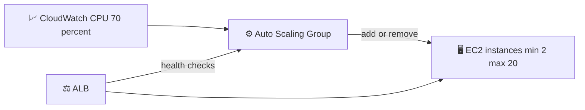

# 22 · Autoscaling & Cost Optimization

> [!info] Topic info
> **Subject:** Infrastructure · **Part:** Cloud & Operations · **Priority:** ⚡ Medium · **Status:** ✅ done · **Last reviewed:** 2026-11-19
>
> [← Back to Infrastructure](README.md) · [Interview questions →](questions/cloud-and-ops-qa.md)

> [!abstract] In one line
> **Autoscaling** adds and removes servers automatically to match load, and **cost optimization** means paying the right price for them — **rightsizing**, **reserved / savings plans** for the baseline and **spot** for flexible work.

---

## 1. The problem

Traffic is 500 req/s at night and 5,000 req/s at 8 pm. If you run 20 servers all day for the peak, ~70% of the bill is idle machines. If you run 4, the evening crashes.

---

## 2. Auto Scaling Groups (ASG)

An **ASG** keeps a group of EC2 instances between **min** and **max**, built from a **launch template** (AMI, instance type, user data).

Scaling policies:
- **Target tracking** ⭐ — "keep average CPU at 60%" (or requests per target). Easiest and best default.
- **Step scaling** — add 2 if CPU > 70%, add 5 if > 90%.
- **Scheduled** — scale to 15 every weekday at 7:45 pm before the known peak.
- **Predictive** — learns daily patterns and scales ahead.

The ASG also **replaces unhealthy instances** — self-healing, not just scaling. Kubernetes has the same ideas: HPA for pods, Cluster Autoscaler / Karpenter for nodes — see [11 · Kubernetes config & scaling](11-kubernetes-config-and-scaling.md).

> [!warning] Scaling isn't instant
> A new instance takes 1–5 min to boot and pass health checks. Keep some headroom, bake images (AMI / Docker) so boot is fast, and use **cooldowns** so it doesn't flap up and down. Scaling app servers also won't help if the **database** is the bottleneck.

---

## 3. Pricing options

| Option | Discount vs on-demand | Catch | Use for |
|---|---|---|---|
| **On-demand** | 0% | Most expensive | Spiky, unknown, short-term |
| **Reserved / Savings Plans** | ~30–70% | 1 or 3 year commitment | Steady baseline (always-on servers, DBs) |
| **Spot** | ~60–90% | Can be taken back with **2 min** warning | Batch jobs, CI runners, stateless workers |

Common mix: **baseline on savings plans + peaks on on-demand + workers on spot**. GCP calls them committed use discounts and Spot VMs; Azure has reservations and Spot VMs.

---

## 4. Cost checklist

- **Rightsize** — a server at 8% CPU should be a smaller type. Graviton (ARM) instances are ~20% cheaper.
- **Turn off** dev/staging at night and weekends (~65% saving on those).
- **Storage** — S3 lifecycle rules to Infrequent Access / Glacier; delete old EBS snapshots and unattached volumes.
- **Data transfer** — use CloudFront, VPC endpoints instead of NAT for S3, keep chatty services in one AZ where safe.
- **Visibility** — tag every resource (`team`, `env`), set **budgets and alerts** in AWS Budgets / Cost Explorer.

> [!tip] 🎤 Say it like this
> "I'd put the app in an Auto Scaling Group behind an ALB with target tracking on CPU or requests per target, min 2 across AZs. For cost I'd cover the steady baseline with savings plans, use spot for stateless workers and CI, rightsize from real metrics, and tag everything with budget alerts so surprises show up in days, not at month end."

> [!failure] Interview traps
> - Running stateful things (a DB, in-memory sessions) on spot instances.
> - Min size 1 — no redundancy and no headroom.
> - Buying 3-year reservations before you know your steady usage.
> - Scaling on CPU when the real bottleneck is DB connections or queue depth — scale workers on **queue length** instead.

---

## Summary

- **ASG** = min/max + launch template + scaling policy + self-healing.
- **Target tracking** is the default policy.
- **Savings plans** for baseline, **on-demand** for peaks, **spot** for interruptible work.
- Rightsize, schedule non-prod, tag and budget.

> [!success] Key takeaway
> Scale on the metric that really limits you, and pay for each workload with the cheapest pricing model it can tolerate.
