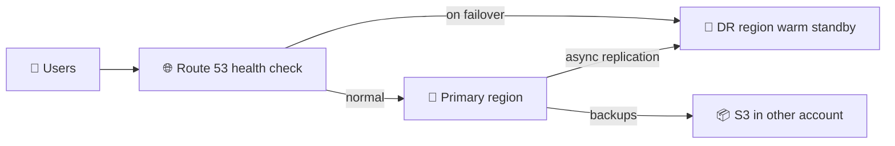

# 23 · Backups & Disaster Recovery

> [!info] Topic info
> **Subject:** Infrastructure · **Part:** Cloud & Operations · **Priority:** ⚡ Medium · **Status:** ✅ done · **Last reviewed:** 2026-11-19
>
> [← Back to Infrastructure](README.md) · [Interview questions →](questions/cloud-and-ops-qa.md)

> [!abstract] In one line
> **Disaster recovery (DR)** is your plan to get back up after a big failure, measured by **RPO** (how much data you can lose) and **RTO** (how long you can be down), and built on **tested backups** plus a **standby strategy**.

---

## 1. The problem

A bad migration runs `DELETE` without a `WHERE` on the orders table at 3 pm. Or the whole `us-east-1` region has an outage. Or ransomware encrypts your DB.

Replication won't save you from the first one — it copies the delete to every replica in milliseconds. You need **backups**, and a plan.

---

## 2. RPO and RTO

- **RPO (Recovery Point Objective)** — max data loss, in time. RPO 5 min = you may lose the last 5 minutes of writes.
- **RTO (Recovery Time Objective)** — max downtime. RTO 1 h = service must be back within an hour.

Lower RPO/RTO = more cost. A blog can live with RPO 24 h; a payments system wants RPO ≈ 0. More on availability numbers in [Availability](../system-design/core-concepts/02-availability.md).

---

## 3. Backup strategies

- **Full / incremental snapshots** — e.g. RDS automated daily snapshots, EBS snapshots.
- **Point-in-time recovery (PITR)** — snapshot + transaction logs (WAL), restore to any second in the retention window. Fixes the 3 pm `DELETE`: restore to 2:59 pm.
- **3-2-1 rule** — **3** copies, **2** different storage types, **1** off-site (another region / account).
- **Immutable backups** — S3 Object Lock / AWS Backup Vault Lock in a **separate account**, so an attacker with prod access can't delete them.

> [!important] A backup you haven't restored is not a backup
> Schedule regular restore tests (e.g. monthly restore to a scratch DB and run checks). Measure how long it takes — that's your real RTO.

---

## 4. DR strategies (cheapest → fastest)

| Strategy | What runs in the DR region | RTO | RPO | Cost |
|---|---|---|---|---|
| **Backup & restore** | Nothing — just backups copied there | Hours | Hours | 💲 |
| **Pilot light** | Core data replicated (DB replica), servers off | 10s of min | Minutes | 💲💲 |
| **Warm standby** | Small but full copy running, scale up on failover | Minutes | Seconds–min | 💲💲💲 |
| **Multi-site active-active** | Full copies serving traffic in both regions | ~0 | ~0 | 💲💲💲💲 |

Failover is usually DNS-based (Route 53 health checks) plus promoting the DR database replica.

> [!tip] 🎤 Say it like this
> "I start from the business RPO and RTO. Every system gets automated backups with point-in-time recovery, copied to another region and an isolated account, and we test restores regularly. Then I pick the DR tier the RTO justifies — pilot light or warm standby for most apps, active-active only when downtime is extremely costly."

> [!failure] Interview traps
> - "We have replicas, so we don't need backups" — replicas copy mistakes and deletions instantly.
> - Never testing restores.
> - Backups in the same account and region as prod.
> - Mixing up RPO (data) and RTO (time).

---

## Summary

- **RPO** = data you can lose · **RTO** = time you can be down.
- Backups: snapshots + PITR, 3-2-1, immutable, tested.
- DR tiers: backup-restore → pilot light → warm standby → active-active.

> [!success] Key takeaway
> Pick the DR level from the business's RPO/RTO, and prove it works by actually restoring and failing over.
