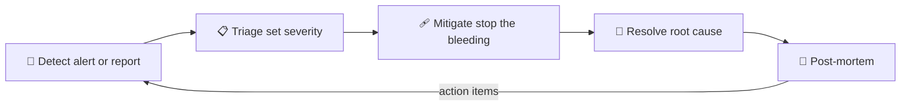

# 24 · Incident Response

> [!info] Topic info
> **Subject:** Infrastructure · **Part:** Cloud & Operations · **Priority:** 🔥 High · **Status:** ✅ done · **Last reviewed:** 2026-11-19
>
> [← Back to Infrastructure](README.md) · [Interview questions →](questions/cloud-and-ops-qa.md)

> [!abstract] In one line
> **Incident response** is the process for handling production outages: **detect**, **mitigate first**, communicate, resolve, then learn through a **blameless post-mortem**.

---

## 1. The problem

It's 2 am. Checkout errors jump from 0.1% to 30%. Five engineers jump into Slack, three start debugging different theories, nobody tells customer support, and someone restarts the DB "to see if it helps".

Incidents are chaotic. A clear process turns panic into a routine.

---

## 2. The incident lifecycle

---

## 3. On-call and severity

**On-call** — one primary (and a secondary) engineer per week holds the pager. Alerts go to them via PagerDuty / Opsgenie. Each alert links to a **runbook** — see [Dashboards & runbooks](../system-design/observability/07-dashboards-and-runbooks.md).

| Severity | Example | Response |
|---|---|---|
| **SEV1** | Site down, payments failing, data loss | All hands, page now, status page update |
| **SEV2** | Major feature broken, big latency spike | Page on-call, fix within hours |
| **SEV3** | Minor bug, small subset of users | Next business day |

---

## 4. During the incident

- **Roles** — **Incident Commander** (coordinates, decides, doesn't debug), **ops / debuggers**, **communications lead** (status page, support, execs).
- **Mitigate first, debug later.** Roll back the last deploy, turn off a feature flag, fail over, scale up, block the bad traffic. Restoring service beats finding the root cause.
- **First question:** "What changed?" — a deploy, config change, traffic spike, dependency outage. Most incidents follow a change.
- **One channel** (`#inc-2026-11-19-checkout`) with a running timeline of what was seen and done.
- **Communicate on a schedule** — e.g. status update every 30 min even if nothing new.

> [!tip] 🎤 Say it like this
> "First I acknowledge and set the severity, then focus on mitigation — usually rolling back the latest deploy or disabling a feature flag — before digging into root cause. For a big incident we assign an incident commander and a comms person, keep one channel with a timeline, and update the status page regularly. Afterwards we write a blameless post-mortem with owned action items."

---

## 5. Post-mortems

Written within a few days for every SEV1/SEV2:
- **Timeline**, **impact** (users, duration, revenue), **root cause and contributing factors**, what went well / badly.
- **Action items** with owners and dates — e.g. add an alert, add a test, make the rollback automatic.
- **Blameless** — focus on why the system allowed the mistake, not who made it. People hide problems when they fear blame.

Track **MTTD** (mean time to detect) and **MTTR** (mean time to recover) to see if you're improving.

> [!failure] Interview traps
> - Debugging root cause for an hour while users are down, when a rollback takes 2 minutes.
> - Everyone debugging, nobody coordinating or communicating.
> - Blaming a person in the post-mortem.
> - Post-mortem action items with no owner — they never get done.

---

## Summary

| Step | Key idea |
|---|---|
| **Detect** | Alerts on user-facing symptoms, on-call rota |
| **Triage** | Severity decides urgency and who's involved |
| **Mitigate** | Rollback / flag off / failover first |
| **Resolve** | Find and fix root cause after service is back |
| **Learn** | Blameless post-mortem with owned action items |

> [!success] Key takeaway
> Stop the bleeding first, communicate constantly, then learn without blame so the same incident never happens twice.
