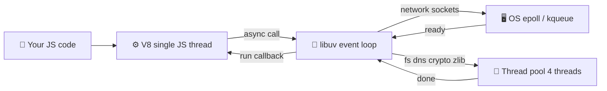

# 01 · What is Node.js

> [!info] Topic info
> **Subject:** Node.js Backend · **Part:** Node.js Core · **Priority:** 🔥 High · **Status:** ✅ done · **Last reviewed:** 2026-11-19
>
> [← Back to Node.js Backend](README.md) · [Interview questions →](questions/nodejs-core-qa.md)

> [!abstract] In one line
> Node.js is a **JavaScript runtime** built on **V8** (runs JS) and **libuv** (event loop + async I/O), so **one JS thread** can serve thousands of connections with **non-blocking I/O**.

---

## 1. The problem

A classic server (old Apache/PHP style) gives **one thread per request**. 10,000 open connections = 10,000 threads, each ~1 MB of stack, mostly sitting idle waiting for the database.

Most web work is **waiting** — DB query 20 ms, API call 100 ms. Node's idea: don't park a thread while waiting. Start the I/O, move on, and run a callback when the result is ready.

---

## 2. What's inside

| Piece | Job |
|---|---|
| **V8** | Google's JS engine (same as Chrome). Compiles JS to machine code, manages the heap + GC. |
| **libuv** | C library. Runs the **event loop**, talks to the OS for async network I/O, owns the **thread pool**. |
| **Core modules** | `fs`, `http`, `net`, `crypto`, `stream`, `events` … the APIs browsers don't have. |
| **Bindings** | Glue that lets JS call the C/C++ parts. |

---

## 3. "Single-threaded" — what that really means

**Your JavaScript** runs on one thread. Node itself is **not** single-threaded:

- **Network I/O** (HTTP, TCP, DB sockets) → handled by the OS kernel (epoll on Linux, kqueue on macOS). No extra threads needed.
- **Thread pool** (libuv, default **4** threads, change with `UV_THREADPOOL_SIZE`, max 1024) → for work the OS can't do async:
  - `fs.*` file operations
  - `dns.lookup()` (what `http.get('example.com')` uses)
  - `crypto.pbkdf2`, `scrypt`, `randomBytes` (async versions)
  - `zlib` compression (async versions)

> [!warning] Thread pool starvation
> Hash 100 passwords with `bcrypt`/`pbkdf2` at once and all 4 pool threads are busy. Now `fs.readFile` and DNS lookups **queue behind them** — the app feels slow even though CPU is fine. Fix: raise `UV_THREADPOOL_SIZE` or move the work to a worker.

> [!tip] 🎤 Say it like this
> "Node runs my JavaScript on a single thread, but I/O is delegated: network sockets go to the OS's async APIs, and things like file reads, DNS lookup, crypto and zlib go to libuv's thread pool of 4 threads. When the work finishes, the callback is queued and the event loop runs it. That's why one Node process can hold thousands of connections — as long as I never block that one JS thread."

---

## 4. Where Node fits

**✅ Great for:** REST/GraphQL APIs, real-time apps (chat, WebSockets), BFF/API gateways, streaming, CLIs — anything **I/O-heavy**. Bonus: one language across frontend and backend.

**❌ Weak for:** **CPU-heavy** work — video encoding, image processing, big ML math. One 2-second loop blocks *every* user. Use worker threads or another service ([08 · Worker threads & cluster](08-worker-threads-and-cluster.md)).

**Node vs browser JS:** same language and V8, but Node has no `window`/DOM; it has `fs`, `process`, `Buffer`, and full OS access.

For how a Node server binds ports and handles TCP/HTTP, see [Backend networking with Node.js](../computer-networks/04-backend-networking-nodejs.md).

> [!failure] Interview traps
> - Saying "Node is single-threaded" without the nuance — JS is, libuv is not.
> - Saying network requests use the thread pool — they don't; sockets use the OS event mechanism.
> - Calling Node a "framework" or "language" — it's a **runtime**. Express is the framework.

---

## Summary

- Node = **V8 + libuv + core modules**.
- One JS thread + **non-blocking I/O** → high concurrency for I/O-bound apps.
- Thread pool (4) serves **fs, dns.lookup, crypto, zlib**; network uses the OS.
- Avoid CPU-heavy work on the main thread.

> [!success] Key takeaway
> Node is fast at **waiting**, not at **computing**. Keep the main thread free and it scales very well.
