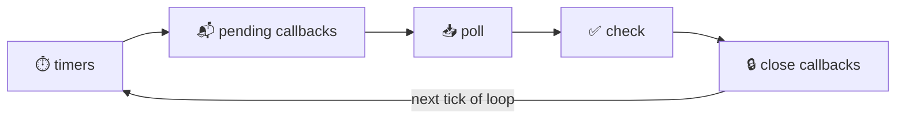

# 02 · The Event Loop

> [!info] Topic info
> **Subject:** Node.js Backend · **Part:** Node.js Core · **Priority:** 🔥 High · **Status:** ✅ done · **Last reviewed:** 2026-11-19
>
> [← Back to Node.js Backend](README.md) · [Interview questions →](questions/nodejs-core-qa.md)

> [!abstract] In one line
> The **event loop** is libuv's endless loop that cycles through **phases** (timers → pending → poll → check → close), running ready callbacks — with **nextTick and Promise microtasks** drained between every callback.

---

## 1. The problem

One JS thread, but 5,000 requests in flight, timers firing, files finishing. Something must decide **which callback runs next**. That's the event loop.

It keeps running as long as there's something to wait for (an open server, a pending timer). Nothing left → the process exits.

---

## 2. The phases



| Phase | What runs there |
|---|---|
| **timers** | `setTimeout` / `setInterval` callbacks whose time is up |
| **pending callbacks** | Some deferred system errors, e.g. TCP `ECONNREFUSED` |
| **poll** | **New I/O** — incoming requests, finished file reads, socket data. Waits here if nothing else to do. |
| **check** | `setImmediate` callbacks |
| **close callbacks** | `socket.on('close')` and similar |

(There are also internal *idle/prepare* phases — you don't need them in interviews.)

**Microtasks are not a phase.** After **every single callback**, Node drains:
1. the `process.nextTick` queue, then
2. the Promise microtask queue (`.then`, `await` continuations).

---

## 3. Classic "what does this print?"

```js
console.log('A');
setTimeout(() => console.log('B'), 0);
setImmediate(() => console.log('C'));
Promise.resolve().then(() => console.log('D'));
process.nextTick(() => console.log('E'));
console.log('F');
```

**Output:** `A F E D B C` (B and C may swap).

- `A`, `F` — synchronous code runs first.
- `E` — nextTick queue runs before Promises.
- `D` — Promise microtask.
- `B` vs `C` — from the main script the order is **not guaranteed** (depends on whether 1 ms passed before the loop started). **Inside an I/O callback**, `setImmediate` always wins because check comes right after poll.

> [!note] ESM twist
> In an ES module (`.mjs`), top-level code itself runs inside a Promise job, so `D` can print before `E`. The classic answer assumes CommonJS.

> [!tip] 🎤 Say it like this
> "The event loop goes through phases: timers, pending callbacks, poll for I/O, check for setImmediate, and close callbacks. Between every callback it drains microtasks — first process.nextTick, then Promises. So sync code runs first, then nextTick, then promises, then timers and immediates. setImmediate is guaranteed before setTimeout 0 only inside an I/O callback."

---

## 4. Blocking the event loop

While a callback runs, **nothing else runs**. A 200 ms loop = every request waits 200 ms.

Common blockers:
- **CPU work** — big loops, sorting 1M items, regex with catastrophic backtracking.
- **Sync APIs** — `fs.readFileSync`, `crypto.pbkdf2Sync`, `zlib.gzipSync` in a request handler.
- **`JSON.parse` / `JSON.stringify` of huge payloads** — a 50 MB JSON can block for hundreds of ms.
- **Recursive `process.nextTick`** — starves I/O forever, because the nextTick queue must empty first.

**Fixes:** chunk work with `setImmediate`, stream large data, move CPU work to [worker threads](08-worker-threads-and-cluster.md), or to a [background job](19-background-jobs.md).

> [!failure] Interview traps
> - Thinking `setTimeout(fn, 0)` runs "immediately" — it waits at least ~1 ms and until the timers phase.
> - Saying microtasks run "once per loop" — they drain after **each** callback (since Node 11).
> - Believing `async` makes CPU code non-blocking — `await` doesn't move work off the thread.

---

## Summary

| Queue | When it runs |
|---|---|
| **Sync code** | First, to completion |
| **process.nextTick** | After the current callback, before Promises |
| **Promise microtasks** | Right after nextTick queue |
| **setTimeout / setInterval** | Timers phase |
| **setImmediate** | Check phase, right after poll |

> [!success] Key takeaway
> Know the order — sync → nextTick → promises → timers/immediate — and never block the loop: one slow callback delays **every** user.
