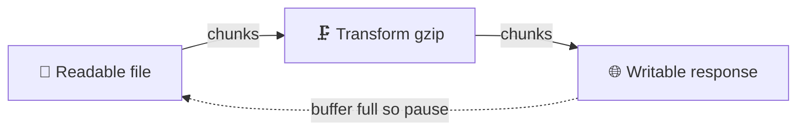

# 05 · Streams and Buffers

> [!info] Topic info
> **Subject:** Node.js Backend · **Part:** Node.js Core · **Priority:** 🔥 High · **Status:** ✅ done · **Last reviewed:** 2026-11-19
>
> [← Back to Node.js Backend](README.md) · [Interview questions →](questions/nodejs-core-qa.md)

> [!abstract] In one line
> **Streams** process data in **small chunks** instead of loading it all into memory; **backpressure** stops a fast producer from flooding a slow consumer; a **Buffer** is a chunk of raw binary data.

---

## 1. The problem

A user downloads a **2 GB** CSV export. `fs.readFile` loads all 2 GB into RAM first — 10 users at once and the server dies with out-of-memory.

With a stream, we read **64 KB**, send it, read the next 64 KB. Memory stays flat no matter the file size, and the user starts receiving bytes immediately.

---

## 2. Four stream types

| Type | Does | Examples |
|---|---|---|
| **Readable** | Source of data | `fs.createReadStream`, HTTP **request** (`req`) |
| **Writable** | Destination | `fs.createWriteStream`, HTTP **response** (`res`) |
| **Duplex** | Both, independent | TCP socket |
| **Transform** | Duplex that changes data | `zlib.createGzip()`, CSV parser |

All streams are [EventEmitters](06-event-emitter.md): `data`, `end`, `error`, `finish`, `drain`.

---

## 3. Backpressure

The disk reads at 500 MB/s but the client's network takes 1 MB/s. Without control, unsent chunks pile up in memory.



- Every stream has an internal buffer limit, **highWaterMark** (16 KB default, 64 KB for file reads).
- `writable.write(chunk)` returns **false** when that buffer is full → the reader should **pause** and resume on the `'drain'` event.
- `pipe()` and `pipeline()` do this for you.

---

## 4. Use `pipeline()`

```js
const { pipeline } = require('node:stream/promises');
const fs = require('node:fs');
const zlib = require('node:zlib');

app.get('/export', async (req, res) => {
  res.setHeader('Content-Encoding', 'gzip');
  await pipeline(fs.createReadStream('big.csv'), zlib.createGzip(), res);
});
```

`.pipe()` handles backpressure but **not errors** — if one stream fails, the others stay open and leak. `pipeline()` forwards errors and **destroys every stream** on failure (e.g. client disconnects mid-download).

> [!tip] 🎤 Say it like this
> "Streams let me process data in chunks, so a 2 GB file uses a few KB of memory. There are readable, writable, duplex and transform streams. Backpressure means when the writer's buffer is full, write returns false and the reader pauses until drain. I use stream.pipeline because it handles backpressure, errors and cleanup together."

---

## 5. Buffers

A **Buffer** is a fixed-size block of raw bytes, stored **outside the V8 heap**. Streams emit Buffers by default; files, sockets and crypto all work with them.

```js
const b = Buffer.from('hi', 'utf8'); // <Buffer 68 69>
b.toString('base64');                // 'aGk='
Buffer.alloc(10);       // zero-filled, safe
Buffer.allocUnsafe(10); // faster, may contain old memory — overwrite before use
```

> [!failure] Interview traps
> - Concatenating Buffer chunks with `+=` as strings — breaks multi-byte UTF-8 characters split across chunks. Collect and `Buffer.concat()`, or `setEncoding('utf8')`.
> - Using `.pipe()` in production without error handling.
> - `readFile` + `res.send` for large files instead of streaming.

---

## Summary

- Streams = chunks → **flat memory**, faster first byte.
- 4 types: Readable, Writable, Duplex, Transform.
- **Backpressure:** `write()` false → pause → `'drain'`.
- Use **`pipeline()`** over `.pipe()`.
- **Buffer** = raw bytes outside the JS heap.

See also [Streaming responses](../computer-networks/04-backend-networking-nodejs.md) and [File uploads](20-file-uploads.md).

> [!success] Key takeaway
> Anything big — files, exports, uploads, proxies — should be a stream joined with `pipeline()`.
