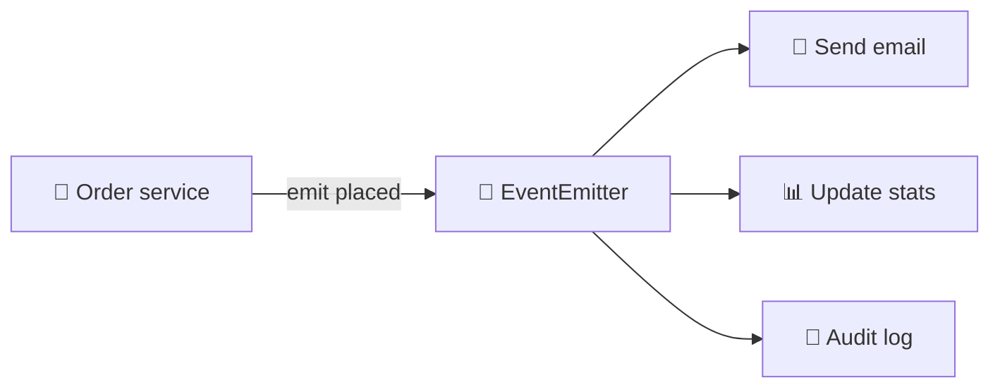

# 06 · EventEmitter

> [!info] Topic info
> **Subject:** Node.js Backend · **Part:** Node.js Core · **Priority:** ⚡ Medium · **Status:** ✅ done · **Last reviewed:** 2026-11-19
>
> [← Back to Node.js Backend](README.md) · [Interview questions →](questions/nodejs-core-qa.md)

> [!abstract] In one line
> **EventEmitter** is Node's built-in **publish/subscribe** class: objects `emit` named events and listeners registered with `on` run **synchronously**, in order.

---

## 1. What it is

When an order is placed, we want to send an email, update stats and write an audit log. The order code shouldn't know about all three. It just says *"order placed"* and whoever cares listens.

Most of Node is built on this: HTTP servers (`'request'`), streams (`'data'`, `'end'`), `process` (`'exit'`).

---

## 2. How it works

```js
const { EventEmitter } = require('node:events');
const orders = new EventEmitter();

orders.on('placed', (order) => sendEmail(order));
orders.once('placed', () => console.log('first order!'));

orders.emit('placed', { id: 42 });  // runs both listeners, now
orders.off('placed', handler);      // remove a listener
```



Key facts:
- **Synchronous:** `emit()` calls listeners one by one and returns after all finish. A slow listener blocks the emitter. Do async work inside the listener if needed.
- **`'error'` is special:** emitting `'error'` with no listener **throws** and can crash the process. Always add `.on('error', …)` to streams, sockets and your own emitters.
- **Leak warning:** more than **10** listeners on one event prints `MaxListenersExceededWarning` — usually a sign you add a listener per request and never remove it.

> [!tip] 🎤 Say it like this
> "EventEmitter is Node's in-process pub/sub — emit a named event, and all listeners registered with on run synchronously in order. Streams, HTTP servers and process are all emitters. Two things I watch: always handle the error event, or it crashes the process, and remove listeners I add per request, or I get a memory leak."

> [!failure] Interview traps
> - Thinking `emit` is async — it isn't.
> - Using EventEmitter across servers — it's **in-memory, one process only**. Across services use a [message queue / pub-sub](../system-design/communication-patterns/07-pub-sub.md).
> - Ignoring the `MaxListenersExceededWarning` by raising the limit instead of fixing the leak.

---

## Summary

- `on` / `once` / `off` / `emit` — simple in-process pub/sub.
- Listeners run **synchronously**, in registration order.
- Unhandled `'error'` event = crash.
- >10 listeners warning = likely leak.

> [!success] Key takeaway
> Great for decoupling inside one process; for anything cross-process or durable, use a real queue.
