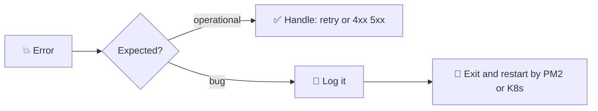

# 07 · Error Handling

> [!info] Topic info
> **Subject:** Node.js Backend · **Part:** Node.js Core · **Priority:** 🔥 High · **Status:** ✅ done · **Last reviewed:** 2026-11-19
>
> [← Back to Node.js Backend](README.md) · [Interview questions →](questions/nodejs-core-qa.md)

> [!abstract] In one line
> **Handle operational errors** (DB down, bad input) gracefully, **crash and restart** on programmer errors (bugs), catch async errors explicitly, and treat **unhandledRejection / uncaughtException** as a last-resort log-and-exit.

---

## 1. The problem

One request hits a bug, throws inside an async callback, and **the whole process crashes** — dropping 2,000 other users' requests. Or worse: the error is swallowed, the request hangs forever, and nobody knows.

---

## 2. Two kinds of errors

| | **Operational error** | **Programmer error** |
|---|---|---|
| **What** | Expected runtime failure | A bug in the code |
| **Examples** | DB timeout, 404, invalid input, network reset | `undefined.x`, wrong argument type, forgot `await` |
| **Response** | Handle: retry, return 4xx/5xx, log | Log, **crash**, let the process manager restart |

Why crash on bugs? After an unknown bug the process may be in a **broken state** (half-written data, leaked connections). A clean restart via PM2, Docker or Kubernetes is safer than limping on.

---

## 3. Catching errors in each style

- **Sync code:** `try/catch`.
- **Callbacks:** check `err` first — `try/catch` around the call does **not** catch it.
- **Promises:** `.catch()` or `await` inside `try/catch`.
- **EventEmitters / streams:** `.on('error', …)` — otherwise the process crashes.

```js
// throws later, on another tick — this catch never sees it
try { setTimeout(() => { throw new Error('boom'); }, 0); } catch (e) {}
```

---

## 4. Async errors in Express

**Express 4** does not catch rejected promises from async handlers — the request **hangs** and you get an unhandled rejection. Express 5 forwards them to the error handler automatically.

```js
// Express 4: wrap async handlers
const wrap = (fn) => (req, res, next) => fn(req, res, next).catch(next);

app.get('/users/:id', wrap(async (req, res) => {
  const user = await User.findById(req.params.id);
  if (!user) throw new NotFoundError('User not found'); // custom class
  res.json(user);
}));

// central error middleware — 4 arguments
app.use((err, req, res, next) => {
  logger.error(err);
  res.status(err.status || 500).json({ error: err.expose ? err.message : 'Internal error' });
});
```

Use **custom error classes** (`NotFoundError extends Error` with a `status`) so the central handler can map errors to HTTP codes. Never leak stack traces to clients. More on middleware in [13 · Middleware](13-middleware.md).

---

## 5. The last-resort handlers

```js
process.on('unhandledRejection', (reason) => { logger.fatal(reason); process.exit(1); });
process.on('uncaughtException', (err) => { logger.fatal(err); process.exit(1); });
```

- Since **Node 15**, an unhandled rejection **crashes the process** by default.
- Use these handlers only to **log and exit** (ideally graceful shutdown) — not to "keep going".



> [!tip] 🎤 Say it like this
> "I separate operational errors, like a DB timeout or bad input, from programmer errors, which are bugs. Operational ones I handle and return a proper status code; bugs I log and let the process crash so the orchestrator restarts it clean. In Express I route all errors — including async ones — to one central error middleware, and unhandledRejection or uncaughtException just log and exit."

> [!failure] Interview traps
> - Using `uncaughtException` to keep the server running after a bug.
> - `try/catch` around a callback-based call and thinking it catches the async error.
> - Missing `.on('error')` on a stream or socket → crash.
> - Async Express 4 handler without a wrapper → hanging request.

---

## Summary

- **Operational → handle**, **programmer → crash + restart**.
- Each async style has its own catch mechanism.
- One **central error middleware**; wrap async handlers in Express 4.
- `unhandledRejection` / `uncaughtException` = log and exit.

> [!success] Key takeaway
> Never swallow errors and never limp on after a bug — fail fast, log well, restart clean.
