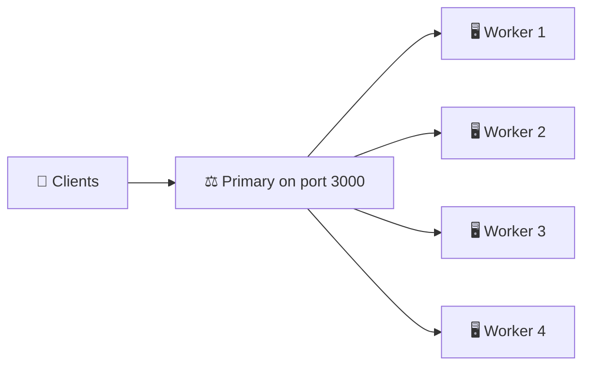

# 08 · Worker Threads, Cluster and Child Processes

> [!info] Topic info
> **Subject:** Node.js Backend · **Part:** Node.js Core · **Priority:** 🔥 High · **Status:** ✅ done · **Last reviewed:** 2026-11-19
>
> [← Back to Node.js Backend](README.md) · [Interview questions →](questions/nodejs-core-qa.md)

> [!abstract] In one line
> Use **cluster** to run one Node process **per CPU core** for more request throughput, **worker_threads** to move **CPU-heavy work** off the main thread, and **child_process** to run **other programs**.

---

## 1. The problem

Our server has **8 cores**, but one Node process uses **1 core** for JavaScript. 7 cores sit idle.

Separately, one endpoint resizes images — 300 ms of CPU each. While it runs, every other request on that process waits.

Two different problems → two different tools.

---

## 2. Cluster — scale across cores

The **primary** process forks N **workers** (separate processes, each with its own event loop and memory). They all share one port; the primary hands out connections (round-robin on Linux).



- Workers **don't share memory** — in-memory sessions or caches break. Use Redis.
- In practice: **PM2** (`pm2 start app.js -i max`) or, in Kubernetes, **one process per container and more pods** instead of cluster.

---

## 3. Worker threads — CPU work

Threads **inside one process**. Each has its own V8 instance and event loop, but they can pass messages and even **share memory** (`SharedArrayBuffer`).

```js
// main.js
const { Worker } = require('node:worker_threads');
const w = new Worker('./resize.js', { workerData: { path: 'cat.jpg' } });
w.on('message', (result) => console.log('done', result));
w.on('error', console.error);

// resize.js
const { parentPort, workerData } = require('node:worker_threads');
parentPort.postMessage(heavyResize(workerData.path));
```

Creating a worker costs ~tens of ms and memory, so use a **pool** (e.g. `piscina`) instead of one worker per request.

---

## 4. Child process — run other programs

`child_process` starts a separate OS process: `exec` (shell command, buffered output), `spawn` (streams output — good for big output), `fork` (another Node script with an IPC channel). Example: calling `ffmpeg` or a Python script.

> [!warning] Shell injection
> Never pass user input into `exec('convert ' + filename)`. Use `spawn` / `execFile` with an **argument array**.

---

## 5. Comparison

| | **cluster** | **worker_threads** | **child_process** |
|---|---|---|---|
| **Unit** | Process | Thread | Process |
| **Memory** | Separate | Separate heaps, can share buffers | Separate |
| **Communication** | IPC messages | `postMessage`, shared memory | IPC / stdin / stdout |
| **Startup cost** | High | Medium | High |
| **Best for** | More **HTTP throughput** on all cores | **CPU-heavy JS** (hashing, parsing, images) | Running **external programs** |

> [!tip] 🎤 Say it like this
> "Cluster or PM2 runs one Node process per core so I use all CPUs for handling requests — they don't share memory, so state goes to Redis. Worker threads are for CPU-heavy work inside a process, like image processing, so the event loop stays free — I keep them in a pool. child_process is for running external programs like ffmpeg."

> [!failure] Interview traps
> - Using worker threads for I/O — Node is already async for I/O; it only adds overhead.
> - Using cluster to fix a slow CPU endpoint — each worker still blocks on it.
> - Storing sessions in memory with cluster → users "randomly" get logged out.

---

## Summary

- **cluster** → more cores for requests (or PM2 / more pods).
- **worker_threads** → CPU work off the event loop, use a pool.
- **child_process** → other programs, avoid shell injection.

For long or retryable heavy work, a queue is often better: see [19 · Background jobs](19-background-jobs.md).

> [!success] Key takeaway
> Throughput problem → more processes. CPU-blocking problem → worker threads. External tool → child process.
