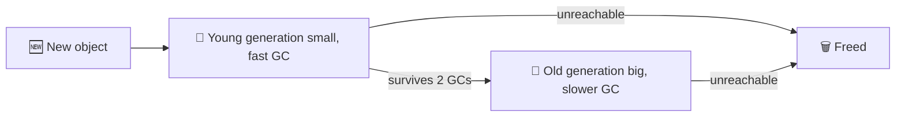

# 09 · Memory and Garbage Collection

> [!info] Topic info
> **Subject:** Node.js Backend · **Part:** Node.js Core · **Priority:** 🔥 High · **Status:** ✅ done · **Last reviewed:** 2026-11-19
>
> [← Back to Node.js Backend](README.md) · [Interview questions →](questions/nodejs-core-qa.md)

> [!abstract] In one line
> V8 **garbage-collects** objects nothing references anymore, using a fast **young generation** for short-lived objects and a slower **old generation**; a **memory leak** is anything that keeps references alive by mistake.

---

## 1. The problem

The API runs fine after deploy. Memory grows **200 MB → 1.5 GB** over 6 hours, latency climbs, then the pod dies with:

`FATAL ERROR: Reached heap limit Allocation failed - JavaScript heap out of memory`

It restarts, and the cycle repeats. Classic **memory leak**.

---

## 2. How V8 GC works (intuition)

The rule: an object is **alive if it can be reached** from a root (globals, the current call stack, active closures). Unreachable = garbage.

Most objects die young (a request's temp objects), so V8 splits the heap:

- **Young gen (Scavenge):** a few MB to tens of MB, cleaned very often in ~1 ms. Survivors get promoted.
- **Old gen (Mark-Sweep-Compact):** mark everything reachable, free the rest, compact to remove gaps. Mostly done **incrementally/concurrently**, but some pauses still happen.
- A leak means objects keep getting promoted to old gen and are never freed → longer GC pauses → eventually out of memory.

**Memory numbers** from `process.memoryUsage()`: `heapUsed` (JS objects), `heapTotal`, `rss` (total process memory), `external` (Buffers, outside the heap).

---

## 3. Common leak causes

- **Unbounded caches** — `const cache = {}` that only grows. Use an LRU with a max size, or Redis.
- **Event listeners never removed** — `emitter.on(...)` per request (watch for `MaxListenersExceededWarning`).
- **Timers** — `setInterval` never cleared, holding references to big objects.
- **Closures** keeping large objects alive longer than needed.
- **Global arrays/maps** — e.g. storing every request for "debugging".

---

## 4. Finding a leak

1. Confirm: `heapUsed` keeps rising across GCs under steady load (dashboards / metrics).
2. Run with `node --inspect app.js`, open `chrome://inspect` → **Memory** tab.
3. Take **3 heap snapshots**: baseline, after load, after more load. Compare — objects that keep growing (e.g. 50,000 `Socket` or closures) point to the leak; the **retainers** view shows who holds them.
4. In production: `--heapsnapshot-signal=SIGUSR2` to dump a snapshot on demand (heavy — do it on one instance).

**Heap limit:** `node --max-old-space-size=1536 app.js` (in MB). In a container with 2 GB, set it to ~75% so V8 GCs before the container's OOM killer strikes.

> [!tip] 🎤 Say it like this
> "V8 frees objects that are no longer reachable. It uses a small young generation that's cleaned very often, since most objects die quickly, and an old generation for long-lived ones. Leaks usually come from unbounded caches, listeners or timers that are never removed, or closures holding big objects. To find one, I take heap snapshots over time with --inspect and compare which objects keep growing."

> [!failure] Interview traps
> - Raising `--max-old-space-size` to "fix" a leak — it only delays the crash.
> - Thinking JS can't leak because it has GC — GC can only free what's unreachable.
> - Big `Buffer` memory shows in `rss`/`external`, not `heapUsed` — check both.

---

## Summary

- Reachable = alive; GC frees the rest.
- **Young gen** (fast, frequent) → survivors → **old gen** (slower).
- Leaks: caches, listeners, timers, closures, globals.
- Debug with **heap snapshots** via `--inspect`; tune `--max-old-space-size`.

> [!success] Key takeaway
> A leak is just a forgotten reference. Bound every cache, remove every listener and timer, and compare heap snapshots to find the one you missed.
