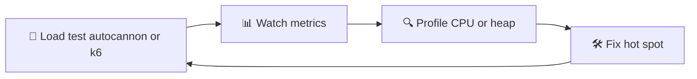

# 11 · Performance and Profiling

> [!info] Topic info
> **Subject:** Node.js Backend · **Part:** Node.js Core · **Priority:** ⚡ Medium · **Status:** ✅ done · **Last reviewed:** 2026-11-19
>
> [← Back to Node.js Backend](README.md) · [Interview questions →](questions/nodejs-core-qa.md)

> [!abstract] In one line
> **Measure first**: load-test, watch **event loop lag**, CPU and memory, then use a **CPU profile / flame graph** (`--inspect`, `--cpu-prof`, clinic) to find the hot function — don't guess.

---

## 1. The problem

p99 latency jumped from **80 ms to 900 ms** after a release. CPU is at 100% on one core. Is it the DB? A regex? JSON? Guessing wastes days — profiling finds it in minutes.

---

## 2. The workflow

**Key signals:**
- **Event loop lag / delay** — how late callbacks run. Healthy: a few ms. 100+ ms = something is blocking. Measure with `perf_hooks.monitorEventLoopDelay()`.
- **CPU** — 100% on one core with low throughput → CPU-bound JS.
- **Memory / GC** — rising heap or frequent long GC pauses (see [09 · Memory](09-memory-and-garbage-collection.md)).
- **Latency p50 / p95 / p99** — averages hide the slow tail.

---

## 3. The tools

| Tool | Use |
|---|---|
| **`node --inspect`** + Chrome DevTools | Live CPU profile and heap snapshots |
| **`node --cpu-prof`** | Writes a `.cpuprofile` on exit — open in DevTools |
| **`node --prof`** | V8 tick profiler, low level |
| **clinic.js** (`doctor`, `flame`, `bubbleprof`) | Diagnoses the type of problem, flame graphs, async delays |
| **0x** | Quick flame graphs |
| **autocannon / k6** | HTTP load generation |

A **flame graph** shows the call stack over time: **wide bars = where CPU time goes**. Look for the widest bar from *your* code.

> [!tip] 🎤 Say it like this
> "I don't guess — I reproduce under load with autocannon or k6, check event loop lag, CPU and memory, then take a CPU profile with --inspect or clinic flame. The widest bars in the flame graph show the hot function. Typical culprits are sync calls, huge JSON parsing, bad regex or a missing index on the DB side."

---

## 4. Common fixes

- Remove **sync APIs** from request paths (`readFileSync`, `*Sync` crypto).
- **Stream** large payloads; paginate instead of returning 50,000 rows.
- **Cache** hot reads ([Caching with Redis](18-caching-with-redis.md)).
- Move CPU work to **worker threads** ([08](08-worker-threads-and-cluster.md)).
- Reuse connections — **keep-alive** and DB **connection pooling** ([pooling](../system-design/database-scaling/08-connection-pooling.md)).
- Use all cores — cluster/PM2 or more pods.
- Run in production mode (`NODE_ENV=production` — Express caches views, less debug work).
- Faster JSON: schema-based serialization (e.g. Fastify's `fast-json-stringify`).

> [!failure] Interview traps
> - Optimizing before measuring.
> - Looking only at average latency, not p99.
> - Blaming Node when the real issue is an N+1 query or missing DB index.
> - Profiling in dev mode with tiny data — reproduce realistic load.

---

## Summary

- Signals: **event loop lag**, CPU, memory/GC, p99 latency.
- Tools: `--inspect`, `--cpu-prof`, clinic, 0x, autocannon/k6.
- Flame graph: widest bar = hot spot.
- Fix: no sync calls, stream, cache, workers, pooling, more cores.

For production monitoring, see [Metrics](../system-design/observability/04-metrics.md).

> [!success] Key takeaway
> Load-test, measure event loop lag, profile, then fix the one widest bar — repeat until p99 is happy.
