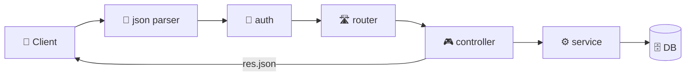

# 12 · Express Basics

> [!info] Topic info
> **Subject:** Node.js Backend · **Part:** Building Production Backends · **Priority:** 🔥 High · **Status:** ✅ done · **Last reviewed:** 2026-11-19
>
> [← Back to Node.js Backend](README.md) · [Interview questions →](questions/building-backends-qa.md)

> [!abstract] In one line
> **Express** is a small, unopinionated web framework on top of Node's `http` module that gives you **routing**, **middleware** and helpers like `res.json()` — you bring the **structure** (routes → controllers → services).

---

## 1. The problem

With raw `http.createServer`, you parse URLs, read the body chunk by chunk, and set headers yourself. For a todo API with 20 endpoints that becomes a giant `if/else` on `req.url`.

Express turns that into `app.get('/todos/:id', handler)` and a pipeline of reusable functions.

---

## 2. How a request flows

Every request runs through a **chain of middleware** in the order you registered them, then hits the matching **route handler**, which sends a response.



```js
const express = require('express');
const app = express();

app.use(express.json());                 // parse JSON body into req.body
app.get('/users/:id', async (req, res) => {
  const user = await userService.find(req.params.id);   // :id → req.params
  if (!user) return res.status(404).json({ error: 'Not found' });
  res.json(user);                        // sets Content-Type + status 200
});
app.listen(3000);
```

Key request bits: `req.params` (path `/users/42`), `req.query` (`?page=2`), `req.body` (needs a parser), `req.headers`.

---

## 3. Project structure — layers

Don't put SQL inside route handlers. Split into layers so each is easy to test and replace:

| Layer | Job | Knows about HTTP? |
|---|---|---|
| **Routes** | Map URL + method → controller, attach middleware | Yes |
| **Controllers** | Read `req`, call service, shape `res` | Yes |
| **Services** | Business rules ("can't order if out of stock") | **No** |
| **Repositories / models** | Talk to the DB | No |

```
src/
├── app.js          ← builds the express app, no listen()
├── server.js       ← imports app, calls listen()  ← lets tests import app without a port
├── routes/  controllers/  services/  repositories/  middlewares/
```

Use `express.Router()` to group routes: `app.use('/api/v1/users', userRouter)`.

> [!tip] 🎤 Say it like this
> "Express is a thin layer over Node's http module — routing plus a middleware pipeline. I structure apps as routes, controllers and services: controllers deal with req and res, services hold business logic and never see HTTP, so I can unit-test them and reuse them from a queue worker too."

> [!note] Alternatives
> **Fastify** — faster (schema-based JSON serialization), built-in validation and logging. **NestJS** — opinionated, TypeScript, decorators and dependency injection, Angular-style modules; often runs on Express or Fastify underneath.

> [!failure] Interview traps
> - Forgetting `express.json()` → `req.body` is `undefined`.
> - Sending two responses (`res.json` then `res.send`) → "Cannot set headers after they are sent". Use `return res...`.
> - Calling `app.listen()` inside `app.js` — makes tests start real ports.
> - Fat controllers with all business logic and SQL inside.

---

## Summary

- Express = routing + middleware on top of `http`.
- `req.params`, `req.query`, `req.body`; respond with `res.status().json()`.
- Layers: **routes → controllers → services → repositories**.
- Separate `app.js` from `server.js` for testability.

> [!success] Key takeaway
> Express gives you the pipeline; the interview signal is how you **structure** it — thin controllers, HTTP-free services.
