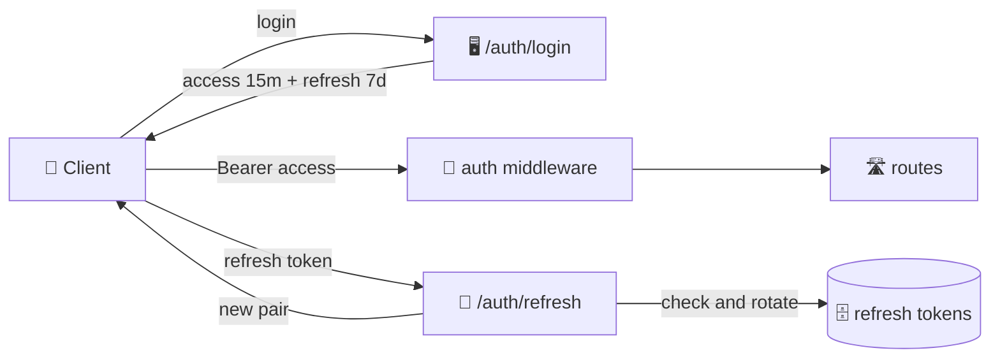

# 16 · Authentication

> [!info] Topic info
> **Subject:** Node.js Backend · **Part:** Building Production Backends · **Priority:** 🔥 High · **Status:** ✅ done · **Last reviewed:** 2026-11-19
>
> [← Back to Node.js Backend](README.md) · [Interview questions →](questions/building-backends-qa.md)

> [!abstract] In one line
> In Node, hash passwords with **bcrypt/argon2**, issue a **short-lived JWT access token** (~15 min) plus a **long-lived refresh token** (~7–30 days, stored server-side and **rotated**), and check them in an **auth middleware**; check permissions separately (**authorization**).

---

## 1. The problem

Users log in once and expect to stay logged in for weeks. But if a token that lives for weeks is stolen, the attacker has weeks too.

Concepts are covered in [auth vs authz](../system-design/api-fundamentals/09-authentication-vs-authorization.md), [session vs token](../system-design/api-fundamentals/10-session-vs-token-auth.md), [JWT](../system-design/api-fundamentals/11-jwt.md) and [password storage](../system-design/security/04-password-storage.md). Here: how to build it in Express.

---

## 2. Passwords — bcrypt

```js
const hash = await bcrypt.hash(password, 12);            // cost 12 ≈ 250 ms, salt built in
const ok   = await bcrypt.compare(input, user.passwordHash);
```

Slow on purpose so brute force is expensive. Use the **async** version — sync hashing blocks the event loop for every login. **argon2** is the modern alternative.

---

## 3. Access + refresh token flow



- **Access token** — JWT, 15 min, sent as `Authorization: Bearer ...`. Verified with no DB call → fast and stateless.
- **Refresh token** — random string or JWT, stored **hashed in DB/Redis**, sent in an **httpOnly, Secure, SameSite cookie**. Used only on `/auth/refresh`.
- **Rotation** — every refresh issues a new refresh token and revokes the old one. If an old one is ever reused → assume theft, revoke the whole family.
- **Logout** = delete the refresh token. The access token dies within 15 min.

---

## 4. Auth middleware + authorization

```js
function requireAuth(req, res, next) {
  const token = req.headers.authorization?.split(' ')[1];
  if (!token) return res.status(401).json({ error: { code: 'NO_TOKEN' } });
  try {
    req.user = jwt.verify(token, process.env.JWT_SECRET, { algorithms: ['HS256'] });
    next();
  } catch { res.status(401).json({ error: { code: 'INVALID_TOKEN' } }); }
}
const requireRole = (role) => (req, res, next) =>
  req.user.role === role ? next() : res.status(403).json({ error: { code: 'FORBIDDEN' } });
```

Also check **ownership** in the service: `order.userId === req.user.id`, otherwise anyone can read `/orders/42` (IDOR — insecure direct object reference).

> [!tip] 🎤 Say it like this
> "Passwords are hashed with bcrypt, async so it doesn't block the event loop. On login I return a 15-minute JWT access token and a refresh token in an httpOnly cookie, stored hashed in Redis and rotated on every use. A middleware verifies the JWT and sets req.user; role and ownership checks happen after that and return 403."

**Tools:** Passport.js (strategies for local, Google, GitHub), or hosted auth (Auth0, Cognito, Clerk) when you don't want to own it.

> [!failure] Interview traps
> - Long-lived access tokens with no way to revoke them.
> - Storing tokens in `localStorage` — readable by any XSS script.
> - Putting secrets or PII in the JWT payload — it's only **base64**, not encrypted.
> - Not pinning `algorithms` in `jwt.verify` (the old `alg: none` attack).
> - Checking login but not **ownership** (IDOR).

---

## Summary

| Piece | Choice |
|---|---|
| **Passwords** | bcrypt / argon2, async |
| **Access token** | JWT, ~15 min, Bearer header |
| **Refresh token** | Stored hashed, httpOnly cookie, rotated |
| **Authorization** | Role middleware + ownership checks → 403 |

> [!success] Key takeaway
> Short access token for speed, revocable rotating refresh token for safety — and always check **who owns the resource**, not just who is logged in.
