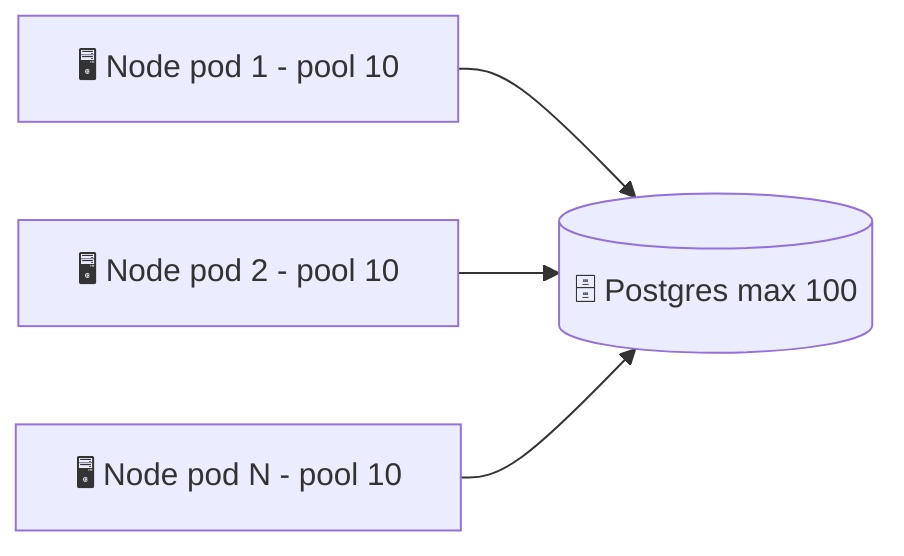

# 17 · Databases and ORMs

> [!info] Topic info
> **Subject:** Node.js Backend · **Part:** Building Production Backends · **Priority:** 🔥 High · **Status:** ✅ done · **Last reviewed:** 2026-11-19
>
> [← Back to Node.js Backend](README.md) · [Interview questions →](questions/building-backends-qa.md)

> [!abstract] In one line
> Node talks to databases through **drivers**, **query builders** or **ORMs** (Prisma, Sequelize, TypeORM, Mongoose); in production you must get **connection pooling**, the **N+1 problem**, **transactions** and **migrations** right.

---

## 1. The options

| Level | Examples | Trade-off |
|---|---|---|
| **Raw driver** | `pg`, `mysql2`, `mongodb` | Full control, most code |
| **Query builder** | Knex, Kysely | SQL-like, composable, still close to SQL |
| **ORM** | **Prisma**, Sequelize, TypeORM, Drizzle | Models + relations + migrations, less SQL |
| **ODM (Mongo)** | **Mongoose** | Schemas and validation on top of MongoDB |

**Prisma** is the common modern pick: a schema file generates a fully typed client and migrations. ORMs speed you up but can hide slow queries — always know the SQL they generate.

---

## 2. Connection pooling

Opening a DB connection costs a TCP + TLS + auth handshake (~20–50 ms). A **pool** keeps, say, 10 open connections and lends them out per query. See [connection pooling](../system-design/database-scaling/08-connection-pooling.md).



- Create the pool **once** at startup, not per request.
- **Math:** 20 pods × pool 10 = 200 connections > Postgres `max_connections` 100 → errors. Use **PgBouncer** or RDS Proxy in front.
- Serverless (Lambda) is the worst case — each instance opens its own pool.

---

## 3. The N+1 problem

Listing 50 orders, then fetching each order's user in a loop = **1 + 50 queries**.

```js
// ❌ N+1
const orders = await prisma.order.findMany({ take: 50 });
for (const o of orders) o.user = await prisma.user.findUnique({ where: { id: o.userId } });

// ✅ one query with a join / IN
const orders = await prisma.order.findMany({ take: 50, include: { user: true } });
```

Fixes: eager loading (`include`, Sequelize `include`, Mongoose `populate`), a manual `WHERE id IN (...)`, or **DataLoader** in GraphQL to batch per request. Spot it by logging queries in dev.

---

## 4. Transactions

When two writes must succeed or fail together (debit wallet + create order), wrap them in a transaction. Concepts: [ACID](../system-design/databases/03-acid-transactions.md).

```js
await prisma.$transaction(async (tx) => {
  await tx.wallet.update({ where: { userId }, data: { balance: { decrement: 500 } } });
  await tx.order.create({ data: { userId, amount: 500 } });
});                                  // any throw → automatic ROLLBACK
```

Keep transactions **short** — no HTTP calls inside; they hold locks and a pooled connection.

---

## 5. Migrations

Schema changes live in versioned files (`prisma migrate`, Knex, Sequelize CLI), committed to git and run in CI/CD before the new code starts. Use backward-compatible steps for zero downtime — see [schema migrations](../system-design/deployment/08-schema-migrations.md).

> [!tip] 🎤 Say it like this
> "I usually use Prisma for typed queries and migrations, but I check the SQL it generates. One pool per process, sized so pods times pool size stays under the DB's connection limit, with PgBouncer if we scale out. I avoid N+1 with eager loading or batching, and wrap multi-step writes in short transactions."

> [!failure] Interview traps
> - New connection per request, or a pool per request.
> - N+1 queries hidden behind a nice ORM loop.
> - Long transactions that call external APIs.
> - Building SQL with string concatenation → SQL injection. Use parameters.

---

## Summary

- Driver → query builder → ORM: more convenience, less control.
- **Pool once**, size it against `max_connections`.
- **N+1** → eager load / batch.
- **Transactions** for multi-write consistency, kept short.
- **Migrations** versioned and run in the pipeline.

> [!success] Key takeaway
> The ORM isn't the hard part — connection limits, N+1 and transaction scope are what break in production.
