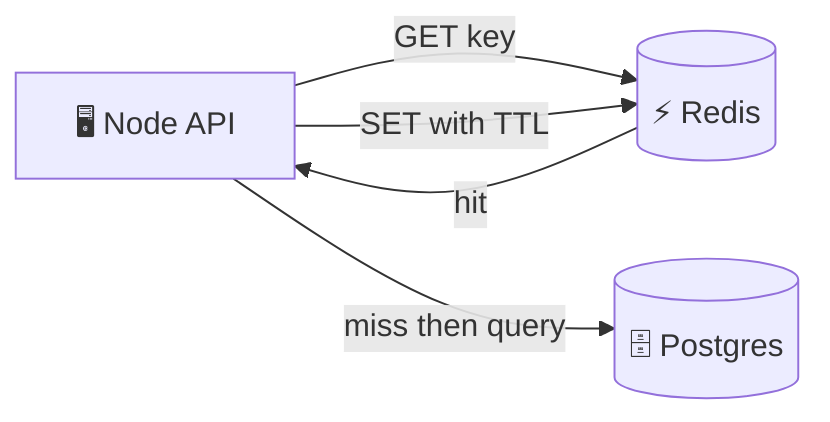

# 18 · Caching with Redis

> [!info] Topic info
> **Subject:** Node.js Backend · **Part:** Building Production Backends · **Priority:** 🔥 High · **Status:** ✅ done · **Last reviewed:** 2026-11-19
>
> [← Back to Node.js Backend](README.md) · [Interview questions →](questions/building-backends-qa.md)

> [!abstract] In one line
> Put **Redis** (an in-memory key-value store, ~1 ms reads) in front of the DB using **cache-aside**: read cache → on miss read DB and store with a **TTL** → **delete the key on write**.

---

## 1. The problem

`GET /products/42` is called 2,000 times a second and runs a 40 ms join every time. The product changes maybe twice a day.

Caching it in Redis turns 40 ms into ~1 ms and removes 99% of that DB load. Theory: [caching strategies](../system-design/caching/02-caching-strategies.md), [invalidation](../system-design/caching/04-cache-invalidation.md).

---

## 2. Why Redis and not a JS object?

An in-process `Map` is fastest, but with 4 PM2 workers × 5 pods you get **20 different caches**, each stale in its own way, and they vanish on restart. It also grows Node's heap.

Redis is **shared** by every instance, has TTLs, eviction (LRU) and data structures (hashes, sorted sets, counters). Use in-process only for tiny, rarely changing data (config, feature flags) with a short TTL.

---

## 3. Cache-aside in Node



```js
async function getProduct(id) {
  const key = `product:${id}`;
  const cached = await redis.get(key);
  if (cached) return JSON.parse(cached);

  const product = await db.product.findUnique({ where: { id } });
  if (product) await redis.set(key, JSON.stringify(product), 'EX', 300);   // 5 min TTL
  return product;
}
async function updateProduct(id, data) {
  const p = await db.product.update({ where: { id }, data });
  await redis.del(`product:${id}`);        // invalidate, don't update
  return p;
}
```

Client: **ioredis** or **node-redis**. Use one shared client, not one per request.

---

## 4. Production concerns

- **TTL always** — a safety net if an invalidation is missed.
- **Delete on write** rather than set — avoids race conditions where an old value overwrites a new one.
- **Stampede** — a hot key expires and 1,000 requests hit the DB at once. Fix with a lock / single-flight or early refresh. See [cache stampede](../system-design/caching/07-cache-stampede.md).
- **Redis down** — catch errors and fall back to the DB (cache is an optimisation, not the source of truth).
- **Key naming** — `service:entity:id:v2`; bump the version when the shape changes.

Other Redis jobs in Node apps: sessions, rate-limit counters, BullMQ queues, Socket.IO adapter, distributed locks.

> [!tip] 🎤 Say it like this
> "I use cache-aside with Redis: check the cache, on a miss load from the DB and set it with a TTL, and on writes delete the key. Redis rather than an in-memory map because all instances share it. I always set a TTL, protect hot keys against stampedes, and fall back to the DB if Redis is down."

> [!failure] Interview traps
> - In-memory cache across many instances → inconsistent data.
> - No TTL → stale forever after a missed invalidation.
> - Caching per-user data under a shared key → **data leak** between users.
> - Treating Redis as the primary store without persistence planned.

---

## Summary

| Decision | Choice |
|---|---|
| **Pattern** | Cache-aside |
| **On write** | `DEL` key |
| **Expiry** | TTL on every key |
| **Hot keys** | Lock / early refresh |
| **Failure** | Fall back to DB |

> [!success] Key takeaway
> Cache-aside + TTL + delete-on-write covers most interview answers; mention stampede and Redis-down fallback to sound senior.
